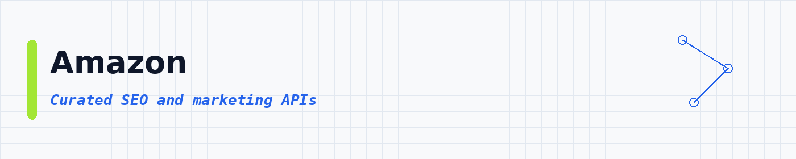
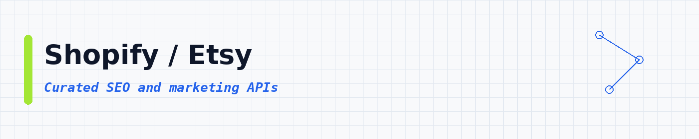
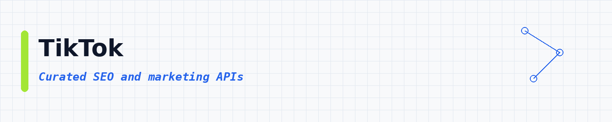
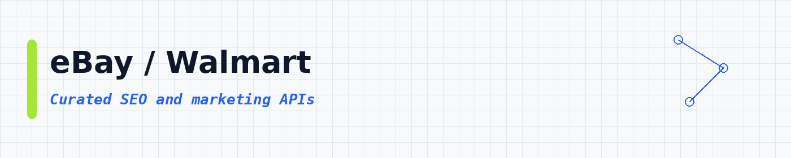

# SEO & Marketing APIs: Keywords, SERP, Audits and Growth Data

<p align="center">
 
</p>

<p align="center">
 
 
 
</p>

<p align="center">
 <a href="#top-10-most-popular">Top 10</a> ·
 <a href="#table-of-contents">Categories</a> ·
 <a href="#how-to-use">How to use</a> ·
 <a href="#faq">FAQ</a>
</p>

**A big, tidy list of SEO and marketing APIs** for keywords, SERP results, site audits, backlinks and ads data. **8,582 APIs**, sorted by real users so the useful ones show up first.

---

## Collection statistics

| Metric | Count |
|--------|-------|
| **SEO & Marketing APIs** | **8,582** |
| **Categories** | **18** |
| **Last updated** | 2026-11-02 |

---

## What is an SEO and marketing API?

An SEO and marketing API is a tool you call to pull search and campaign data. Things like keyword ideas, SERP snapshots, on-page checks and ad copy. You give it a domain, keyword or URL. It gives you clean rows you can save as CSV or JSON.

People also call this a SERP API, a keyword API or a marketing data scraper. Same idea: get SEO facts without clicking through search pages by hand.

---

## What can you build?

These **8,582 ready-to-use SEO and marketing APIs** help you pull growth data into your own apps. You can:

- Pull SERP results for keyword lists
- Find keyword ideas and search volume clues
- Audit titles, meta tags and on-page SEO
- Collect backlink and referring domain rows
- Watch ads and landing pages
- Compare rival sites in search
- Export clean CSV or JSON for SEO tools


Pick an API below, open it, try a small run, then export the results.

---

## Star this repository

If this list helped you, a star helps other people find it too.

---

## Table of contents

- [SEO / SERP](#seo-serp) : **2,735**
- [Other / General](#other-general) : **1,968**
- [Google / Maps](#google-maps) : **1,210**
- [AI / Agents / MCP](#ai-agents-mcp) : **619**
- [Email / Phone](#email-phone) : **540**
- [Reviews / Brand](#reviews-brand) : **256**
- [News / Content](#news-content) : **238**
- [Amazon](#amazon) : **193**
- [X / Twitter](#x-twitter) : **166**
- [Shopify / Etsy](#shopify-etsy) : **137**
- [Facebook / Meta](#facebook-meta) : **109**
- [LinkedIn](#linkedin) : **96**
- [Instagram](#instagram) : **90**
- [TikTok](#tiktok) : **66**
- [Jobs / Recruiting](#jobs-recruiting) : **65**
- [Company / B2B](#company-b2b) : **43**
- [Real Estate](#real-estate) : **33**
- [eBay / Walmart](#ebay-walmart) : **18**

---

## Top 10 most popular

| API | What it does | Users | Rating | Price |
|-----|-------------|-------|--------|-------|
| [Google Search Results Scraper](https://apify.com/apify/google-search-scraper?fpr=data) | Scrape Google Search Engine Results Pages (SERPs). Select the country or language and extract organic and paid results, AI Mode, AI overvie… | 224.8K | 4.65 | Pay per event |
| [Traffic Generator (Youtube, Web, Etsy, Behance and many more!)](https://apify.com/epctex/traffic-generator?fpr=data) | Maximize your website's performance and visibility with our Traffic Generator. Drive targeted traffic, simulate page views, and stress-test… | 45.4K | 4.25 | Pay per event |
| [Skip Trace](https://apify.com/one-api/skip-trace?fpr=data) | Locate hard-to-find individuals with our powerful skip trace/tracing API. TruePeopleSearch, Fastpeoplesearch, Lead Finder, Truthfinder, Spo… | 21.0K | 4.32 | Pay per event |
| [Google Trends Scraper](https://apify.com/apify/google-trends-scraper?fpr=data) | Scrape data from Google Trends by search terms or URLs. Specify locations, define time ranges, select categories to get interest by subregi… | 17.8K | 3.68 | Pay per event |
| [🔥 Web Traffic Generator \| 🚀 WebRocket 🚀](https://apify.com/bebity/web-traffic-generator?fpr=data) | 🚀💥 Introducing WebRocket! 💥 Supercharge your website 📈, deep crawling 🕸️, and robust error handling 🤖. Blast off with start URLs 🚀, choose… | 15.5K | 3.56 | Free |
| [Google Search Results (~$0.05/1K Results)](https://apify.com/scraperlink/google-search-results-serp-scraper?fpr=data) | 🔥 ~$0.05/1K results ($0.50/1,000 SERPs) 🔥 **CHEAPEST** Google Search Results (SERP) Scraper with real-time SERP data and support for multip… | 14.9K | 4.80 | Pay per event |
| [Google Images Scraper](https://apify.com/hooli/google-images-scraper?fpr=data) | Scrape image details from images.google.com. Add your query and number of images and extract image details such as image URL, image source,… | 7.0K | 4.48 | Pay per event |
| [Google Trends Scraper](https://apify.com/data_xplorer/google-trends-fast-scraper?fpr=data) | ✅ 99%+ success rate: the reliable Google Trends API alternative. Get 🔥 daily trending searches by country and analyze Google Trends keyword… | 6.6K | 4.88 | Pay per event |
| [Amazon Reviews Scraper](https://apify.com/web_wanderer/amazon-reviews-extractor?fpr=data) | [UPDATED] Scrape Amazon reviews per product! Filter by stars, keywords, media & verified purchases. Extract global reviews (20+ regions). E… | 6.2K | 3.39 | Pay per event |
| [Ahrefs All-in-One SEO Scraper: DR, Backlinks, Keywords](https://apify.com/pro100chok/ahrefs-seo-tools?fpr=data) | Extract all SEO data from Ahrefs in one API: Domain Rating, backlinks, keyword research (20 engines incl. ChatGPT/Gemini/Perplexity), SERP… | 5.6K | 3.55 | Pay per event |

---

## SEO / SERP

<a id="seo-serp"></a>

<p align="center"></p>

**2,735 APIs in this category** | [View all →](lists/seo-serp.md)

| API | What it does | Users | Rating | Price |
|-----|-------------|-------|--------|-------|
| [Google Trends Scraper](https://apify.com/data_xplorer/google-trends-fast-scraper?fpr=data) | ✅ 99%+ success rate: the reliable Google Trends API alternative. Get 🔥 daily trending searches by country and analyze Google Trends keyword… | 6.6K | 4.88 | Pay per event |
| [Ahrefs All-in-One SEO Scraper: DR, Backlinks, Keywords](https://apify.com/pro100chok/ahrefs-seo-tools?fpr=data) | Extract all SEO data from Ahrefs in one API: Domain Rating, backlinks, keyword research (20 engines incl. ChatGPT/Gemini/Perplexity), SERP… | 5.6K | 3.55 | Pay per event |
| [Pinterest Scraper: Pins, Boards, Comments & User Profiles](https://apify.com/epctex/pinterest-scraper?fpr=data) | Scrape Pinterest pins, boards, idea pages, comments, replies and user profiles from URLs or a keyword. Full pins at $3.10 per 1,000, summar… | 3.7K | 5.00 | Pay per event |
| [SEO Audit Tool](https://apify.com/misceres/seo-audit-tool?fpr=data) | Search Engine Optimization tool to carry out an SEO audit on any website. Finds broken links, missing images, and provides information abou… | 3.6K | 3.81 | Free |
| [Similarweb Fast Scraper](https://apify.com/tri_angle/fast-similarweb-scraper?fpr=data) | Get Similarweb traffic data for any website: monthly visits, global and country rank, top countries, and top keywords. Enter a list of doma… | 2.6K | 5.00 | Pay per event |
| [Keyword Search Volume: Bulk Google Metrics (CPC & Trend)](https://apify.com/aitorsm/keyword-volume?fpr=data) | Check Google keyword search volume, CPC & competition in bulk: real Keyword Planner data, no Google Ads account needed. 12-month trend per… | 2.5K | n/a | Pay per event |
| [Ahrefs Scraper](https://apify.com/radeance/ahrefs-scraper?fpr=data) | Extract key SEO data from Ahrefs including Domain / URL Rating (DR / UR), AI Traffic, Keyword Rankings, Backlink Profiles, Organic Traffic… | 2.4K | 3.02 | Pay per event |
| [Yandex (Яндекс) \| Парсер Поиска Яндекса](https://apify.com/johnvc/Scrape-Yandex?fpr=data) | Яндекс APIs specifically designed for Yandex search scraping. Supports 6+ domains, 19 languages, and provides clean, structured data extrac… | 2.2K | 3.52 | Pay per event |
| [Semrush Full API SEO Scraper: Traffic, Authority, Backlinks](https://apify.com/pro100chok/semrush-scraper?fpr=data) | All-in-one Semrush & Moz scraper: no login required. Domain authority, traffic analytics, backlinks, AI traffic (ChatGPT/Gemini/Claude), co… | 2.1K | 3.00 | Pay per event |
| [SimilarWeb Fast Scraper: Website Traffic, Rankings & Analytics](https://apify.com/pro100chok/similarweb-scraper?fpr=data) | Extract SimilarWeb data for any domain in seconds. Get traffic stats, global rankings, top keywords, traffic sources, AI traffic insights,… | 1.9K | 5.00 | Pay per event |
| [Similarweb Scraper](https://apify.com/radeance/similarweb-scraper?fpr=data) | Extract website traffic, global rank, country rank, bounce rate, visit duration, and traffic sources from Similarweb. Get detailed insights… | 1.8K | 3.36 | Pay per event |
| [Semrush Scraper](https://apify.com/radeance/semrush-scraper?fpr=data) | Access Semrush Domain Authority (DA), Desktop / Mobile Traffic, Keyword Difficulty, Backlink profiles, trending sites & competitor insights… | 1.8K | 4.99 | Pay per event |
| [HTTP Status Code Checker](https://apify.com/onescales/simple-http-status-code-checker?fpr=data) | Bulk check HTTP status codes (200, 301, 302, 402, 404, 500, and more) and redirect chains for any list of URLs. A must-have lookup tool for… | 1.7K | 5.00 | Pay per event |
| [Pinterest Scraper \| Pins, Boards and Profiles](https://apify.com/silentflow/pinterest-scraper-ppr?fpr=data) | Pay per result Pinterest scraper. Extract pins, boards, users and search results. Pay only for the data you get - $0.002 per pin. 30+ data… | 1.5K | 5.00 | Pay per event |
| [✨ Google Shopping Scraper](https://apify.com/damilo/google-shopping-apify?fpr=data) | ⚡ Lightning-fast Google Shopping scraper that captures live product listings straight from Google’s Shopping tab. Extract prices, ratings,… | 1.3K | 4.59 | Pay per event |
| [Pornhub Video (Downloader)](https://apify.com/pintxuki/pornhub-video-downloader?fpr=data) | Unofficial Pornhub Scraper to extract video data, tags, views, ratings, categories, performers, channel info, thumbnails, and download URL.… | 1.2K | n/a | Free |
| [Bing Search Scraper](https://apify.com/tri_angle/bing-search-scraper?fpr=data) | Scrape Bing search results for any keyword or Bing URL: organic listings, ads, People Also Ask, and related searches, page by page. Choose… | 1.1K | 4.33 | Pay per event |
| [Google Autocomplete Scraper: Bulk](https://apify.com/devilscrapes/google-autocomplete-bulk?fpr=data) | Bulk Google Autocomplete (Suggest) scraper and API: run many seeds × languages × countries per run with optional A: Z expansion for long-ta… | 1.1K | n/a | Pay per event |
| [SEO Competitor Keyword Research: Any Domain Ranking Keywords](https://apify.com/amassuo/semrush-competitor-keywords?fpr=data) | Find every keyword your competitor ranks for: position, search volume, CPC, traffic share and the exact ranking URL. SEO competitor analysi… | 1.0K | n/a | Pay per event |
| [Keyword Search Volume, CPC & Difficulty: Google + Bing Bulk](https://apify.com/memo23/keyword-metrics?fpr=data) | Keyword search volume, CPC, competition, difficulty and search intent from Google Ads and Bing, with up to ~7 years of monthly history and… | 988 | n/a | Pay per event |
| [Google Keyword search volume: CPC](https://apify.com/iskander/google-keyword-search-volume-api?fpr=data) | Get google keywords metrics, extract search volume, cost per click (CPC) and competition | 892 | 1.89 | Pay per event |
| [DataForSEO Labs: Keyword Ideas, Difficulty & Competitors](https://apify.com/santhej/dataforseo-labs-keyword-explorer?fpr=data) | DataForSEO Labs keyword toolkit. Get keyword suggestions, related keywords, keyword difficulty, search intent, and a competitor's ranked ke… | 850 | 5.00 | Pay per event |
| [Google Trends Keywords Discovery Tool 📊](https://apify.com/easyapi/google-trends-keywords-discovery-tool?fpr=data) | 🔍 Unlock powerful insights from Google Trends with real-time data extraction. Get comprehensive trending topics, rising queries, and search… | 842 | 5.00 | Pay per event |
| [Broken Link Checker](https://apify.com/jancurn/find-broken-links?fpr=data) | Crawls a website and finds broken links. Unlike other similar SEO analysis tools, the API also reports broken URL #fragments. The results a… | 811 | n/a | Free |
| [Complete SEO Audit Tool: Website Crawler with 0-100 Scores](https://apify.com/smart-digital/complete-seo-audit-tool?fpr=data) | SEO checker, analyzer and website audit tool: crawl a site and get a 0-100 SEO score for every page, plus a site audit report. Technical an… | 796 | 5.00 | Pay per event |
| [Keyword Search Volume, CPC, Ideas & Intent: Google + Bing](https://apify.com/doesaiknow/doesaiknow-keyword-metrics-apify?fpr=data) | SEO keyword research: bulk keyword search volume, CPC, competition & 12-month trend for Google and Bing: 1,000 keywords per run, JSON/CSV.… | 794 | 5.00 | Pay per event |
| [Google Keyword Search Volume: Google Ads Keyword Planner, CPC](https://apify.com/steadyfetch/keyword-search-volume-scraper?fpr=data) | Google Ads monthly search volume, CPC and competition for your keyword list: real Keyword Planner figures, nothing modelled; a keyword with… | 775 | n/a | Pay per event |
| [Google News Scraper Fast & cheap ⭐ (Pay per results) 📰⚡](https://apify.com/scrapestorm/google-news-scraper-fast-cheap-pay-per-results?fpr=data) | Unlock the power of the Google News scraper tool! 📰✨ Effortlessly gather news articles based on your chosen Keyword or topic 🔍. Get key det… | 763 | 3.66 | Pay per event |
| [Google Keyword Planner MCP](https://apify.com/smacient/google-keyword-planner-mcp?fpr=data) | A comprehensive Google Keyword Planner MCP API that provides keyword research, search volume analysis, and location-based targeting using G… | 742 | 4.17 | Pay per event |
| [Google Trends Scraper: Interest, Regions & Queries](https://apify.com/khadinakbar/google-trends-scraper?fpr=data) | Extract all 5 Google Trends data types: keyword interest over time, by region, related queries, related topics & daily trending searches. N… | 737 | n/a | Pay per event |
| [Google Trends Daily Scraper: Real-Time Trending Keywords API](https://apify.com/vnx0/google-trends-scraper?fpr=data) | Extract real-time trending searches from Google Trends "Trending Now" feed. Get daily trending keywords with traffic scores, news articles,… | 732 | 5.00 | Pay per event |
| [ChatGPT Search Scraper](https://apify.com/apify/chatgpt-search-scraper?fpr=data) | Scrape ChatGPT Search results at scale without an API. Extract AI-generated answers, cited sources, URLs, and follow-up questions for any q… | 728 | 3.72 | Pay per event |
| [✨ Google Images Scraper](https://apify.com/damilo/google-images-scraper?fpr=data) | ⚡️ Blazing-fast Google Images Scraper. Fetch image URLs, alt-text & titles by keyword in seconds. Delivers clean JSON for AI training, visu… | 713 | 4.79 | Pay per event |
| [Similarweb Scraper: Traffic, AI Traffic & WHOIS](https://apify.com/vortex_data/similarweb-scraper?fpr=data) | 🔍 Spy on any website in seconds: traffic, rankings, top keywords, AI traffic share (ChatGPT/Claude/Gemini), competitors, similar sites & WH… | 700 | 5.00 | Pay per event |
| [Semrush Keyword Magic Tool](https://apify.com/burbn/semrush-keyword-magic-tool?fpr=data) | Extract Semrush Keyword Magic Tool keyword ideas and variations into a clean dataset. Get average monthly search volume, Low/High CPC, comp… | 680 | n/a | Pay per event |
| [小红书 API \| Xiaohongshu (XHS / RedNote) Pro Scraper](https://apify.com/selleraim.com/xiaohongshu-pro-scraper?fpr=data) | 小红书 / Xiaohongshu / XHS / RedNote data API. Seven modes: keyword search, note details, comments, creator profile, topic feed, hot list, key… | 666 | 5.00 | Pay per event |
| [Google Autocomplete Scraper](https://apify.com/automation-lab/google-autocomplete-scraper?fpr=data) | Extract Google autocomplete keyword suggestions for SEO and content research. Get long-tail keywords, trending search predictions, and ques… | 664 | 4.85 | Pay per event |
| [Backlink Checker API: Backlinks, Referring Domains & Anchors](https://apify.com/s-r/backlinks-checker?fpr=data) | Get the full backlink profile for any domain as structured JSON: domain score, referring-domain count, total-link count and one row per bac… | 662 | n/a | Pay per event |
| [Free Google Keyword Research Tool: SEO Volume, CPC & Intent](https://apify.com/s-r/google-keywords?fpr=data) | Free keyword research tool for SEO. Combines Google Autocomplete with monthly search volume, CPC, SEO difficulty, paid difficulty, and sear… | 662 | 3.00 | Pay per event |
| [Google Images API - $0.10 per 1,000: Fast Image API](https://apify.com/johnvc/google-images-api?fpr=data) | Scrape Google Images at scale and export clean JSON: image URL, width and height, thumbnail, source site, domain, and the page link. Bulk i… | 644 | 5.00 | Pay per event |


[View all 2,735 in this section →](lists/seo-serp.md)

## Other / General

<a id="other-general"></a>

<p align="center"></p>

**1,968 APIs in this category** | [View all →](lists/other-general.md)

| API | What it does | Users | Rating | Price |
|-----|-------------|-------|--------|-------|
| [Google Trends Scraper](https://apify.com/apify/google-trends-scraper?fpr=data) | Scrape data from Google Trends by search terms or URLs. Specify locations, define time ranges, select categories to get interest by subregi… | 17.8K | 3.68 | Pay per event |
| [🔥 Web Traffic Generator \| 🚀 WebRocket 🚀](https://apify.com/bebity/web-traffic-generator?fpr=data) | 🚀💥 Introducing WebRocket! 💥 Supercharge your website 📈, deep crawling 🕸️, and robust error handling 🤖. Blast off with start URLs 🚀, choose… | 15.5K | 3.56 | Free |
| [Google Images Scraper](https://apify.com/hooli/google-images-scraper?fpr=data) | Scrape image details from images.google.com. Add your query and number of images and extract image details such as image URL, image source,… | 7.0K | 4.48 | Pay per event |
| [(New) Best Website Traffic Generator](https://apify.com/harshmaur/website-traffic-generator?fpr=data) | Draw targeted traffic to your websites, mimic real user behaviour and view their stats on Google analytics. Auto discover links on the page… | 3.5K | 4.98 | Pay per event |
| [Google Flights API](https://apify.com/johnvc/Google-Flights-Data-Scraper-Flight-and-Price-Search?fpr=data) | Google Flights API for extracting flight search data. Search one-way, round-trip, and multi-city itineraries. Filter by price, stops, airli… | 3.0K | 4.05 | Pay per event |
| [Bulk Image Downloader](https://apify.com/onescales/bulk-image-downloader?fpr=data) | The Bulk Image Downloader is a powerful APIs that extracts and downloads images from web pages or processes direct image URLs in bulk. Whet… | 2.1K | 5.00 | Pay per event |
| [2gis Places Scraper](https://apify.com/m_mamaev/2gis-places-scraper?fpr=data) | Извлекайте данные из тысяч мест и предприятий на 2ГИС, включая номера телефонов, соцсети, сайты. отзывы, фотографии и многое другое. Экспор… | 1.5K | 5.00 | Pay per event |
| [Wappalyzer Alternative: Tech Stack Detector & BuiltWith API](https://apify.com/nexgendata/wappalyzer-replacement?fpr=data) | Wappalyzer alternative and tech stack detector: point it at any website and get its technologies as clean JSON: CMS, analytics, ecommerce,… | 1.5K | n/a | Pay per event |
| [Similarweb Quick Scraper](https://apify.com/mscraper/similarweb-quick-scraper?fpr=data) | A quick scraper for Similarweb. Get needed data instantly for domains of your choice. Export accumulated data into formats such as HTML, JS… | 1.3K | 1.70 | Pay per event |
| [Web Traffic Boots](https://apify.com/hung.ad4gate/web-traffic-boots?fpr=data) | Generate realistic web traffic for Google Analytics (GA) with sophisticated bot detection avoidance and human-like behavior simulation capa… | 1.2K | 5.00 | Pay per event |
| [Traffic Booster! 🚀](https://apify.com/bluebird/traffic-generator?fpr=data) | The solution if you need quick web traffic! quickly get some more visits to test your new google analytics layout, or add some extra views… | 958 | 3.66 | Free |
| [Google Ads Scraper](https://apify.com/automation-lab/google-ads-scraper?fpr=data) | Scrape Google Ads from the Ads Transparency Center for competitor monitoring. Search by advertiser name, domain, or ID. Get ad copy, headli… | 881 | 5.00 | Pay per event |
| [Social Profile Finder \| Username Search API](https://apify.com/xtech/social-media-finder-pro?fpr=data) | Check usernames across 400+ supported websites and collect public profile links. Choose selected sites for a focused search or run broader… | 829 | 2.03 | Pay per event |
| [Google Ads Scraper](https://apify.com/ivanvs/google-ads-scraper?fpr=data) | Extract details about ads from Google Ads Transparency Centar. Scrape ad details like when it was run, ad targeting, advertiser and content… | 786 | 5.00 | Pay per event |
| [BuiltWith (Technology Looker)](https://apify.com/canadesk/builtwith?fpr=data) | Find out what websites are Built With (technology looker). It's fast and costs little. | 709 | 1.12 | Pay per event |
| [Sitemap URL Extractor](https://apify.com/onescales/sitemap-url-extractor?fpr=data) | Provide a website link to a sitemap.xml and the app will extract and list all URLs in the sitemap as well as additional data in the sitemap… | 662 | 5.00 | Pay per event |
| [Domain Inspector](https://apify.com/visita/domain-inspector?fpr=data) | A powerful, all-in-one tool to perform DNS lookups, WHOIS queries, HTTP status checks, and SSL certificate validation for a list of domains… | 635 | 5.00 | Pay per event |
| [Google Lens OCR API: Image to Text ~800ms REST API](https://apify.com/zen-studio/google-lens-ocr?fpr=data) | Extract text from any image via Google Lens OCR API. ~800ms per image, no browser needed. Returns word-level bounding boxes with pixel coor… | 620 | 5.00 | Pay per event |
| [Bulk URL Status Checker: Broken Link & Redirect Audit](https://apify.com/logiover/bulk-url-status-checker?fpr=data) | Bulk HTTP status code checker and broken link checker. Trace redirect chains, find 404s, export to CSV/JSON. No browser, no login. | 600 | n/a | Pay per event |
| [Skip Trace](https://apify.com/twoapi/skip-trace?fpr=data) | | 548 | 2.90 | Pay per event |
| [Websites Traffic Generator](https://apify.com/m3web/websites-traffic-generator?fpr=data) | Boost your website’s visibility with realistic visits from different countries and devices. This API simulates natural browsing behavior us… | 531 | 5.00 | Pay per event |
| [Google Flights](https://apify.com/canadesk/google-flights?fpr=data) | Find flight fares and schedules by airport name or IATA code, compare destinations and dates, and retrieve airport details. | 490 | 4.04 | Pay per event |
| [Website Scraper](https://apify.com/snipercoder/website-scraper?fpr=data) | Scrape websites effortlessly | 477 | n/a | Pay per event |
| [LD+JSON Schema scraper](https://apify.com/pocesar/json-ld-schema?fpr=data) | Extract all LD+JSON tags from the given URLs. | 460 | 5.00 | Free |
| [Tripadvisor (Hotels)](https://apify.com/canadesk/tripadvisor-hotels?fpr=data) | Get Locations and Hotels with advanced filters from Tripadvisor. It's fast and costs little. | 440 | 1.00 | Pay per event |
| [Sitemap Extractor](https://apify.com/apify/sitemap-extractor?fpr=data) | This APIs extracts all URLs from a website's sitemaps and checks their status codes via lightweight HTTP requests. It provides a clean list… | 438 | 3.24 | Pay per event |
| [Fast URL Content Crawler](https://apify.com/6sigmag/fast-url-content-crawler?fpr=data) | A high-performance web scraper that rapidly extracts and analyzes content from multiple URLs simultaneously. Perfect for competitive resear… | 431 | 5.00 | Pay per event |
| [Telegram](https://apify.com/canadesk/telegram?fpr=data) | Collect public Telegram channel profiles and messages, including text, timestamps, views, media links, replies and polls. | 430 | 4.71 | Pay per event |
| [Traffic Generator pro](https://apify.com/scrapingxpert/traffic-generator-pro?fpr=data) | The Traffic Generator simulates realistic web traffic using Playwright. It generates views, simulates user behavior, and tests website perf… | 423 | 1.00 | Free |
| [HTML Scraper pro](https://apify.com/scrapingxpert/html-scraper-pro?fpr=data) | The HTML Scraper Pro is a powerful tool designed to extract the HTML source code and metadata from websites. It uses advanced web scraping… | 417 | 5.00 | Pay per event |
| [Google Trends Scraper: series by term, geo and window, as rows](https://apify.com/tallyrake/google-trends-scraper?fpr=data) | Google Trends scraper: for each term, the interest series over your time window, interest by country or region, and related queries, as fla… | 411 | n/a | Pay per event |
| [Tech Stack Detector](https://apify.com/automation-lab/tech-stack-detector?fpr=data) | Affordable BuiltWith and Wappalyzer alternative. Detect 45+ technologies on any website: JavaScript frameworks, CMS, analytics, CDN, and ho… | 410 | n/a | Pay per event |
| [Website Screenshot API: Full-Page, Element & Device Capture](https://apify.com/cheapapi/website-screenshot-api?fpr=data) | Website Screenshot API: capture any URL as PNG, JPEG or WebP (PDF too): true full-page, element & region capture, 13 device profiles, dark… | 398 | 5.00 | Pay per event |
| [Threads](https://apify.com/canadesk/threads?fpr=data) | Collect or Search for Posts and User profiles on Threads. It's fast and costs little! | 383 | 1.00 | Pay per event |
| [Smart Website Traffic](https://apify.com/xaikyo/smart-website-traffic?fpr=data) | Deliver targeted traffic to your website, deep crawl all internal links and pages, google analytics integration and stress test. Fast, para… | 361 | n/a | Pay per event |
| [Similarweb Scraper](https://apify.com/epctex/similarweb-scraper?fpr=data) | The most comprehensive Similarweb Scraper you will ever find. Obtain data on website popularity and receive it in formats such as JSON, XML… | 341 | 5.00 | Pay per event |
| [Google Images Scraper](https://apify.com/automation-lab/google-images-scraper?fpr=data) | Scrape Google Images results. Extract full-resolution image URLs, thumbnails, dimensions, titles, and source pages. Filter by size, color,… | 339 | 4.00 | Pay per event |
| [Screenshot](https://apify.com/dz_omar/screenshot?fpr=data) | 📸 Capture high-quality screenshots of any website with full-page support, custom viewports, and cookie authentication. Perfect for web moni… | 338 | 5.00 | Pay per event |
| [Ahrefs Domain Overview Checker](https://apify.com/scrap3r/ahrefs-domain-overview-checker?fpr=data) | Ahrefs Scraper, optimized for speed and reliability. Just enter your URL, and extract data such as Domain Rating, Url Rating, and more: all… | 332 | 1.38 | Pay per event |
| [Load Stress Test & Traffic Generator](https://apify.com/onidivo/load-stress-test?fpr=data) | Perform load and stress tests against your website. Drive traffic and test your website tools and integrations. | 310 | 4.00 | Free |


[View all 1,968 in this section →](lists/other-general.md)

## Google / Maps

<a id="google-maps"></a>

<p align="center"></p>

**1,210 APIs in this category** | [View all →](lists/google-maps.md)

| API | What it does | Users | Rating | Price |
|-----|-------------|-------|--------|-------|
| [Google Search Results Scraper](https://apify.com/apify/google-search-scraper?fpr=data) | Scrape Google Search Engine Results Pages (SERPs). Select the country or language and extract organic and paid results, AI Mode, AI overvie… | 224.8K | 4.65 | Pay per event |
| [Traffic Generator (Youtube, Web, Etsy, Behance and many more!)](https://apify.com/epctex/traffic-generator?fpr=data) | Maximize your website's performance and visibility with our Traffic Generator. Drive targeted traffic, simulate page views, and stress-test… | 45.4K | 4.25 | Pay per event |
| [Google Search Results (~$0.05/1K Results)](https://apify.com/scraperlink/google-search-results-serp-scraper?fpr=data) | 🔥 ~$0.05/1K results ($0.50/1,000 SERPs) 🔥 **CHEAPEST** Google Search Results (SERP) Scraper with real-time SERP data and support for multip… | 14.9K | 4.80 | Pay per event |
| [Google Search Scraper ($0.15 per 1000 results)](https://apify.com/igolaizola/google-search-scraper-ppe?fpr=data) | $0.15 per 1000 results 💸 Fast & Low Cost Google Search scraper that returns clean, structured SERP data. Get position, title, URL and snipp… | 3.1K | 4.09 | Pay per event |
| [Youtube Channel Scraper](https://apify.com/newbs/Youtube-Channel?fpr=data) | Scrape YouTube channels or keyword searches for video URLs, titles, metrics, transcripts, channel profiles, social links, descriptions and… | 3.1K | 4.33 | Pay per event |
| [Best Youtube Transcripts Scraper](https://apify.com/scrape-creators/best-youtube-transcripts-scraper?fpr=data) | Extract transcripts from YouTube videos. Simply enter video URLs. Get full text, timestamps, and metadata where available. Perfect for rese… | 3.0K | 4.52 | Pay per event |
| [Google Search Scraper](https://apify.com/epctex/google-search-scraper?fpr=data) | Boost SEO with our tool! Explore organic & paid results, People Also Ask, and Related Queries. Select countries, languages, and precise loc… | 2.8K | 3.48 | Free |
| [Google Maps Scraper](https://apify.com/epctex/google-maps-scraper?fpr=data) | Effortlessly gather places data from Google Maps using our advanced scraper. Search by keyword or location, retrieve reviews, and analyze i… | 2.6K | 4.02 | Free |
| [Keyword Search Volume Finder: Ahrefs Alternative](https://apify.com/khadinakbar/dataforseo-keyword-research?fpr=data) | Get keyword ideas or Google search volumes for your seed phrases, with CPC, competition, keyword difficulty, intent and a 12-month trend pe… | 2.3K | n/a | Pay per event |
| [Google Maps Reviews Scraper: Most Comprehensive](https://apify.com/kaix/google-maps-reviews-scraper?fpr=data) | 🔥 ~$0.04/1K reviews + FREE review photos 🔥 Extract all reviews with ratings, text, translations, photos, author details, owner responses, s… | 2.0K | 4.89 | Pay per event |
| [Businesses Without Websites Leads Scraper (Google Maps)](https://apify.com/xmiso_scrapers/businesses-without-websites-leads-scraper-google-maps?fpr=data) | Get unique leads of various businesses which don't seem to have their own website yet. Offer them web related services, SEO, design etc. Th… | 1.8K | 4.97 | Pay per event |
| [Google Maps Scraper: Business Leads, Emails & Reviews](https://apify.com/andrew_babo/google-maps-scraper?fpr=data) | Scrape Google Maps business data at scale: names, addresses, phones, websites, emails, opening hours, ratings and reviews. HTTP-first engin… | 1.7K | n/a | Free |
| [Google Maps Email Extractor](https://apify.com/leadsbrary/google-maps-email-extractor?fpr=data) | Search Google Maps by keyword and instantly collect email addresses for each business. Get name, address, phone, website, rating, reviews,… | 1.6K | 4.04 | Pay per event |
| [Google Search Results Scraper (SERP)](https://apify.com/apidojo/google-search-scraper?fpr=data) | SERP: Google Search Scraper with unbeatable pricing! $0.002/query gets you 10 results FREE + $0.0002/extra item. Event-based billing = pay… | 1.6K | 3.90 | Pay per event |
| [Google Maps Business Scraper & Lead Generator](https://apify.com/ittechinnovators/google-maps-business-scraper-lead-generator?fpr=data) | Extract targeted business listings from Google Maps by keyword and location. Collect phone numbers, addresses, ratings, reviews, claimed st… | 1.4K | 5.00 | Pay per event |
| [Website Contact Finder: Emails, Phones & Socials for Leads](https://apify.com/automation-lab/website-contact-finder?fpr=data) | Turn company websites from Google Maps, directories, CRMs, or spreadsheets into outreach-ready contact signals. Extract public emails, phon… | 1.3K | n/a | Pay per event |
| [YouTube Transcript Scraper](https://apify.com/akash9078/youtube-transcript-scraper?fpr=data) | YouTube Transcript Scraper & Extractor API: Extract transcripts, captions & subtitles from YouTube videos, Shorts & VODs without an API key… | 1.2K | 4.94 | Pay per event |
| [Free Google Search Results Scraper: SERP API by Country](https://apify.com/s-r/free-google-search-results-serp---only-0-25-per-1-000-results?fpr=data) | Ultra-fast Google Search scraper. Extract comprehensive SERP data including rank, title, snippet, URL, domain and favicon. Free plans get 1… | 1.1K | 4.48 | Pay per event |
| [Google Maps Scraper: Leads, Emails, Phones & Reviews](https://apify.com/santamaria-automations/google-maps-scraper?fpr=data) | Scrape Google Maps places with 30+ fields: name, address, phone, website, rating, reviews, hours, GPS. Optional add-ons find emails, social… | 981 | 5.00 | Pay per event |
| [Cheapest Google Search Results (Fast and cheap SERP API)](https://apify.com/lofomachines/google-serp-scraper?fpr=data) | Lowest price 0.14$ for 1000 results: Scrape Google search results at scale. Get position, title, URL and snippet for any query, country, la… | 980 | n/a | Pay per event |
| [Google Maps Extractor: Fast Business Data & Leads](https://apify.com/andrew_babo/google-maps-extractor?fpr=data) | Extract Google Maps business data at scale: names, categories, addresses, coordinates, phones, websites, opening hours, ratings and review… | 850 | n/a | Free |
| [YouTube Search Scraper: Keyword Rankings](https://apify.com/tubelens/youtube-search-scraper?fpr=data) | Give it keywords, get YouTube's ranked results: position, title, channel, views and publish date for every result. Built for rank tracking… | 787 | n/a | Pay per event |
| [YouTube Search Scraper: Videos & Shorts by Keyword](https://apify.com/delicious_zebu/youtube-video-scraper-by-keyword?fpr=data) | Scrape YouTube search results for any keyword in the same order as on YouTube: videos or Shorts with exact views, likes, publish date, dura… | 783 | 5.00 | Pay per event |
| [Google Maps Places Scraper: Fast & Cheap Bulk Places](https://apify.com/johnvc/google-maps-places-api?fpr=data) | Fast, low-cost Google Maps places scraper. Get business names, addresses, phone numbers, websites, ratings, categories, coordinates, and op… | 647 | 5.00 | Pay per event |
| [✨ Google Search Results Scraper](https://apify.com/damilo/google-search-apify?fpr=data) | ⚡️ Lightning-fast Google Search Scraper. Grab pinpoint-accurate, geo-targeted SERP data with query, lang, country, date, and pagination con… | 642 | n/a | Pay per event |
| [Google Search Results Scraper](https://apify.com/datarava/google-search-results-scraper?fpr=data) | Scrape Google SERP data at scale. Get thousands of results including titles, links, snippets, knowledge graph data, related search terms, P… | 603 | 5.00 | Pay per event |
| [Google Search Scraper: Organic SERP, PAA & Related](https://apify.com/automation-lab/google-search-scraper?fpr=data) | Scrape Google organic results, People Also Ask questions, and related searches for SEO research, rank tracking, and content gap workflows. | 592 | 5.00 | Pay per event |
| [Google Maps Reviews Scraper](https://apify.com/beatanalytics/google-maps-reviews-scraper?fpr=data) | Scrape Google Maps reviews with exact timestamps, date-range filtering, and bulk input. Extract full review text, ratings, author info, own… | 579 | 5.00 | Pay per event |
| [YouTube Autocomplete Keyword Scraper: a-z, questions, CSV/JSON](https://apify.com/tallyrake/youtube-autocomplete-scraper?fpr=data) | YouTube search suggestions as CSV/JSON rows: seed, query sent, suggestion, rank, expansion (a-z, question words, prepositions; comparisons… | 539 | n/a | Pay per event |
| [✨ Google Maps Scraper](https://apify.com/damilo/google-maps-scraper?fpr=data) | 📍 Scrape business listings from Google Maps by keyword and location. Extract names, addresses, phone numbers, websites, ratings, coordinate… | 501 | 4.92 | Pay per event |
| [Google Maps Reviews Scraper](https://apify.com/louisdeconinck/google-maps-reviews-scraper?fpr=data) | Scrape reviews from Google Maps locations. Extract detailed data including reviewer info, rating, and review text. Features include handlin… | 473 | 1.15 | Free |
| [Google Search Scraper ($0.35/1000 results)](https://apify.com/api-ninja/google-search-scraper?fpr=data) | Extract structured Google results across Search, Images, Videos, Places, Maps, News, Shopping, Scholar, Autocomplete, and Patents. Supports… | 448 | 4.55 | Pay per event |
| [Keyword Research Tool: Search Volume, CPC & Keyword Ideas](https://apify.com/santhej/keyword-research-tool?fpr=data) | Bulk keyword research: accurate Google search volume, CPC, competition & thousands of keyword ideas for any seed or market. Clean JSON/CSV… | 402 | 5.00 | Pay per event |
| [Google Play Apps Scraper](https://apify.com/solidcode/google-play-apps-scraper?fpr=data) | [💰 $0.50 / 1K] Extract Google Play app metadata: title, developer, ratings, installs, price, screenshots, description, version, contact inf… | 400 | n/a | Pay per event |
| [Google Search Results Scraper](https://apify.com/datascoutapi/google-search-results-scraper?fpr=data) | 🚀 Google Search Engine Scraper API: Extract real-time Google search results easily. Get organic results, paid ads, People Also Ask, Related… | 380 | 3.55 | Pay per event |
| [Google Maps Reviews Scraper ($0.30/1000 results)](https://apify.com/api-ninja/google-maps-reviews-scraper?fpr=data) | Extract comprehensive review data from Google Maps places. Get detailed user reviews, ratings, photos, business responses, and rich metadat… | 378 | 4.91 | Pay per event |
| [Google Search Scraper: SERP, AI Overview, Ads](https://apify.com/scrape.badger/google-search-scraper?fpr=data) | Scrape Google Search (SERP) results at scale: organic, paid ads, AI Overview, knowledge graph, People Also Ask, local pack, news, related s… | 367 | n/a | Pay per event |
| [Youtube Search Scraper](https://apify.com/scraper_one/youtube-search-scraper?fpr=data) | This APIs performs a YouTube video search based on a given keyword or phrase, and extracts detailed metadata for each video found. | 364 | 5.00 | Pay per event |
| [Google Search Results Scraper: SERP, Ads & AI Overview](https://apify.com/santamaria-automations/google-search-scraper?fpr=data) | Scrape Google search result pages: organic results, paid ads, People Also Ask with answers, related queries, featured snippet and AI Overvi… | 357 | 4.47 | Pay per event |
| [Google Search](https://apify.com/devisty/google-search?fpr=data) | API used to retrieve data from Google search results in real time | 341 | 5.00 | Pay per event |


[View all 1,210 in this section →](lists/google-maps.md)

## AI / Agents / MCP

<a id="ai-agents-mcp"></a>

<p align="center"></p>

**619 APIs in this category** | [View all →](lists/ai-agents-mcp.md)

| API | What it does | Users | Rating | Price |
|-----|-------------|-------|--------|-------|
| [Google Lens \| AI Mode \| Reverse image search \| Translation+OCR](https://apify.com/borderline/google-lens?fpr=data) | Google Lens \| Reverse image search \| AI Mode🌟 Seamlessly identify text, translate in real time 🌐, recognize and classify objects 🎁, rever… | 2.3K | 3.91 | Pay per event |
| [G2 Reviews Scraper Real-Time (2026)](https://apify.com/zen-studio/g2-reviews-scraper?fpr=data) | Extract G2 product reviews in real-time. Filter by star rating (1-5), sort by recency or helpfulness, search within review text. Structured… | 1.1K | 2.69 | Pay per event |
| [Google AI Overviews Scraper](https://apify.com/apify/google-ai-overviews-scraper?fpr=data) | Scrape Google AI Overviews for any search query. Extract the AI Overview answer and cited sources as JSON, CSV, or Excel. Track AI search v… | 695 | 4.61 | Pay per event |
| [Yandex Maps Reviews Scraper \| Парсер Отзывов Яндекс Карт](https://apify.com/zen-studio/yandex-maps-reviews-scraper?fpr=data) | Extract reviews from any Yandex Maps business. Ratings, text, photos, videos, author profiles, business replies, AI summaries & translation… | 693 | 5.00 | Pay per event |
| [Perplexity Search Scraper](https://apify.com/apify/perplexity-search-scraper?fpr=data) | Scrape Perplexity AI answers at scale without an API. Extract AI-generated responses, cited sources, URLs, and related questions for any qu… | 578 | 5.00 | Pay per event |
| [G2 Reviews Scraper](https://apify.com/azzouzana/g2-scraper?fpr=data) | From $1/1K 💰 Scrape G2 product reviews by URL or slug. Export JSON or CSV with rating, pros, cons, NPS and 45+ fields. Sort, filter, up to… | 533 | 3.96 | Pay per event |
| [Google Lens Search API: Reverse Image Search & OCR](https://apify.com/zen-studio/google-lens-visual-search?fpr=data) | Reverse image search via Google Lens. Returns visual matches, AI descriptions, related links, related searches, and OCR text with bounding… | 411 | n/a | Pay per event |
| [Perplexity](https://apify.com/winbayai/perplexity?fpr=data) | Our advanced API, powered by AI, enables seamless Google、Bing、Wiki... data search and analysis, transforming raw data into actionable insig… | 359 | n/a | Pay per event |
| [Google AI Mode Scraper](https://apify.com/apify/google-ai-mode-scraper?fpr=data) | Scrape Google AI Mode answers for any search query. Extract the full AI-generated response, cited sources with links and titles, and follow… | 344 | 5.00 | Pay per event |
| [Gemini Search Scraper](https://apify.com/apify/gemini-search-scraper?fpr=data) | No-code scraper for Google Gemini AI search. Run any prompt and extract Gemini's AI responses, cited sources, and links at scale. Track bra… | 332 | 5.00 | Pay per event |
| [Google AI Overview API](https://apify.com/johnvc/Google-AI-Overview-API?fpr=data) | Fetch Google AI Overviews for any query: get the AI-generated answer and its cited sources as structured JSON. Send one or many queries, ta… | 305 | 5.00 | Pay per event |
| [Capterra Reviews Scraper](https://apify.com/azzouzana/capterra-reviews-scraper?fpr=data) | From $0.7/1K 💰 Fast Capterra product reviews: unlimited profiles, ten of thousands of reviews! Grab your products URLs & you’re set. Compre… | 273 | 5.00 | Pay per event |
| [Reddit Scraper & Reddit Comments Scraper: Posts, Search, Users](https://apify.com/openclawai/reddit-scraper?fpr=data) | Reddit comments scraper: comment threads with replies, plus Reddit posts, search results, subreddits and users. A Reddit API alternative an… | 255 | 4.88 | Pay per event |
| [Google Lens Scraper: Reverse Image Search API](https://apify.com/gio21/google-lens-scraper?fpr=data) | Reverse image search via Google Lens: visual matches, exact matches and an AI description, all in one call. One flat price per image, no se… | 232 | n/a | Pay per event |
| [AI Rank Tracker: GEO/AEO: ChatGPT, Claude, Gemini, Perplexity](https://apify.com/santhej/ai-rank-tracker-pro?fpr=data) | AI rank tracker & GEO/AEO audit tool for 5 AI platforms (Google AI Overview, ChatGPT, Claude, Gemini, Perplexity). Tracks brand visibility,… | 190 | 5.00 | Pay per event |
| [Microsoft Copilot Search Scraper](https://apify.com/apify/microsoft-copilot-search-scraper?fpr=data) | Scrape Microsoft Copilot answers at scale without an API. Extract AI-generated responses, cited sources, URLs, and follow-up questions for… | 185 | 4.94 | Pay per event |
| [Google AI Overview Scraper: Extract AI Summaries & Sources](https://apify.com/clearpath/google-ai-overview?fpr=data) | Extract Google's AI Overview summaries, cited sources, and organic results for any search query. Works best with question-style searches. S… | 174 | 1.00 | Pay per event |
| [Naver Shopping Reviews Scraper](https://apify.com/delicious_zebu/naver-shopping-reviews-scraper?fpr=data) | Scrape customer reviews from any Naver SmartStore or Brand Store product by URL: star rating, text, date, photos & videos, the option/SKU b… | 168 | 5.00 | Pay per event |
| [AI Markdown Maker](https://apify.com/onescales/bulk-ai-markdown-maker?fpr=data) | Convert any web page into clean, AI ready markdown format in seconds. This markdown generator is perfect for content for AI models, creatin… | 155 | 5.00 | Pay per event |
| [AI Search Visibility Tracker: AI Brand Visibility ChatGPT LLMs](https://apify.com/doesaiknow/ai-brand-visibility-tracker-chatgpt-perplexity-gemini?fpr=data) | Scan how Google AI Overviews, ChatGPT, Perplexity, Gemini and Copilot mention your brand vs competitors. Input: brand + 3-15 buyer queries.… | 128 | 4.48 | Pay per event |
| [Perplexity AI Search Scraper](https://apify.com/zhorex/perplexity-ai-scraper?fpr=data) | Search Perplexity AI programmatically and get AI-generated answers with sources and citations as clean JSON. No Perplexity API key needed;… | 127 | n/a | Pay per event |
| [LLM Brand Visibility and Citation Tracker](https://apify.com/khadinakbar/llm-visibility-tracker?fpr=data) | Track brand mentions, response rank, share of voice, citations, competitors, and sentiment across ChatGPT, Perplexity, Gemini, and optional… | 125 | n/a | Pay per event |
| [GEO Audit: AI Search Optimization Checker](https://apify.com/lofomachines/geo-technical-audit?fpr=data) | Analyze your web pages for Generative Engine Optimization (GEO). Get actionable insights to improve visibility in ChatGPT, Perplexity, Gemi… | 122 | n/a | Pay per event |
| [Brand DNA](https://apify.com/solutionssmart/brand-dna?fpr=data) | Extract structured brand identity from any website: colors, fonts, tone, positioning, and reusable marketing templates: using deterministic… | 121 | 2.57 | Pay per event |
| [Pinterest Scraper: Pins from Search, Boards & Profiles](https://apify.com/khadinakbar/pinterest-scraper?fpr=data) | Scrape Pinterest pins from searches, boards, profiles and pin links, with full-size image, video link, saves, hashtags, outbound link, boar… | 112 | n/a | Pay per event |
| [AI Brand Visibility](https://apify.com/adityalingwal/AI-brand-Visibility?fpr=data) | Track your brand visibility across AI platforms (ChatGPT and Gemini). Analyze mentions, citations, and competitive positioning. | 111 | 4.17 | Pay per event |
| [Link Prospecting Tool](https://apify.com/apify/link-prospecting-tool?fpr=data) | Monitor your brand visibility across AI and organic search platforms (ChatGPT, Google AI Mode, Google AI Overviews, and Perplexity). Check… | 111 | 5.00 | Free |
| [Bing Copilot AI Answers API \| Microsoft AEO Monitoring](https://apify.com/johnvc/bing-copilot-api?fpr=data) | Track Bing Copilot AI answers for any query: Microsoft AI-generated answers, structured text blocks, cited sources, and brand mentions as c… | 93 | 5.00 | Pay per event |
| [Google Lens Search: Reverse Image Finder & OCR](https://apify.com/getascraper/google-lens-visual-search?fpr=data) | Reverse image search via Google Lens. Get visual matches, exact matches, AI image descriptions, related links, and OCR text with bounding b… | 85 | n/a | Pay per event |
| [Article Scraper & News Scraper API](https://apify.com/tugelbay/article-extractor?fpr=data) | Article scraper API for clean text and metadata from URLs as Markdown, text, or HTML for RAG, AI agents, monitoring, and research. Guide: | 84 | n/a | Pay per event |
| [ChatGPT Search Scraper: Answers, Citations & Brand Tracking](https://apify.com/parseforge/chatgpt-search-scraper?fpr=data) | Scrape ChatGPT Search answers: full text and Markdown, cited sources, claim-level citations, product cards and brand tracking. Export CSV,… | 84 | n/a | Pay per event |
| [Trustpilot Reviews Scraper](https://apify.com/azzouzana/trustpilot-scraper?fpr=data) | From $0.4/1k 💰 Scrape Trustpilot reviews at scale with 70+ data points (ratings, text, country, names, replies, full business profiles, rev… | 76 | 5.00 | Pay per event |
| [AI Search Visibility Audit](https://apify.com/responsible_bookmark/ai-search-visibility-audit?fpr=data) | Audits websites for AI search readiness: scores how likely pages are to be cited by ChatGPT, Perplexity, Gemini, Claude, Copilot, Grok, and… | 75 | n/a | Pay per event |
| [SEC EDGAR Scraper](https://apify.com/constructive_calm/sec-edgar-scraper?fpr=data) | Fetches SEC EDGAR filings, normalized financial statements, XBRL facts, insider trades (Form 4), institutional holdings (13F), activist sta… | 74 | 5.00 | Pay per event |
| [Google Trends Scraper](https://apify.com/syntellect_ai/google-trends-scraper?fpr=data) | "Scrape Google Trends data with built-in AI trend prediction. Get interest over time, related queries, topics, and regional interest: plus… | 68 | n/a | Free |
| [Google News Scraper: Headlines, Sources, URLs (2K Max)](https://apify.com/scrapeio/google-news-scraper?fpr=data) | Turn any Google News query into a deduplicated dataset of up to 2,000 articles: headlines, sources, dates, RSS links, publisher URLs, and s… | 62 | 5.00 | Pay per event |
| [LLM Prompt Response](https://apify.com/jakubsuchy/llm-prompt-response?fpr=data) | Submits prompts to LLM providers (ChatGPT, Perplexity) via Camoufox anti-detect browser and captures structured responses with sources. | 62 | 5.00 | Pay per event |
| [Bulk PageSpeed & Lighthouse Checker: Core Web Vitals from CSV](https://apify.com/nerolabs/bulk-pagespeed-checker?fpr=data) | Google PageSpeed Insights (Lighthouse) scores, Core Web Vitals and top speed fixes for every URL in a plain urls list, dataset, CSV or Goog… | 59 | n/a | Pay per event |
| [Google Ads Transparency Scraper: Creatives & Run Dates](https://apify.com/khadinakbar/google-ads-transparency-scraper?fpr=data) | Scrape Google Ads Transparency Center ads by domain or advertiser name, with advertiser, ad ID, format, preview image, regions and first an… | 57 | n/a | Pay per event |
| [AI Brand Visibility Tracker: ChatGPT, Gemini, Perplexity](https://apify.com/inovaflow/ai-brand-monitoring?fpr=data) | Monitor your brand visibility and brand mentions in AI search results: ChatGPT, Google AI Overviews, Gemini, Perplexity and Copilot. Track… | 56 | n/a | Pay per event |


[View all 619 in this section →](lists/ai-agents-mcp.md)

## Email / Phone

<a id="email-phone"></a>

<p align="center"></p>

**540 APIs in this category** | [View all →](lists/email-phone.md)

| API | What it does | Users | Rating | Price |
|-----|-------------|-------|--------|-------|
| [Skip Trace](https://apify.com/one-api/skip-trace?fpr=data) | Locate hard-to-find individuals with our powerful skip trace/tracing API. TruePeopleSearch, Fastpeoplesearch, Lead Finder, Truthfinder, Spo… | 21.0K | 4.32 | Pay per event |
| [Naver Product Detail Scraper](https://apify.com/delicious_zebu/naver-product-detail-scraper?fpr=data) | Scrape complete product data from any Naver SmartStore or Brand Store URL: price, discount, per-SKU options & stock, images, reviews, deliv… | 2.1K | 5.00 | Pay per event |
| [Yandex Maps Places Scraper](https://apify.com/m_mamaev/yandex-maps-places-scraper?fpr=data) | Extract structured data from thousands of Yandex Maps locations and businesses, including phone numbers, emails, websites, reviews, images,… | 1.7K | 4.24 | Pay per event |
| [Skip Trace: People Search, Phones & Emails API](https://apify.com/apivault_labs/skip-trace-people-finder?fpr=data) | Research publicly available people and contact evidence by names, addresses, phones or emails. Bulk JSON/CSV/Excel API. PPE per1K: Free$6,… | 847 | 5.00 | Pay per event |
| [2GIS Scraper (Phones, Emails, Reviews) \| Парсер 2ГИС API](https://apify.com/zen-studio/2gis-places-scraper-api?fpr=data) | 2GIS scraper and API: extract phones, emails, reviews, and photos from 207 cities across 20 countries. 1,000 places in 90 seconds. 731 cate… | 766 | 4.39 | Pay per event |
| [Email Scraper](https://apify.com/ib4ngz/email-scraper?fpr=data) | This API scrapes email addresses from a list of provided URLs. It recursively crawls pages, extracts unique emails, and stores them in a da… | 685 | n/a | Pay per event |
| [Email Finder](https://apify.com/dealgate/email-finder?fpr=data) | Find anyone's email address with DealGate's Email Finder API. Get verified emails in seconds. | 645 | 1.00 | Pay per event |
| [Crunchbase Scraper Pro](https://apify.com/vulnv/crunchbase-scraper-pro?fpr=data) | Professional Crunchbase company data scraper. Extract comprehensive business intelligence including funding rounds, leadership teams, conta… | 508 | 5.00 | Pay per event |
| [BBB Scraper \| Business Leads, Ratings & Phones](https://apify.com/piotrv1001/bbb-advanced-scraper?fpr=data) | Extract business leads from the Better Business Bureau (BBB): names, ratings, accreditation, phones, addresses and categories. Search many… | 467 | 4.38 | Pay per event |
| [Yelp Business Info Scraper](https://apify.com/delicious_zebu/yelp-business-info-scraper?fpr=data) | Turn Yelp business URLs into complete records: rating and star breakdown, review count, hours, phone, website, address with coordinates, ph… | 443 | 5.00 | Pay per event |
| [Naver Map Search Results Scraper](https://apify.com/delicious_zebu/naver-map-search-results-scraper?fpr=data) | Scrape Naver Map business listings by keyword or URL: names, categories, ratings, reviews, phone numbers, addresses, coordinates, hours, me… | 442 | 4.95 | Pay per event |
| [Website Media Extractor & Scraper](https://apify.com/hlymrk/html-web-media-scraper?fpr=data) | The Advanced Website Media Extractor & Scraper is a comprehensive media extraction tool that supports images, videos, audio, documents, arc… | 326 | 4.88 | Pay per event |
| [Whatsapp Scraper Profile(unlimited by month)](https://apify.com/antonio_cesar/whatsapp-scraper-profile-unlimited-by-month?fpr=data) | WhatsApp Profile Scraper lets you extract public profile info from any WhatsApp number: unlimited per month. | 301 | 5.00 | Pay per event |
| [Skip Trace & People Search: Phone, Email & Address](https://apify.com/brilliant_gum/skip-trace-people-search?fpr=data) | Find people in the US by name, or find out who is behind a phone number. Get age, aliases, relatives with ages, address history and phone n… | 278 | n/a | Pay per event |
| [Ultimate Screenshot](https://apify.com/dz_omar/ultimate-screenshot?fpr=data) | Capture any web page as a JPEG, PNG, PDF, MP4 or GIF. 131 phone and tablet presets, full-page capture, signed-in sessions with cookies, and… | 268 | 5.00 | Pay per event |
| [Yelp Business Scraper](https://apify.com/piotrv1001/yelp-business-scraper?fpr=data) | The Yelp Business Scraper extracts business listings and enriched profiles from Yelp by search term and location, capturing names, star rat… | 228 | 5.00 | Pay per event |
| [Trustpilot Scraper Pro](https://apify.com/coder_zoro/Trustpilot-Scraper-Pro?fpr=data) | Trustpilot Scraper Pro is a powerful APIs that extracts detailed business information and customer reviews from Trustpilot. Choose between… | 221 | 4.73 | Pay per event |
| [Website Content Crawler: Markdown, 45 Fields](https://apify.com/parseforge/website-content-crawler?fpr=data) | Crawls websites from start URLs with depth, domain and URL-pattern limits. 45 fields per page: Markdown and plain text, word count, title a… | 185 | n/a | Pay per event |
| [Social Media and Contact Info Extractor: Gather Key Details](https://apify.com/dainty_screw/Social-Media-and-Contact-Info-Extractor?fpr=data) | Efficiently collect essential contact information and social media profiles with our extractor tool. Ideal for building comprehensive datab… | 183 | 5.00 | Pay per event |
| [Gsmarena Phones Scraper](https://apify.com/fetchcraftlabs/gsmarena-phones-scraper?fpr=data) | GSMArena scraper for smartphone specs, phone database extraction, and mobile device data collection. Scrape 5G phones, Android devices, Sna… | 170 | 5.00 | Pay per event |
| [Company Enrichment API: Domain to Buyer Fit Brief](https://apify.com/george.the.developer/company-enrichment-api?fpr=data) | Enrich company data from any domain: look up company info by website and get firmographics, tech stack, contacts, WHOIS, DNS, SEO metadata,… | 167 | n/a | Pay per event |
| [Website Contact & Email Scraper](https://apify.com/sandy_yclept/website-contact-email-scraper?fpr=data) | Website contact scraper, email and phone number scraper and contact info scraper for any list of websites: company emails, phone numbers an… | 161 | n/a | Pay per event |
| [OSINT Website Intelligence Analyzer](https://apify.com/onescales/website-intelligence-analyzer-osint?fpr=data) | All-in-one website analysis tool. Run 30 OSINT checks on any URL: DNS, SSL, WHOIS, tech stack, security headers, email security, open ports… | 157 | 5.00 | Pay per event |
| [Yellow Pages AU Scraper: Businesses, Contacts & Leads](https://apify.com/abotapi/yellow-pages-au-scraper?fpr=data) | Scrape Yellow Pages Australia (yellowpages.com.au) business listings by category and location from $1/1K results. Extract business names, p… | 145 | n/a | Pay per event |
| [Temp Number Scraper: Free Temporary Phone Numbers & SMS](https://apify.com/vnx0/temp-number-scraper?fpr=data) | Scrape free temporary phone numbers and real-time incoming SMS messages from temp-number.com. Get available countries, browse virtual phone… | 140 | n/a | Pay per event |
| [Meta Threads Scraper: Posts, Reply Trees, Bio Contacts](https://apify.com/constructive_calm/threads-scraper?fpr=data) | Scrape Threads posts, profiles, hashtags & search with FULL recursive reply trees + bio email/phone extraction + monitoring mode. Beats inc… | 137 | 5.00 | Pay per event |
| [Website Metadata Extractor(sitemap, socialLinks, robotsTxt)](https://apify.com/codescraper/website-metadata-extractor?fpr=data) | A fast metadata extractor for all meta tags, robots.txt, sitemaps, 15+ social links, H1s, word count, JSON-LD data, contacts & technology d… | 117 | 5.00 | Pay per event |
| [BuiltWith Domain Scraper](https://apify.com/ecomdate/builtwith-domain-scraper?fpr=data) | Extract full technology stacks, company intelligence, spend data, and growth metrics from any domain. Scrape BuiltWith profiles at scale: t… | 111 | 5.00 | Pay per event |
| [Brand Store Locator Scraper](https://apify.com/piotrv1001/brand-store-locator-scraper?fpr=data) | The Brand Store Locator Scraper extracts retail stockist and store location data from any brand's website, pulling records with store names… | 108 | n/a | Pay per event |
| [Email Finder](https://apify.com/tomba-io/email-finder?fpr=data) | Email Finder tool helps you discover verified professional email addresses using just a person's name and their company domain. | 106 | 5.00 | Pay per event |
| [Google Local Services API \| Local Services Ads & Lead Gen](https://apify.com/johnvc/google-local-services-api?fpr=data) | Search Google Local Services Ads: Google Guaranteed and Google Screened home-service pros with ratings, reviews, and phone numbers as clean… | 106 | 5.00 | Pay per event |
| [2GIS Places Scraper](https://apify.com/piotrv1001/2gis-scraper?fpr=data) | 2ГИС парсер: телефоны, email, сайты, соцсети, рейтинг, адрес, метро. Scrape 2GIS businesses by keyword and city (Москва, Алматы, Dubai): ph… | 99 | 5.00 | Pay per event |
| [Domain Typosquatting Checker: Phishing Lookalike Scanner](https://apify.com/ntriqpro/dnstwist-osint?fpr=data) | Enter your domain and get back the look-alike domains that are actually registered: typos, homoglyph (IDN) spoofs, TLD swaps and bitsquatti… | 99 | n/a | Pay per event |
| [Github Profile Finder](https://apify.com/saswave/github-profile-finder?fpr=data) | Find github profile account suggestions from fullname, username or email search. Enrich and scale your data analysis | 98 | 5.00 | Pay per event |
| [Threads Search & Monitor: Keyword Tracking + Contacts](https://apify.com/constructive_calm/threads-search-monitor?fpr=data) | Search Threads by keyword/hashtag and monitor saved searches for new posts on a schedule. Optional reply trees + author bio contacts (email… | 89 | n/a | Pay per event |
| [Website Email Scraper: Emails, Phones & Socials from Sites](https://apify.com/webdata_labs/website-contact-extractor?fpr=data) | [💵 $1.00 / 1K websites, no start fee] Bulk-extract emails, phones and social profiles from company websites. Ranks contact/impressum/kontak… | 87 | n/a | Pay per event |
| [Local Business Leads](https://apify.com/flash_scraper/local-business-leads?fpr=data) | Local business leads by category and city: MX-verified business emails, phones, socials, lead score. Local lead generation, lead gen scrape… | 80 | 5.00 | Pay per event |
| [Local Services Ads & Google Verified Scraper](https://apify.com/piotrv1001/local-services-ads-google-verified-scraper?fpr=data) | The Local Services Ads & Google Verified Scraper extracts businesses from Google local searches: Local Services Ads, Google Verified badges… | 77 | n/a | Pay per event |
| [Telegram Channel Scraper](https://apify.com/ahaham_bytiz/telegram-channel-scraper?fpr=data) | Scrape public Telegram channels without authentication. Extract messages, views, media, reactions, forwards, publish dates from any public… | 77 | n/a | Pay per event |
| [B2B Company Enrichment: Website & Domain KYB Data API](https://apify.com/pink_comic/website-company-enrichment?fpr=data) | B2B company enrichment and domain KYB API. Extract page-reported names, contacts, social profiles, tech signals, and SEO fields for CRM cle… | 67 | n/a | Pay per event |


[View all 540 in this section →](lists/email-phone.md)

## Reviews / Brand

<a id="reviews-brand"></a>

<p align="center"></p>

**256 APIs in this category** | [View all →](lists/reviews-brand.md)

| API | What it does | Users | Rating | Price |
|-----|-------------|-------|--------|-------|
| [Google Ads Scraper](https://apify.com/dz_omar/google-ads-scraper?fpr=data) | Extract ads from Google’s Ads Transparency Center [💲0.70/1K 💰] by URL, advertiser, or domain, including political & election ads. Get creat… | 820 | 5.00 | Pay per event |
| [Website Logo Finder: Extract Logos from Any URL](https://apify.com/coder_luffy/website-logo-finder?fpr=data) | Easily find and extract logos from any website URL. This tool helps you instantly get brand logos for websites: perfect for marketing, rese… | 530 | 4.70 | Pay per event |
| [Trustpilot Reviews Scraper API \| $0.50/1K Reviews](https://apify.com/thewolves/trustpilot-reviews-scraper?fpr=data) | The Wolves proudly introduces the Trustpilot Review Scraper, an ideal tool for extracting reviews. It can gather 100-200 reviews per second… | 392 | 2.43 | Pay per event |
| [Unlimited Trustpilot Reviews Scraper](https://apify.com/saswave/unlimited-trustpilot-reviews-scraper?fpr=data) | $0.2 / 1000 results in 20 seconds, no proxies. Trustpilot reviews scraper handles requests at scale for faster output return and results. U… | 385 | 5.00 | Pay per event |
| [Naver Place Reviews](https://apify.com/oxygenated_quagmire/naver-place-reviews?fpr=data) | Scrape visitor reviews, ratings & statistics from Naver Place (네이버 플레이스): Korea's #1 local business platform. Extract korean business revie… | 201 | 5.00 | Pay per event |
| [Apple App Store Reviews Scraper](https://apify.com/jdtpnjtp/apple-app-store-scraper?fpr=data) | Extract App Store reviews for competitor analysis, sentiment tracking, and market research. Get app ratings, developer info, and user feedb… | 166 | n/a | Pay per event |
| [Goodreads Books, ISBN & Reviews Scraper API](https://apify.com/thescrapelab/Apify-Goodreads-Scraper?fpr=data) | Scrape Goodreads books, ISBN lookups, reviews, ratings, authors, series, genres, and book metadata from URLs or searches into clean JSON da… | 158 | n/a | Pay per event |
| [⭐ App Store Reviews Scraper: iOS & macOS Reviews](https://apify.com/benthepythondev/appstore-reviews-scraper?fpr=data) | Returns customer reviews of any iOS or macOS app on the Apple App Store: star rating, title, full text, author, country and date. Filter by… | 153 | 4.22 | Pay per event |
| [Douyin Xingtu Creator Rankings: Brand-Deal KOLs & Rates](https://apify.com/zen-studio/douyin-xingtu-rankings-scraper?fpr=data) | Extract top Douyin (抖音) commercial creators with CPM rates, follower counts, brand-order metrics, and stable creator IDs from Xingtu (巨量星图)… | 150 | n/a | Pay per event |
| [App Store Reviews Scraper](https://apify.com/glassventures/app-store-reviews-scraper?fpr=data) | Scrape App Store reviews and app details from Apple iTunes. Extract ratings, review text, authors, versions. Export to JSON, CSV, Excel. | 145 | 5.00 | Free |
| [LogoFinder (High Resolution)](https://apify.com/coder_zoro/logofinder?fpr=data) | LogoFinder (High Resolution) is a smart and efficient tool for discovering and collecting high-resolution logos from websites. Quickly find… | 145 | n/a | Pay per event |
| [Google Ads Transparency Scraper](https://apify.com/shashankms2580/google-ads-transparency-scraper?fpr=data) | Scrapes Google’s Ad Transparency Center with image/video extraction, OCR, and multi-region support. Includes presets, cost preview, and ent… | 138 | 1.49 | Pay per event |
| [Capterra](https://apify.com/canadesk/capterra-software-advice?fpr=data) | Fetch reviews and software alternatives from Capterra (Software Advice). Search and advanced filters available. | 133 | 1.00 | Pay per event |
| [Capterra Company Reviews](https://apify.com/hello.datawizards/Capterra-Company-Reviews?fpr=data) | The Capterra Company Reviews APIs scrapes detailed Capterra reviews in structured JSON, including ratings, comments, and reviewer details.… | 133 | 1.92 | Pay per event |
| [Telegram Channel Scraper](https://apify.com/thescrapelab/Apify-Telegram-Scraper?fpr=data) | Scrape public Telegram channels without the Telegram API. Extract posts, dates, URLs, outlinks, link previews, hashtags, mentions, and chan… | 107 | n/a | Pay per event |
| [Snapify: Capture Screenshot, save PDF](https://apify.com/replymaster/snapify?fpr=data) | Snapify is a powerful and efficient tool for capturing full-page screenshots and PDFs of any website with ease. Whether you need high-quali… | 93 | 2.00 | Pay per event |
| [Free web accessibility checker (EAA and WCAG compliance)](https://apify.com/katzino/actor-web-a11y-audit?fpr=data) | This web accessibility checker crawls a site and reviews it for adherence to the Web Content Accessibility Guidelines (WCAG). Results can b… | 85 | n/a | Free |
| [Simple BBB](https://apify.com/canadesk/simple-bbb?fpr=data) | Collect BBB customer reviews, business responses and complaints from multiple US and Canadian business profiles. | 74 | n/a | Pay per event |
| [Daraz Product Review Scraper](https://apify.com/itclan-bd/daraz-product-review-scraper?fpr=data) | Scrape product reviews from Daraz across Bangladesh, Pakistan, Sri Lanka, Myanmar, and Nepal. | 70 | 5.00 | Pay per event |
| [Favicon & Brand Asset Checker](https://apify.com/pillowy_travel/favicon-brand-asset-checker?fpr=data) | Checks favicon presence and basic brand asset indicators on a website. | 67 | n/a | Free |
| [Software Advice](https://apify.com/canadesk/software-advice?fpr=data) | Collect Software Advice categories, products, reviews, ratings and search results. | 67 | n/a | Pay per event |
| [Naver Smart Store Product & Review Monitor](https://apify.com/accurate_dancer/naver-smart-store-monitor?fpr=data) | Monitor Naver Smart Store brands: product prices, stock, ratings, and reviews. Supports multi-store comparison, price change detection, and… | 66 | n/a | Pay per event |
| [2GIS Reviews Scraper: Ratings, Text & Owner Replies](https://apify.com/dami_studio/2gis-reviews-scraper?fpr=data) | 2GIS reviews scraper for any place, from place links or a search and a city. Each row has the star rating, full text, author, dates, photos… | 65 | 5.00 | Pay per event |
| [Allegro Product Scraper: Prices, Sellers, EAN & Stock](https://apify.com/flarewow/allegro-seller-scraper?fpr=data) | NEW 2.0: up to 8× cheaper and faster. Scrape Allegro.pl,.cz and.sk: search, categories, seller shops, offers and EAN codes. Prices, discoun… | 64 | n/a | Pay per event |
| [Yandex Maps Reviews Scraper](https://apify.com/fetch_cat/yandex-maps-reviews-scraper?fpr=data) | Export public Yandex Maps reviews with ratings, exact dates, reactions, media, reviewer details, and owner replies using fast JSON paginati… | 63 | n/a | Pay per event |
| [Target Review & Rating Scraper](https://apify.com/saswave/target-review-rating-scraper?fpr=data) | $0.5 / 1000 results. The Target Reviews Scraper is a specialized data extraction tool designed to capture customer reviews from Target.com.… | 60 | 5.00 | Pay per event |
| [Aliexpress Product Review](https://apify.com/pintostudio/aliexpress-product-review?fpr=data) | This API allows you to extract reviews from AliExpress products with precision. This API provides detailed information, including buyer fee… | 54 | n/a | Pay per event |
| [G2 Reviews Scraper: B2B Software Reviews, No Proxy](https://apify.com/zhorex/g2-reviews-scraper?fpr=data) | Extract G2 software reviews, ratings and product data: no browser, no proxy. 41 fields per review including NPS, sentiment and switching da… | 52 | n/a | Pay per event |
| [Goodreads Reviews Scraper](https://apify.com/parseforge/goodreads-reviews-scraper?fpr=data) | Scrapes Goodreads book reviews by book ID or direct URL. Returns each review as a flat row with reviewer name, star rating, full text, and… | 50 | 5.00 | Pay per event |
| [MercadoLibre Product Detail Scraper 🛍️ - Cheap](https://apify.com/scrapestorm/mercadolibre-product-detail-scraper---cheap?fpr=data) | Discover top MercadoLibre products with ⚡fast data extraction! Sort by 🔥 popularity, 🕒 newest listings, or 💰 price. Get key info like produ… | 47 | 5.00 | Pay per event |
| [Apple Maps Business Listings Scraper](https://apify.com/alizarin_refrigerator-owner/apple-maps-business-listings-scraper?fpr=data) | Scrape Business Listings from Apple Maps. Apple's mapping platform has unique business data including Apple's proprietary percentage-based… | 44 | n/a | Pay per event |
| [Yelp Search API](https://apify.com/johnvc/yelp-search-api?fpr=data) | Scrape Yelp search results: ranked local business listings with name, categories, star rating, and review count. Search by location and ter… | 41 | 5.00 | Pay per event |
| [TripAdvisor Reviews Scraper: Most Comprehensive](https://apify.com/kaix/tripadvisor-reviews-scraper?fpr=data) | 🔥 ~$0.05/1K reviews 🔥 Scrape all reviews for any TripAdvisor business. Full review text, ratings, author profiles, trip types, and helpful… | 39 | n/a | Pay per event |
| [App Store Scraper for Localization Gaps](https://apify.com/kazkn/apple-app-store-localization-scraper?fpr=data) | Find strong US apps missing French, German, Spanish, or other localizations. Scrape metadata, language support, and country-specific review… | 36 | n/a | Pay per event |
| [Apple App Store](https://apify.com/canadesk/apple-app-store-ppe?fpr=data) | Extract app details, reviews, search results, and privacy information from the App Store. | 31 | n/a | Pay per event |
| [App Store Scraper: Reviews, App Details, Search & Charts](https://apify.com/wulfcare/app-store-scraper?fpr=data) | Scrape Apple App Store reviews with no 500 cap (any country, newest/helpful/critical sort, star and date filters, developer replies), full… | 27 | n/a | Pay per event |
| [AUTO.RIA Scraper: Car Listings, Prices, VIN \| Ukraine](https://apify.com/skipper_lume/autoria-scraper?fpr=data) | Scrape AUTO.RIA.com: Ukraine's largest car marketplace. Extract prices in USD/UAH/EUR, VIN codes, mileage, fuel type, gearbox, body type, p… | 25 | n/a | Pay per event |
| [Similarweb Traffic Analytics Scraper](https://apify.com/thescrappa/similarweb-traffic-analytics-scraper?fpr=data) | Review Similarweb traffic estimates, visit trends, shares and country breakdowns. Add several domains to compare estimated visits, traffic… | 24 | 5.00 | Pay per event |
| [Trip.com Hotel Scraper](https://apify.com/shinkiro.h/trip-hotel-scraper?fpr=data) | Crawl hotel data from Trip.com. You can search by a city, a specific hotel, or a point of interest (POI).From this API, you can obtain basi… | 23 | 5.00 | Free |
| [Sitejabber Scraper [PPR]](https://apify.com/zadexinho/sitejabber-scraper?fpr=data) | Scrape Sitejabber reviews, star ratings, business profiles, reviewer data, and star distributions. Enter company domains or category URLs.… | 21 | n/a | Pay per event |


[View all 256 in this section →](lists/reviews-brand.md)

## News / Content

<a id="news-content"></a>

<p align="center"></p>

**238 APIs in this category** | [View all →](lists/news-content.md)

| API | What it does | Users | Rating | Price |
|-----|-------------|-------|--------|-------|
| [Google News Scraper (Pay Per Event)](https://apify.com/data_xplorer/google-news-scraper-fast?fpr=data) | Scrape Google News in real time, including images and descriptions. This tool extracts complete structured data: high-resolution visuals, f… | 2.6K | 4.90 | Pay per event |
| [Bing Search Result Scraper](https://apify.com/curious_coder/bing-search-scraper?fpr=data) | Bing Search Result Scraper extracts organic and paid results, ads, Related, People Also Ask, News, Videos and Images Answers. Supports all… | 1.1K | n/a | Free |
| [Articles Extractor](https://apify.com/web.harvester/articles-extractor?fpr=data) | The Article Extractor is an enterprise-grade web scraping solution designed specifically for extracting structured data from news articles,… | 765 | 5.00 | Pay per event |
| [Google News Scraper](https://apify.com/epctex/google-news-scraper?fpr=data) | Unlock timely news insights with our Google News data retrieval tool. Get the latest news on any news at any time, and more. Effortless and… | 618 | 5.00 | Free |
| [Website Content Crawler \| Markdown for RAG](https://apify.com/xtech/news-source-crawler?fpr=data) | Turn public news, blog, and documentation pages into clean Markdown or plain text. Discover pages through sitemaps and feeds, or extract kn… | 445 | 4.76 | Pay per event |
| [Ultimate News API](https://apify.com/glitch_404/Ultimate-News-Scraper?fpr=data) | Scrape up to 10000 news articles from over 4500 news sources in less than 20 minutes, news from over 20 categories, e.g., Crypto news, Worl… | 262 | 1.00 | Free |
| [Wordpress Post Scraper: NEW](https://apify.com/eloquent_mountain/wordpress-post-scraper---new?fpr=data) | This API scrapes WordPress blog posts of one or more websites, cleans the HTML content, and pushes flattened JSON data (collects all data i… | 188 | 1.00 | Free |
| [Expired Article Hunter](https://apify.com/eneiromatos/expired-article-hunter?fpr=data) | Expired Article Hunter is a Wayback Machine Scraper designed to extract expired content to be reused in Moneysites and PBNs. With EAH Wayba… | 139 | n/a | Free |
| [Google News API](https://apify.com/johnvc/GoogleNewsAPI?fpr=data) | Search and scrape news articles from Google News. Fast. Location-based searches, language filters, safe search, pagination control. Returns… | 113 | 5.00 | Pay per event |
| [Tech News Article Scraper](https://apify.com/inquisitive_sarangi/news-article-scraper?fpr=data) | Tech News Article Scraper is a simple yet powerful tool to extract news articles from a variety of popular news websites. Supported The Ver… | 94 | n/a | Pay per event |
| [Naver Blog Profile Scraper (네이버 블로그)](https://apify.com/hgservices/naver-blog-profile-scraper?fpr=data) | Scrape a Naver blogger's profile and the full list of their posts: nickname, subscribers, visitor counts, category tree, and every post wit… | 84 | n/a | Pay per event |
| [Google News Scraper: Cheap](https://apify.com/bot_kevin/Google-News-Scraper?fpr=data) | Easily scrape news from Google News page in.json format. | 57 | n/a | Free |
| [Reuters Scraper](https://apify.com/dadhalfdev/reuters-scraper-per-event?fpr=data) | Stay ahead of global news with comprehensive coverage from Reuters, one of the world's most trusted and largest multimedia news providers!… | 45 | 5.00 | Pay per event |
| [Zonebourse & Marketscreener Scraper](https://apify.com/saswave/zonebourse-marketscreener-scraper?fpr=data) | Zonebourse & Marketscreener scraper collect data at scale from website marketscreener.com and zonebourse.com Extract informations from publ… | 43 | n/a | Pay per event |
| [Google Trends Scraper & API: Daily, Regions, Trending Now](https://apify.com/quarra/google-trends-scraper?fpr=data) | Scrape Google Trends data: interest over time for one term or any number on one scale, by region, related queries and the full Trending now… | 39 | n/a | Pay per event |
| [Super Fast Google News Scraper](https://apify.com/aymorato/super-fast-google-news-scraper?fpr=data) | Efficiently extract direct links to the latest Google News articles from the past 24 hours. | 38 | n/a | Free |
| [Intercom Help Center](https://apify.com/canadesk/intercom?fpr=data) | Get Categories and Articles from any public Intercom Help Center. It's fast and costs little. | 31 | n/a | Free |
| [Bing Search Scraper](https://apify.com/memo23/bing-search-scraper?fpr=data) | Scrape Bing search results: organic results, paid ads, related queries, People Also Ask, news, videos, and the entity/knowledge card. Filte… | 24 | n/a | Pay per event |
| [WordPress Post Scraper](https://apify.com/hgservices/wordpress-post-scraper?fpr=data) | Extract every blog post from any WordPress site: title, content, date, author, image, categories and tags. | 19 | n/a | Pay per event |
| [Aljazeera Scraper](https://apify.com/piotrv1001/aljazeera-scraper?fpr=data) | Scrapes news articles from Al Jazeera, extracting titles, excerpts, dates, authors, tags, geographic regions, full body text, image credits… | 18 | 5.00 | Pay per event |
| [Google News](https://apify.com/canadesk/google-news?fpr=data) | Find the latest news with direct source links from Google News. It's fast and costs little! | 18 | n/a | Free |
| [Website To Rss](https://apify.com/gabrielaxy/website-to-rss?fpr=data) | Convert any website into RSS, Atom, or JSON feeds. Auto-detects articles, tracks changes, and sends notifications. Works with WordPress, Gh… | 18 | n/a | Free |
| [Reddit Feeds V2: Popular, News, r/All, Subreddit & More (9)](https://apify.com/red_crawler/reddit-feeds?fpr=data) | Fetch any of 9 Reddit feeds at scale: Popular, News, r/All, Watch (videos), Games, Explore, Topic, Recommended Media and any subreddit's po… | 14 | 5.00 | Free |
| [Google News Scraper: Full Article Text & Sentiment](https://apify.com/brilliant_gum/google-news-scraper?fpr=data) | Scrapes Google News RSS feeds for search queries and topic categories. Returns articles with decoded URLs, sentiment analysis, reading time… | 13 | n/a | Pay per event |
| [Vietnam News RSS Scraper](https://apify.com/getdataforu/vietnam-news-rss-scraper?fpr=data) | Scrapes the latest news Vietnamese news sites like (VnExpress, Tuoi Tre, Dan Tri, VietNamNet, Thanh Nien, Tien Phong, CafeF, ZNews,...). Se… | 13 | 5.00 | Pay per event |
| [Google News PPR](https://apify.com/devisty/google-news-ppr?fpr=data) | Provide real-time news and articles sourced from Google News (Pay per result) | 12 | n/a | Pay per event |
| [Google Trends Scraper: Trending Searches by Country](https://apify.com/sian.agency/google-trends-scraper?fpr=data) | Scrape Google Trends trending searches into clean JSON/CSV. Get every trending term for any country with its search-traffic volume, the new… | 12 | n/a | Pay per event |
| [Pinterest Video Transcript](https://apify.com/truefetch/pinterest-video-transcript?fpr=data) | Pinterest Video Transcript converts one public video Pin into text for idea research, tutorial notes, and content planning. Results include… | 12 | n/a | Pay per event |
| [RSS Feed Scraper (All-in-one) 🔎📡📰](https://apify.com/scrapestorm/rss-feed-scraper-all-in-one?fpr=data) | Unlock the power of news and content with automated RSS feed scraping 📡📰 Discover and aggregate articles across multiple sources, extract s… | 12 | n/a | Pay per event |
| [Trending News](https://apify.com/buzzfeed/trending-news?fpr=data) | | 11 | n/a | Free |
| [Cointelegraph News Scraper](https://apify.com/constructive_calm/crypto-news-scraper?fpr=data) | Scrapes cryptocurrency news from Cointelegraph across 15 languages. Extracts titles, summaries, full article text, authors, categories, pub… | 10 | 5.00 | Pay per event |
| [News Finder & Monitor](https://apify.com/lokki/news-finder-monitor?fpr=data) | Google Alerts, but structured, automatable, and API-first. Monitor companies, competitors, topics, launches, and press releases from Google… | 10 | n/a | Pay per event |
| [Google Trending Searches Scraper](https://apify.com/fetch_cat/google-trending-searches-scraper?fpr=data) | Scrape country-level Google trending search topics with traffic estimates, trend timing, and related news context. | 9 | n/a | Pay per event |
| [Movie News](https://apify.com/movie-web/movie-news?fpr=data) | | 8 | n/a | Free |
| [Naver Search Scraper](https://apify.com/searchapi/naver-search-scraper?fpr=data) | Scrapes Naver Search (universal: web + news + blog + cafe) for any query. Extracts the full canonical search-vertical schema: title, URL, s… | 7 | n/a | Pay per event |
| [Outbrain Ads Scraper: Native Ads, Advertisers](https://apify.com/automation_craft/outbrain-ads-scraper?fpr=data) | Scrape the native ads Outbrain runs right now in the Promoted stories boxes of 665 verified news sites in 43 countries, or any page URL. On… | 7 | n/a | Pay per event |
| [Universal News Scraper](https://apify.com/moving_beacon-owner1/my-actor-62?fpr=data) | Universal News Scraper Scrapes BBC, CNN, Reuters, Al Jazeera, The Guardian, and NYT using RSS feeds + web scraping. No API keys or login ne… | 7 | n/a | Pay per event |
| [Google Trends Scraper](https://apify.com/fetch_cat/google-trends-scraper?fpr=data) | Export current Google Trends searches by country with feed ranks, approximate traffic labels and news article context. Save results as JSON… | 6 | n/a | Pay per event |
| [Zoho Help Center](https://apify.com/canadesk/zoho?fpr=data) | Get Categories and Articles from a Zoho Desk Help Center. It's fast and costs little. | 6 | n/a | Free |
| [HelpScout Docs](https://apify.com/canadesk/helpscout-docs?fpr=data) | Get Categories and Articles from any public HelpScout Help Center. It's fast and costs little. | 5 | n/a | Free |


[View all 238 in this section →](lists/news-content.md)

## Amazon

<a id="amazon"></a>

<p align="center"></p>

**193 APIs in this category** | [View all →](lists/amazon.md)

| API | What it does | Users | Rating | Price |
|-----|-------------|-------|--------|-------|
| [Amazon Reviews Scraper](https://apify.com/web_wanderer/amazon-reviews-extractor?fpr=data) | [UPDATED] Scrape Amazon reviews per product! Filter by stars, keywords, media & verified purchases. Extract global reviews (20+ regions). E… | 6.2K | 3.39 | Pay per event |
| [Amazon Search Results Scraper](https://apify.com/apt_marble/amazon-search-results-scraper?fpr=data) | Collect Amazon search results for any keyword, with sponsored placements flagged and organic rank reported separately. Filter by price, sta… | 1.4K | n/a | Pay per event |
| [Amazon Reviews Scraper](https://apify.com/jdtpnjtp/amazon-reviews?fpr=data) | Scrape full Amazon customer reviews with NO login and NO cookie. Provide ASINs or product URLs: get every review (rating, title, text, auth… | 1.4K | 5.00 | Pay per event |
| [Amazon Search Scraper](https://apify.com/khadinakbar/amazon-search-scraper?fpr=data) | Scrape Amazon search result pages by keyword or URL across 18 marketplaces. Extract rank, ASIN, title, price, rating, reviews, Prime, spons… | 363 | n/a | Pay per event |
| [Amazon Search Scraper](https://apify.com/amazon-scraper/amazon-search-scraper?fpr=data) | This Amazon Search Scraper allows you to scrape the products on Amazon. It extracts data from Amazon search pages in structured formats suc… | 352 | 3.32 | Pay per event |
| [Amazon Product Scraper: Search Results & Prices, 20 Sites](https://apify.com/delicious_zebu/amazon-product-data-scraper?fpr=data) | Scrape Amazon search results by keyword or category URL across 20 Amazon sites: price, list price, coupons, rating, reviews, Best Sellers R… | 324 | 4.96 | Pay per event |
| [Answer The Public](https://apify.com/deadlyaccurate/answer-the-public?fpr=data) | Extract comprehensive keyword research data from AnswerThePublic.com for any keyword. Get search insights from multiple sources including G… | 202 | 5.00 | Free |
| [Keyword Research Tool: Google, YouTube, TikTok & Amazon](https://apify.com/scrapesage/keyword-research-scraper?fpr=data) | Keyword research from real autocomplete: one seed becomes hundreds of long-tail keywords and questions across Google, YouTube, TikTok, Bing… | 194 | 5.00 | Pay per event |
| [🔍 All-in-One Autocomplete Keywords Tool](https://apify.com/easyapi/all-in-one-autocomplete-keywords-tool?fpr=data) | Discover trending keywords and search suggestions across multiple platforms! Get real-time autocomplete data from Google, Pinterest, Instag… | 179 | n/a | Pay per event |
| [Keyword Suggestions Scraper 🔍](https://apify.com/easyapi/keyword-suggestions-scraper?fpr=data) | Scrape keyword suggestions and autocomplete data from multiple search engines and e-commerce platforms including Google, Amazon, YouTube, P… | 162 | n/a | Pay per event |
| [Amazon KDP Book Niche Analyzer: Self Publishing Niche Research](https://apify.com/getascraper/kdp-book-niche-analyzer?fpr=data) | Amazon KDP niche research for self publishing. Check any keyword for real Kindle Best Sellers Rank, prices, ratings, book age and competiti… | 136 | n/a | Pay per event |
| [Amazon Keyword Research Tool: Volume + Reverse ASIN \| $0.99/1K](https://apify.com/doesaiknow/amazon-keyword-research-tool-volume-reverse-asin?fpr=data) | Amazon keyword research tool & API: bulk estimated search volume, related keywords & reverse-ASIN (every keyword a product ranks for + its… | 126 | n/a | Pay per event |
| [KDP & Amazon Book Niche Analyzer](https://apify.com/sarginstudio/kdp-amazon-book-niche-analyzer?fpr=data) | Find profitable KDP niches for low content book publishing. Enter any keyword and get scored Amazon book results ranked by competition, pri… | 97 | n/a | Pay per event |
| [Amazon Reviews Scraper 2026](https://apify.com/oza-dev/amazon-reviews-scraper?fpr=data) | Amazon Reviews Scraper: Extract reviews, ratings & images with AI sentiment analysis. Identify "Happy" or "Angry" customers and detect emot… | 80 | 4.00 | Pay per event |
| [KDP Niche Finder: Amazon Book Opportunity Scores](https://apify.com/datascoutlab/kdp-niche-analyzer?fpr=data) | Find low-competition Amazon KDP book niches. Enter keywords, get each scored 0: 100 by competition (review counts), price and rating: with… | 80 | n/a | Pay per event |
| [Amazon Keywords Discovery Tool 🎯](https://apify.com/easyapi/amazon-keywords-discovery-tool?fpr=data) | 🔍 Discover untapped keywords and topics in seconds! Get real-time search suggestions and insights from amazon search engines. Perfect for S… | 70 | 5.00 | Pay per event |
| [Keyword Suggestions & Autocomplete Scraper: Google, Amazon](https://apify.com/selleraim.com/keyword-suggest-multi?fpr=data) | Scrape keyword suggestions and autocomplete from 9 engines: Google, Bing, DuckDuckGo, YouTube, Amazon, eBay, Yandex, Baidu, Naver: across 2… | 63 | n/a | Pay per event |
| [Amazon Ranked Keywords Analyzer](https://apify.com/opspilot.cc/amazon-ranked-keywords-analyzer?fpr=data) | Discover what keywords an Amazon ASIN ranks for: search volume, ranking positions, ratings, pricing, and competitive data. Cursor-paginates… | 61 | n/a | Pay per event |
| [Amazon Keywords Discovery Tool](https://apify.com/maximedupre/amazon-keywords-discovery-tool?fpr=data) | Discover Amazon autocomplete keyword suggestions from seed terms. Export source-ranked suggestions, marketplace context, expansion queries,… | 58 | n/a | Pay per event |
| [Amazon Reviews Scraper (US): Export & Monitor Reviews](https://apify.com/stanvanrooy6/amazon-review-scraper-us?fpr=data) | Scrape Amazon.com reviews with no login. Filter by star rating, date and verified purchase, get up to about 1,000 reviews per product inclu… | 58 | n/a | Pay per event |
| [Amazon Best Selling Categories Scraper](https://apify.com/amazon-scraper/amazon-best-selling-categories-scraper?fpr=data) | Discover Amazon categories and subcategories from Best Sellers, New Releases, Most Wished For, Most Gifted, and Movers & Shakers. Export st… | 56 | n/a | Free |
| [AmazonPageScraper](https://apify.com/devlory/amazonpagescraper?fpr=data) | The best amazon page scraper! Use this scraper to get all the products on an Amazon page! | 54 | n/a | Pay per event |
| [Amazon Keyword Research: Reverse ASIN & Search Volume](https://apify.com/santhej/amazon-seo-keywords?fpr=data) | Find every keyword an Amazon product (ASIN) ranks for with search volume and position, plus Amazon keyword research from seed terms. Revers… | 47 | 5.00 | Pay per event |
| [Amazon Product Reviews Scraper API: ASIN & Ratings](https://apify.com/vonsensey/amazon-reviews-scraper-api?fpr=data) | Used by brand teams, sellers and review-analysis pipelines tracking product sentiment. Amazon reviews scraper by ASIN or URL: rating, title… | 47 | n/a | Pay per event |
| [Amazon Scraper All-in-One Product](https://apify.com/devil_port369-owner/amazon-scraper?fpr=data) | Extract comprehensive product data from Amazon without proxy costs. This professional Amazon scraper provides 8 powerful scraping modes to… | 45 | 5.00 | Pay per event |
| [Amazon Product Scraper: Prices, Reviews & BSR](https://apify.com/brilliant_gum/amazon-product-scraper?fpr=data) | Extract prices, ratings, reviews, Best Sellers Rank, variants, Q&A and full specs from any Amazon product. Search by keyword, ASIN, or URL… | 43 | n/a | Pay per event |
| [Amazon book scraper](https://apify.com/datapilot/amazon-book-scraper?fpr=data) | . It collects title, author, price, rating, reviews, ASIN, publisher, publication date, pages, language, description, and image. Outputs st… | 41 | 3.00 | Pay per event |
| [Amazon Keyword Research: Related, Result Count & Reverse ASIN](https://apify.com/memo23/amazon-keyword-research?fpr=data) | Amazon keyword research without a Helium 10 seat. Related autocomplete keywords with a volume-proxy rank, Amazon search-result counts per t… | 38 | n/a | Pay per event |
| [Amazon Product Scraper: Prices, Stock, BSR & 64 Fields](https://apify.com/amazonscrapers/amazon-product-details?fpr=data) | Scrape Amazon product data by ASIN, URL, search term or category. 64 fields per product: price, list price, discount, stock, bestseller ran… | 37 | n/a | Pay per event |
| [Amazon Search Scraper: Keyword SERP, ASIN, Prices & Rankings](https://apify.com/crawloop/amazon-search-scraper?fpr=data) | Amazon search scraper for keyword SERP extraction across 20+ marketplaces. Get ASIN, title, price, ratings, badges, Prime, sponsored flag,… | 35 | n/a | Pay per event |
| [Amazon Keyword Suggestions Scraper: Autocomplete + Volume](https://apify.com/memo23/amazon-keywords-scraper?fpr=data) | Scrape Amazon autocomplete keyword suggestions from any seed. 16 marketplaces (US: IE), multi-department sweeps, A: Z suffix + prefix, loca… | 34 | 5.00 | Pay per event |
| [Amazon Global Product Scraper](https://apify.com/cloud9_ai/amazon-product-scraper?fpr=data) | Scrape Amazon product data across 9 markets (US, Japan, UK, DE, FR, IT, ES, CA, AU): title, price, rating, reviews, seller, ASIN, variants,… | 31 | n/a | Pay per event |
| [Amazon BSR Scraper](https://apify.com/marketplace-scrapers/amazon-bsr-scraper?fpr=data) | Scrape Amazon BSR rank, Buy Box winner, price, and offer count for any list of ASINs across the US, UK, DE, and JP marketplaces. Time-serie… | 29 | n/a | Pay per event |
| [Amazon Keyword Rank Tracker](https://apify.com/harvestlab/amazon-keyword-rank-tracker?fpr=data) | Track Amazon keyword rankings by ASIN. Returns SERP rank, page, product title, price, rating, review count, competitor rows, summaries, and… | 29 | n/a | Pay per event |
| [Amazon Email Scraper: Advanced, Cheapest & Reliable 📧🎟️](https://apify.com/contactminerlabs/amazon-email-scraper---advanced-cheapest-reliable?fpr=data) | 🔍 Scrape Mass/Bulk Amazon Emails Enter your search parameters to collect verified contact emails from Amazon profiles, along with profile t… | 28 | 3.81 | Pay per event |
| [Amazon Keyword Research: Autocomplete & Search Volume Tool](https://apify.com/seemuapps/amazon-keyword-research?fpr=data) | Find Amazon keywords from autocomplete with A-Z expansion, result counts per keyword and reverse-ASIN page-1 rank checks across 22 Amazon m… | 28 | n/a | Pay per event |
| [Amazon Best Sellers Scraper](https://apify.com/pintostudio/amazon-best-sellers-scraper?fpr=data) | The Amazon BestSeller API is a web scraping tool deployed on the platform that extracts best-selling products from Amazon across multiple p… | 25 | n/a | Pay per event |
| [Amazon Product Scraper](https://apify.com/leadsbrary/amazon-product-scraper?fpr=data) | From $1/1000 results. Extract product titles, prices, ratings, reviews, images, variants (color, size, style), seller info and more from Am… | 25 | n/a | Pay per event |
| [Amazon Product Scraper: Price, Reviews, ASIN etc..](https://apify.com/datablow/Amazon-Product-Scraper?fpr=data) | A powerful, comprehensive Amazon scraper designed to extract high-quality product data from any Amazon store (US, UK, IN, UAE, AU). Extract… | 25 | n/a | Pay per event |
| [Keyword Suggestion Generator](https://apify.com/akash9078/keyword-suggestion-generator?fpr=data) | Generate relevant keyword suggestions from a base keyword using multiple data sources including Google, YouTube, and Amazon. | 24 | n/a | Pay per event |


[View all 193 in this section →](lists/amazon.md)

## X / Twitter

<a id="x-twitter"></a>

<p align="center"></p>

**166 APIs in this category** | [View all →](lists/x-twitter.md)

| API | What it does | Users | Rating | Price |
|-----|-------------|-------|--------|-------|
| [X Twitter](https://apify.com/canadesk/x-twitter?fpr=data) | Collect Tweets and Usernames from X.com (Twitter). It's fast and costs little! | 1.2K | 1.00 | Free |
| [Twitter (X) Scraper post (timeline / # / search / replies)](https://apify.com/scraping_solutions/twitter-x-scraper-post-timeline-search-replies?fpr=data) | 🚀 X (Twitter) Scraper: Collect posts, timelines, hashtags, searches & replies with ease. Extract text, links & engagement, capture threads,… | 567 | n/a | Pay per event |
| [Twitter Timeline Scraper](https://apify.com/danek/twitter-timeline-ppr?fpr=data) | Scrap Twitter timeline fast and easy. It is designed to be fast and efficient, so it can extract a large number of post for low price. | 313 | 5.00 | Pay per event |
| [🌸 Tweets / X: Scraper](https://apify.com/mikolabs/x-scraper?fpr=data) | Extract anything from X (Twitter) with speed and precision. This smart scraper auto-detects what to collect: tweets, profiles, users, lists… | 255 | 5.00 | Pay per event |
| [Schema Markup Scraper & SEO Auditor](https://apify.com/autofacts/metadata-scraper?fpr=data) | Extract JSON-LD, Microdata, RDFa, Open Graph & Twitter Cards. Runs a 0-100 SEO audit: checks canonical, hreflang, headings, image alt, EEAT… | 221 | 5.00 | Pay per event |
| [Web Traffic Spike Simulator X](https://apify.com/m3web/web-traffic-spike-simulator-x?fpr=data) | Simulates realistic web traffic spikes triggered by viral posts on X (Twitter), mimicking user engagement patterns that influence SEO and s… | 173 | 5.00 | Pay per event |
| [X/Twitter Scraper: Skip the $200/mo API Fee](https://apify.com/convertfleetdotonline/twitter-scraper?fpr=data) | The Twitter/X scraper for people dodging X's official API pricing (up to $5,000/mo). No API key, no login required, no rate limits. Extract… | 133 | 5.00 | Free |
| [Twitter (X) Trends Scraper (PPE)](https://apify.com/eunit/x-twitter-trends-ppe?fpr=data) | Scrape real-time Twitter/X trends from any country or city. Get top 50 trending hashtags, tweet counts, and hourly history. Ideal for socia… | 123 | 5.00 | Pay per event |
| [Twitter X Latest Post Date Tracker](https://apify.com/newbs/Latest-Post-Time-Twitter?fpr=data) | Track the latest public X/Twitter post time for one or more profiles. Accepts usernames and profile URLs, and exports profile metadata plus… | 120 | n/a | Free |
| [Website Brand Extractor (Pay per Event)](https://apify.com/eiv/website-brand-extractor-pay-per-event?fpr=data) | Extract logos, brand colors, fonts, social links, and metadata from any website. Returns structured JSON with favicon, logo images, primary… | 95 | n/a | Pay per event |
| [X Followers & Following Scraper: At Scale](https://apify.com/arjun_code/x-twitter-followers-followings-scraper?fpr=data) | Export followers and accounts followed by public X / Twitter profiles. Enter usernames, profile URLs, or user IDs; filter by verification,… | 84 | 5.00 | Pay per event |
| [X/Twitter Keywords Discovery Tool](https://apify.com/easyapi/x-twitter-keywords-discovery-tool?fpr=data) | Extract comprehensive X/Twitter hashtag data and Keyword suggestion with advanced filtering capabilities. Get real-time trending hashtags,… | 74 | n/a | Pay per event |
| [Website Metadata Bulk Extractor](https://apify.com/botflowtech/website-metadata-bulk-extractor?fpr=data) | Extract SEO metadata, Open Graph tags, Twitter cards, and detect 50+ technologies from any website URL in bulk. Fast concurrent processing… | 57 | n/a | Pay per event |
| [X (Twitter) Tweet Replies Scraper: Comments & Sentiment](https://apify.com/seemuapps/x-tweet-replies-scraper?fpr=data) | Extract every reply under any X (Twitter) post: full text, author, and engagement metrics. Perfect for sentiment analysis, brand monitoring… | 54 | n/a | Pay per event |
| [Tweet Scraper - $0.15/1K Tweets: No Rate Limits: X Scraper](https://apify.com/theagents/twitter-scraper?fpr=data) | Only $0.15 per 1,000 tweets. The cheapest and fastest Tweet Scraper on the platform for X/Twitter data extraction. Scrape tweets at scale w… | 53 | n/a | Pay per event |
| [JSON-LD Schema & Meta Tag Extractor](https://apify.com/logiover/json-ld-schema-meta-tag-extractor?fpr=data) | Bulk JSON-LD structured data scraper and meta tag extractor for any URL. Export Schema.org, OpenGraph and Twitter Cards to CSV/JSON. No API. | 51 | n/a | Pay per event |
| [X / Twitter Account Origin Intelligence](https://apify.com/arjun_code/x-twitter-account-origin-scraper?fpr=data) | Extract X/Twitter account origin signals by username, profile URL, or numeric user ID, including account_based_in, app/source, username cha… | 44 | 5.00 | Pay per event |
| [X/Twitter Public Data Scraper](https://apify.com/gentle_cloud/x-twitter-public-data-scraper?fpr=data) | Scrape public tweet data and user profiles from X/Twitter without login. Supports batch tweet lookup (via FXTwitter API) and profile overvi… | 39 | n/a | Pay per event |
| [SEO Data Extractor](https://apify.com/nocodeventure/seo-data-extractor?fpr=data) | Extract comprehensive SEO metadata, headings, links, images, Open Graph tags, Twitter Cards, and technical data from websites. Perfect for… | 35 | n/a | Pay per event |
| [Web Metadata Extractor: Open Graph, Title & Favicon](https://apify.com/ntriqpro/metascraper-actor?fpr=data) | Extract structured metadata from any web page URL: title, description, author, publisher, date, image, language, plus Open Graph and Twitte… | 31 | n/a | Pay per event |
| [SEO Metadata Extractor: Meta Tags, Open Graph & Schema](https://apify.com/santamaria-automations/seo-metadata-extractor?fpr=data) | Extract SEO metadata from any website: title, meta description, Open Graph, Twitter Cards, Schema.org JSON-LD, canonical URL, hreflang and… | 30 | n/a | Pay per event |
| [Bulk SEO Audit: Titles, Meta, Headings, Schema, Links](https://apify.com/thirdwatch/seo-data-extractor?fpr=data) | Run an SEO audit on hundreds of pages at once. For each URL you get the title, meta description, headings, canonical, Open Graph and Twitte… | 22 | n/a | Pay per event |
| [Organic Visit Simulator X](https://apify.com/m3web/organic-visit-simulator-x?fpr=data) | Simulates steady, organic web traffic triggered by viral posts on X (Twitter), mimicking natural engagement patterns recognized by search e… | 22 | n/a | Pay per event |
| [Schema Markup Scraper API: JSON-LD, Microdata & RDFa](https://apify.com/pink_comic/schema-markup-extractor?fpr=data) | Extract JSON-LD, Microdata, RDFa, schema.org types, canonical URL, Open Graph, Twitter Cards, and meta tags from public pages. Fast structu… | 21 | n/a | Pay per event |
| [X / Twitter Scraper](https://apify.com/alwaysprimedev/twitter-scraper-json?fpr=data) | Scrape X (Twitter) search results, profiles, posts, and lists into clean structured JSON. Supports bulk URLs, pagination, normalized output… | 16 | n/a | Pay per event |
| [Web Page Metadata Extractor: Title, OG Tags, Author & More](https://apify.com/maged120/get-metadata?fpr=data) | Extract all metadata from any web page in one request: title, meta description, Open Graph tags, Twitter Card data, canonical URL, author,… | 14 | n/a | Pay per event |
| [Meta Tags Extractor](https://apify.com/hairy_grape/meta-tags-extractor?fpr=data) | Extract all SEO meta tags, Open Graph, Twitter Cards, and get an instant SEO score (0-100). Perfect for SEO audits, competitive analysis, a… | 13 | n/a | Free |
| [X (Twitter) Trends Scraper \| $0.16/1K \| By Country](https://apify.com/feedminer/x-trends-scraper?fpr=data) | Scrape trending topics on X (Twitter) country by country. One row per trend with its rank, its category, the post volume when X publishes o… | 13 | n/a | Pay per event |
| [Social Preview Checker](https://apify.com/zinin/social-preview-checker?fpr=data) | Audit observed Open Graph and Twitter Card metadata for up to 100 authorized public pages. Delivered rows include tags, image checks, bound… | 12 | 5.00 | Pay per event |
| [Twitter Trends Scraper](https://apify.com/easyapi/twitter-trends-scraper?fpr=data) | Scrape Twitter trending topics by country or worldwide. Get ranks, trend names, detail links, and position charts for now, hours ago, or hi… | 10 | n/a | Pay per event |
| [Image Extractor: Every Image URL on a Page, With Alt Text](https://apify.com/eliai/webpage-images-extractor?fpr=data) | Extracts image URLs from page HTML for any web page URL: absolute src, alt text, width and height, srcset, loading, og:image and twitter:im… | 9 | n/a | Pay per event |
| [Link Preview API: Bulk OpenGraph & Metadata Unfurl](https://apify.com/technicaldost/link-preview-api?fpr=data) | High-volume link previews: OpenGraph, Twitter Cards, JSON-LD, titles, images, favicons, canonicals, authors, dates, language and feeds. No… | 9 | n/a | Pay per event |
| [URL Metadata & OpenGraph Extractor](https://apify.com/scrapeworks/url-metadata?fpr=data) | Extract clean metadata from any list of URLs: title, description, preview image, favicon, site name, and more. Reconciles OpenGraph, Twitte… | 8 | n/a | Pay per event |
| [Website SEO & Metadata Checker: Meta, OpenGraph, JSON-LD](https://apify.com/dataquarry/website-seo-metadata-checker?fpr=data) | Free SEO & metadata audit for any URL: title, meta description, OpenGraph, Twitter card, JSON-LD types, canonical, hreflang, viewport, robo… | 8 | n/a | Free |
| [Structured Data Validator (JSON-LD / OG)](https://apify.com/jungle_synthesizer/structured-data-validator-pro?fpr=data) | Extract and validate structured data from any URL: JSON-LD, Open Graph, Twitter Cards, microdata, RDFa, meta tags. Local schema.org validat… | 7 | n/a | Pay per event |
| [SEO Audit Pro](https://apify.com/botflowtech/seo-audit-pro?fpr=data) | Professional-grade SEO audit tool built for agencies, developers, and marketers. Extract 30+ SEO data points from any webpage including Tit… | 6 | n/a | Pay per event |
| [Twitter (X.com) Video Downloader](https://apify.com/alpha-scraper/twitter-x-com-video-downloader?fpr=data) | Twitter (X.com) Video Downloader extracts public video data from one or multiple Twitter/X post URLs. Get structured tweet IDs, titles, thu… | 6 | n/a | Pay per event |
| [Twitter Post Scraper \| No Cookie \| No Login](https://apify.com/rexreus/Twitter-Post-Scraper?fpr=data) | Scrape public X (Twitter) tweets, profiles & timelines at scale: no login needed. Filter by date, replies & retweets; export clean JSON/CSV… | 6 | 5.00 | Pay per event |
| [Website SEO & Metadata Extractor: Tags, OG & Issues](https://apify.com/scrapesage/website-seo-extractor?fpr=data) | Extract SEO and metadata from any list of URLs: title, meta description, OpenGraph, Twitter cards, JSON-LD structured data, headings, links… | 6 | n/a | Pay per event |
| [URL Metadata Extractor: OG Tags, Twitter Cards, Favicons](https://apify.com/george.the.developer/url-metadata-extractor?fpr=data) | Extract Open Graph tags, Twitter cards, favicons, structured data (JSON-LD), and meta tags from any URL. Perfect for link preview generatio… | 5 | n/a | Pay per event |


[View all 166 in this section →](lists/x-twitter.md)

## Shopify / Etsy

<a id="shopify-etsy"></a>

<p align="center"></p>

**137 APIs in this category** | [View all →](lists/shopify-etsy.md)

| API | What it does | Users | Rating | Price |
|-----|-------------|-------|--------|-------|
| [Shopify Products Scraper](https://apify.com/trovevault/shopify-products-scraper?fpr=data) | Scrape Shopify products with prices, real inventory counts when public, product and variant IDs, SKUs, barcodes and GTINs, named options, w… | 813 | 5.00 | Pay per event |
| [Shopify Store Finder: URLs, emails & more](https://apify.com/igolaizola/shopify-store-finder?fpr=data) | Shopify Store Finder locates Shopify stores by keyword and returns structured data: ID, title, description, URL, contact emails, earliest p… | 565 | 5.00 | Pay per event |
| [Etsy Keyword Research + Reverse Keyword Tool](https://apify.com/yumitori/etsy-keyword-tool?fpr=data) | Find the Etsy keywords actually worth chasing. Every term is scored on real demand (live carts, recent sales), competition and buyer intent… | 341 | n/a | Pay per event |
| [Shopify AppStore Scraper](https://apify.com/applora/shopify-appstore-scraper?fpr=data) | A powerful APIs designed to extract comprehensive data from the Shopify App Store. This scraper can discover all available apps, collect de… | 325 | 4.07 | Pay per event |
| [Etsy Scraper: Products, Prices, Reviews & Shop Data](https://apify.com/khadinakbar/etsy-all-in-one-scraper?fpr=data) | Scrape Etsy product listings, prices, ratings, seller info, Star Seller & Bestseller badges, materials, tags, shop catalogs & customer revi… | 324 | n/a | Pay per event |
| [Etsy Keywords Research Tool 🎯](https://apify.com/easyapi/etsy-keywords-research-tool?fpr=data) | 🔍 Unlock valuable keyword insights from Etsy's search data! Extract suggestions, related terms, and trending searches to optimize your Etsy… | 259 | 1.00 | Pay per event |
| [Etsy Scraper: Listings, Shops & Search Results](https://apify.com/cirkit/etsy-shop-product-scraper?fpr=data) | Scrape Etsy product listings, shop profiles, and search results. Get price, sales, reviews, photos, variants, shop info. 3 input modes. | 233 | 5.00 | Pay per event |
| [Shopify App Store Scraper](https://apify.com/alwaysprimedev/shopify-app-store-scraper?fpr=data) | Scrape the Shopify App Store for app metadata, pricing tiers, ratings, reviews, and Built-for-Shopify badges. Designed for delta-tracking:… | 200 | n/a | Pay per event |
| [Etsy Listings Scraper](https://apify.com/piotrv1001/etsy-listings-scraper?fpr=data) | The Etsy Listings Scraper efficiently extracts product data from Etsy pages, capturing titles, images, brands, prices, and product URLs. Id… | 177 | 1.00 | Pay per event |
| [Etsy Shop Scraper: Listings, Reviews & Sales](https://apify.com/epicscrapers/etsy-shop-scraper?fpr=data) | Scrape any Etsy shop: a profile with total sales, ratings, followers and seller contact details, every listing with live in-cart counts, ta… | 154 | n/a | Pay per event |
| [Shopify Store Info](https://apify.com/pintostudio/shopify-store-info?fpr=data) | Get instant Shopify store data from any URL: title, meta description, theme, logo, currency, product & collection counts, emails, phone num… | 130 | 4.00 | Pay per event |
| [Store Leads Scraper \| Shopify Data](https://apify.com/silentflow/storeleads-scraper-ppe?fpr=data) | Look up Shopify and WooCommerce stores by domain with no Store Leads account: store name, location, currency, product and collection counts… | 96 | n/a | Pay per event |
| [Shopify Products Scraper](https://apify.com/bumble/shopify?fpr=data) | Automate monitoring prices on Shopify, the most popular platform for building online stores and selling products. Crawl arbitrary Shopify-p… | 78 | n/a | Free |
| [Etsy Scraper](https://apify.com/caprolok/etsy-scraper?fpr=data) | The Etsy Scraper extracts product details, prices, seller info, and reviews from Etsy. Ideal for market research, competitive analysis, or… | 76 | n/a | Free |
| [Etsy Keyword Research Tool](https://apify.com/axlymxp/etsy-keyword-research-tool?fpr=data) | Discover the keywords real buyers type on Etsy. Expand seed terms into Etsy autosuggest keywords, each enriched with competing-listing coun… | 74 | n/a | Pay per event |
| [Etsy Keywords Research Tool](https://apify.com/maximedupre/etsy-keywords-research-tool?fpr=data) | Collect public Etsy autocomplete suggestions from seed terms. Export suggestion text, ranks, source queries, market metadata, and Etsy sear… | 47 | n/a | Pay per event |
| [Website Technology Stack Detector](https://apify.com/botflowtech/website-technology-stack-detector?fpr=data) | Detect CMS, JavaScript frameworks, analytics tools, CDN, and hosting from any website. Identifies WordPress, Shopify, React, Next.js, and 5… | 44 | n/a | Pay per event |
| [Shopify Product Search](https://apify.com/pintostudio/shopify-product-search?fpr=data) | This API retrieves targeted product data based on your input, including details such as product titles, descriptions, and metadata, making… | 41 | n/a | Pay per event |
| [Shopify Revenue Estimator: Store Intel API](https://apify.com/nexgendata/shopify-analyzer?fpr=data) | Estimate any Shopify store's monthly revenue, detect themes, installed apps & traffic sources. SimilarWeb, Semrush & Store Leads alternativ… | 41 | n/a | Pay per event |
| [Etsy Keyword Tool & Autocomplete Scraper](https://apify.com/astravalabs/etsy-keyword-research-tool?fpr=data) | Discover Etsy autocomplete and long-tail keywords from up to 50 seed terms per run. Expand across custom prefixes, preserve Etsy's suggesti… | 22 | n/a | Pay per event |
| [Etsy Product & Shop Scraper](https://apify.com/dataharvest/etsy-scraper?fpr=data) | Scrape product listings, prices, ratings and reviews from Etsy. | 14 | n/a | Free |
| [Etsy Keyword Tool: Etsy Search Autocomplete Suggestions](https://apify.com/vital_tuxedo/etsy-keyword-suggestions?fpr=data) | Etsy keyword research from Etsy's own search autocomplete: every completion the etsy.com search box shows for your seeds, expanded seed + a… | 12 | n/a | Pay per event |
| [Etsy Scraper API: Listings, Prices, Tags & Keywords](https://apify.com/vonsensey/etsy-scraper?fpr=data) | Scrape Etsy listings with the fields sellers actually need: USD price and option price range, favourites, all 13 SEO tags, materials, image… | 12 | n/a | Pay per event |
| [Etsy Tags Scraper: All 13 Tags From Any Listing](https://apify.com/vonsensey/etsy-tags-scraper?fpr=data) | Every Etsy listing gets 13 tags and they are the biggest lever in Etsy search. This pulls all 13 from any listing, search term or shop, wit… | 12 | n/a | Pay per event |
| [Shopify Tech Stack Detector](https://apify.com/gentle_cloud/shopify-tech-stack-detector?fpr=data) | Detect Shopify store themes and installed third-party apps by analyzing HTML source and HTTP headers. No API key required. | 10 | n/a | Pay per event |
| [Etsy Trend Gap Finder: Pinterest Signals](https://apify.com/leopoldsaint/pinterest-etsy-trend-gap-finder?fpr=data) | Find Etsy keyword opportunities with rising Pinterest demand, live Etsy evidence, and transparent scoring. | 9 | n/a | Pay per event |
| [Etsy Scraper: Listings, Shops, Reviews & Keyword Research](https://apify.com/crawl_craft/etsy-scraper?fpr=data) | Etsy research tools charge monthly and still hide the raw data. Get it yourself: listings, shops, reviews, prices, sales estimates, keyword… | 7 | n/a | Pay per event |
| [Etsy Tags & SEO Keyword Generator](https://apify.com/dev00/etsy-tags-generator-apify?fpr=data) | Generate Etsy SEO tags, search volumes, and competition metrics for product listings optimization. | 7 | n/a | Pay per event |
| [Robots.txt Checker: CMS-Aware Analysis with AI Recommendations](https://apify.com/alizarin_refrigerator-owner/robots-txt-checker?fpr=data) | The Robots.txt Checker provides comprehensive analysis of your robots.txt file: Syntax Validation CMS Detection: Identify WordPress, Shopif… | 7 | n/a | Pay per event |
| [Shopify Product Scraper & Inventory Tracker](https://apify.com/aiscraperdev/shopify-product-inventory-scraper?fpr=data) | Scrape complete product catalogs from any Shopify or headless Next.js store. Extract real-time prices, precise backend stock/inventory coun… | 7 | 5.00 | Pay per event |
| [Bulk Tech Stack & CMS Detector](https://apify.com/milburn-automations/bulk-tech-stack-cms-detector?fpr=data) | Instantly detect if a list of websites is using WordPress, Shopify, Wix, or Custom HTML. Perfect for Web Agencies looking for leads, SEO au… | 6 | n/a | Free |
| [Shopify App Store Reviews Scraper](https://apify.com/fabrikit/shopify-app-store-reviews-scraper?fpr=data) | Scrape every review of any Shopify app: star rating, full review text, merchant store name, country, ISO date, how long they had been using… | 6 | n/a | Pay per event |
| [Ecommerce Store Lead Finder](https://apify.com/leadforge412/ecommerce-lead-finder-store-pain-signals-opportunity-score?fpr=data) | Find Shopify, WooCommerce, and ecommerce stores with visible growth signals. Detect platforms, marketing tools, public contacts, pain signa… | 5 | n/a | Pay per event |
| [Etsy Print on Demand Research: Digital & POD Niches](https://apify.com/vonsensey/etsy-print-on-demand-research-tool?fpr=data) | Research the print-on-demand and digital-download side of Etsy: which designs sell, what they charge, how many favourites they hold and the… | 5 | n/a | Pay per event |
| [Listing SEO Auditor for Etsy sellers](https://apify.com/wheaten_steelpan/listing-seo-auditor?fpr=data) | Audit one Etsy listing, a batch, or up to 100 authorized shop listings using official Etsy API data: readiness scoring, prioritized fixes,… | 5 | n/a | Pay per event |
| [Tech Stack & Framework Detector (CMS, Next.js, React)](https://apify.com/thodor/tech-stack-detector?fpr=data) | Detect the exact frontend framework (Next.js, React, Nuxt, Vue) and CMS (Shopify, WordPress, Headless) powering any website. Bulk-analyze t… | 5 | n/a | Pay per event |
| [Etsy Competitor Research Tool: Track Rival Shops](https://apify.com/vonsensey/etsy-competitor-research-tool?fpr=data) | Pull a rival Etsy shop's listings and see exactly how they price, tag and position: price range and median, total favourites, bestseller co… | 4 | n/a | Pay per event |
| [Etsy Keyword Research Tool: Ranked Search Suggestions](https://apify.com/vonsensey/etsy-keyword-research-tool?fpr=data) | Etsy's own search suggestions as data, in the order Etsy ranks them. Expand any seed with buyer-intent modifiers and an A-Z sweep to get hu… | 4 | n/a | Pay per event |
| [Etsy Keyword Research Tool: Sales, Competition & Top Tags](https://apify.com/epicscrapers/etsy-keyword-research?fpr=data) | Turn a seed into hundreds of Etsy long-tail keywords, each scored on sales rate, recent sales, competition and buyer intent, with the tags… | 4 | n/a | Pay per event |
| [Website Tech Stack & Contact Scraper](https://apify.com/glitchbound/website-scraper?fpr=data) | Website platform detector and technology lookup API: analyse any site in bulk and detect the platform (Shopify store detector, WordPress si… | 4 | n/a | Pay per event |


[View all 137 in this section →](lists/shopify-etsy.md)

## Facebook / Meta

<a id="facebook-meta"></a>

<p align="center"></p>

**109 APIs in this category** | [View all →](lists/facebook-meta.md)

| API | What it does | Users | Rating | Price |
|-----|-------------|-------|--------|-------|
| [Google Ads Scraper](https://apify.com/silva95gustavo/google-ads-scraper?fpr=data) | Extract up to 400 ads per minute along with text, image and video ads from Google Ads, scraped from the ad library provided by the Google A… | 5.0K | 4.90 | Pay per event |
| [Facebook (Meta) Ads Library Scraper](https://apify.com/igolaizola/facebook-ad-library-scraper?fpr=data) | Extract powerful ad insights from Meta's Facebook Ads Library. Scrape comprehensive data including IDs, ad text, images, links, and page de… | 4.4K | 3.91 | Pay per event |
| [Facebook Ads Scraper Pro](https://apify.com/dz_omar/facebook-ads-scraper-pro?fpr=data) | $0.4/1K💰 Extract Facebook Ad Library data: creatives, targeting & metrics. Successful Ad scrapeds * cheaper & more complete. 📱 | 1.5K | 5.00 | Pay per event |
| [Facebook Profile Scraper](https://apify.com/lazyscraper/facebook-profile-scraper?fpr=data) | This tool efficiently extracts public profile data from specified Facebook accounts, including: Email addresses (if publicly listed) 、Bio、U… | 1.3K | 2.58 | Pay per event |
| [Facebook Pages Scraper](https://apify.com/caprolok/facebook-pages-scraper?fpr=data) | 📘 Unlock the power of social media with Facebook Post Scraper! Extract detailed insights from posts, including likes 👍, comments 💬, shares… | 1.2K | 2.19 | Pay per event |
| [👤Facebook Pages & Profile Scraper⚡](https://apify.com/premiumscraper/facebook-pages-profile-scraper?fpr=data) | 👤 Scrape any Facebook Page or Profile: extract name, bio, followers, page likes, category, website, address, business hours, profile pictur… | 741 | 5.00 | Pay per event |
| [Facebook Comment Scraper](https://apify.com/dz_omar/facebook-comment-scraper?fpr=data) | Scrape Facebook comments from [💲0.35/1K 💰 ] 💬 reels, videos, photos, posts & groups. Threaded replies, bulk URLs, full pagination, reaction… | 577 | 4.56 | Pay per event |
| [Facebook Ad Library Scraper 📢 [No Login] Ads & Creatives](https://apify.com/viralanalyzer/facebook-ads-library?fpr=data) | Scrape active Meta and Facebook ads globally without login or cookies: ad copy, creative media, targeting, advertiser page, and CTA links.… | 496 | 4.91 | Pay per event |
| [Google Ads Transparency & Meta Ads Scraper: No Login](https://apify.com/fortuitous_pirate/google-ads-transparency-scraper?fpr=data) | Competitor ads from Google Ads Transparency Center and Meta Ad Library in one run. Brands, domains or advertiser IDs; bulk lists from CSV o… | 374 | n/a | Pay per event |
| [Facebook Ad Library Scraper](https://apify.com/saswave/facebook-ad-library-scraper?fpr=data) | $0.6 / 1000 results. Extract Creatives, Spend Signal & Transparency Data from Meta Ads Library. Providing ad creative, copy, media, CTA, de… | 338 | 3.58 | Pay per event |
| [Facebook Pages Scraper](https://apify.com/powerful_bachelor/Facebook-Posts-Scraper?fpr=data) | Unlock the power of Facebook data with 📘 Facebook Pages Scraper! Dive deep into page analytics, trends, and audience engagement. Curious wh… | 188 | n/a | Free |
| [Public Facebook Post Scraper](https://apify.com/thescrapelab/Apify-Facebook-Post-Scraper?fpr=data) | Extract specific public Facebook post permalinks from page HTML and rendered DOM with native identity checks, clear coverage limits and bou… | 178 | n/a | Pay per event |
| [Facebook Groups Scraper](https://apify.com/powerful_bachelor/Facebook-Group-Scraper?fpr=data) | Facebook Groups Scraper that analyzes social media group content for trending topics, engagement, and interaction metrics like popularity,… | 160 | n/a | Pay per event |
| [Facebook Groups Search Scraper 👥 - Cheap](https://apify.com/scrapestorm/facebook-groups-search-scraper---cheap?fpr=data) | Easily gather data about Facebook groups based on any keyword 🌐📊 Enter a keyword to retrieve detailed info like group name, URL, image, pri… | 157 | 1.00 | Pay per event |
| [Facebook Ads Library Scraper [💰$0.05/1k]: Creatives & Reach](https://apify.com/blackfalcondata/facebook-ads-library-scraper?fpr=data) | Scrape the Facebook Ads Library by keyword or advertiser: ad copy, image and video URLs, landing page URL, start and end dates, and how man… | 144 | n/a | Pay per event |
| [Google Ads Transparency API](https://apify.com/experthasan/google-ads-transparency-api?fpr=data) | Powerful Google Ads Transparency Center scraper or google ad library API. Search ads by domain or advertiser ID. Features automatic paginat… | 134 | n/a | Pay per event |
| [Facebook Comments Scraper](https://apify.com/donjuan_mime/facebook-comments-scraper?fpr=data) | Facebook Comments Scraper is a tool designed to efficiently extract comments from Facebook posts. Built for the platform and powered by Pla… | 132 | 5.00 | Pay per event |
| [Google Ads Transparency Scraper: Advertiser Ad Library Export](https://apify.com/devilscrapes/google-ads-transparency?fpr=data) | Scrape ad creatives from the Google Ads Transparency Center by advertiser domain or advertiser ID: creative, format, regions, first/last sh… | 123 | 5.00 | Pay per event |
| [Facebook Page Followers & Following Count Scraper](https://apify.com/alpha-scraper/facebook-page-followers-following-count-scraper?fpr=data) | Facebook Page Followers & Following Count Scraper extracts public Facebook page data including page name, username, bio, profile picture, f… | 109 | n/a | Pay per event |
| [Meta Ads Library Scraper](https://apify.com/scraperhive/meta-ads-library-scraper?fpr=data) | Scrape ads from the Facebook Ads Library by keyword or Facebook Page URL. Extract ad copy, creatives, targeting,CTA, start/end dates & comp… | 98 | 5.00 | Pay per event |
| [Facebook Pages Search Scraper 📄](https://apify.com/scrapestorm/facebook-pages-search-scraper?fpr=data) | Easily gather data about Facebook pages based on any keyword 🌐📊 Enter a keyword to retrieve detailed info like page name, URL, image, and d… | 92 | 5.00 | Pay per event |
| [Ultimate Facebook Ad Library Scraper](https://apify.com/enrich-stream/ultimate-fb-ad-library-scraper?fpr=data) | Scrape Facebook ad data to uncover market trends and competitor strategies: fast, lightweight, and designed to maximize your ad ROI. | 91 | 4.16 | Pay per event |
| [Facebook Share User Data Scraper](https://apify.com/danny.hub/facebook-share-user-data-scraper?fpr=data) | Extract Facebook Share users' data from one or multiple Facebook posts. You can get the user name/user profile links, and avatar. You can d… | 90 | n/a | Pay per event |
| [Facebook Reels Scraper](https://apify.com/turtle_ai/facebook-reels-scraper?fpr=data) | Scrape Facebook Reels from any public profile or page. Extracts reel URL, views, caption, music track, likes, comments, shares, and direct… | 87 | 5.00 | Free |
| [Bing Ads Scraper](https://apify.com/lexis-solutions/bing-ads-scraper?fpr=data) | Find and scrape current and past ads on Bing. Get ad copy, shown dates and locations, impressions, and more. Download and analyze data from… | 85 | 5.00 | Pay per event |
| [Facebook Like User Data Scraper](https://apify.com/danny.hub/facebook-like-user-data-scraper?fpr=data) | Extract Facebook like users' data from one or multiple Facebook posts. You can get the user name/like type(like, love, care, sad, wow), use… | 83 | 1.00 | Pay per event |
| [Facebook Ads Library Scraper](https://apify.com/moving_beacon-owner1/my-actor-28?fpr=data) | A Python tool to extract ad data from the Facebook Ads Library for research, analysis, or competitive insights. | 79 | n/a | Pay per event |
| [Facebook Comment User profile Scraper](https://apify.com/danny.hub/facebook-comment-scraper?fpr=data) | Extract Facebook Comment users' data from one or multiple Facebook posts. You can get the user name/user profile urls/comment content/wheth… | 65 | n/a | Pay per event |
| [Facebook Posts Scraper](https://apify.com/seemuapps/facebook-posts-scraper?fpr=data) | Scrape posts from any public Facebook Page or profile text, reactions, comments, shares, video URLs, view counts, and author details. | 53 | n/a | Pay per event |
| [Facebook Ads Library Scraper](https://apify.com/khadinakbar/facebook-ads-library-scraper?fpr=data) | Scrape public Facebook Ad Library ads by keyword, page ID, company name or ad ID, with advertiser, ad copy, CTA, landing page, media URLs,… | 51 | n/a | Pay per event |
| [Facebook Ads Library Scraper](https://apify.com/coregent/facebook-ads-library-scraper?fpr=data) | Search the public Facebook/Meta Ads Library by keyword, advertiser Page, or Ads Library URL. Get normalized ad copy, creative media, CTA, a… | 40 | n/a | Pay per event |
| [Facebook Ads Library Scraper \| Meta Ad Library API \| $0.13/1K](https://apify.com/getanyapi/facebook-ads-library-scraper?fpr=data) | Research competitor Facebook ads from the Meta Ad Library. $0.13 per 1,000 ads. Search by keyword, country, status, and dates and get ad co… | 33 | n/a | Pay per event |
| [🎯 Facebook Ad Copywriter Creator](https://apify.com/powerai/facebook-ad-copywriter-creator?fpr=data) | Transform your Facebook ad campaigns with AI-powered copywriting! Creates engaging, conversion-focused ad copy tailored to your target audi… | 33 | 5.00 | Pay per event |
| [Facebook Page SEO Scraper ⚡](https://apify.com/premiumscraper/facebook-page-seo-scraper?fpr=data) | Facebook Page SEO Scraper returns all meta tags, app links, bio, categories, category, cover photo url, description, followers, followers t… | 29 | n/a | Pay per event |
| [Meta Ads Checker](https://apify.com/m3web/meta-ads-checker?fpr=data) | Helps marketers discover which companies are not advertising on Meta platforms: so you can reach out and offer your services! Simple to use… | 28 | 5.00 | Pay per event |
| [Facebook Page Followers Following Count Scraper Pro](https://apify.com/alpha-scraper/facebook-page-followers-following-count-scraper-pro?fpr=data) | Facebook Page Followers Following Count Scraper Pro extracts public Facebook page data, including page names, usernames, URLs, bios, profil… | 24 | n/a | Pay per event |
| [Facebook Ads Library Scraper & Ad Intelligence](https://apify.com/fetch_cat/facebook-ads-library-scraper?fpr=data) | Export public Facebook and Meta ads by keyword, advertiser ID, or Ads Library URL. Collect ad copy, creative URLs, advertiser details, and… | 23 | n/a | Pay per event |
| [Ad Library Scraper for Bing Ads: Microsoft Ads Transparency](https://apify.com/scrapesage/bing-ads-library-scraper?fpr=data) | See the Bing ads any advertiser runs in the EU/EEA. Scrape the Microsoft Ad Library by keyword, advertiser or link: ad copy, landing pages,… | 17 | n/a | Pay per event |
| [Facebook Ad Library Scraper (Meta Ads Library)](https://apify.com/xmolodtsov/facebook-ads-library-scraper?fpr=data) | Scrape the Facebook Ads Library (Meta Ad Library) by keyword, page ID or URL: ad copy, images, videos, CTAs, landing pages, dates, platform… | 17 | n/a | Pay per event |
| [Facebook Posts Scraper with All Reactions](https://apify.com/alpha-scraper/facebook-posts-scraper-with-all-reactions?fpr=data) | Facebook Posts Scraper with All Reactions extracts detailed Facebook posts, reaction counts, comments, shares, media, page details, and eng… | 16 | n/a | Pay per event |


[View all 109 in this section →](lists/facebook-meta.md)

## LinkedIn

<a id="linkedin"></a>

<p align="center"></p>

**96 APIs in this category** | [View all →](lists/linkedin.md)

| API | What it does | Users | Rating | Price |
|-----|-------------|-------|--------|-------|
| [B2B 🟢 Leads Finder [NO COOKIES] - like apollo, linkedIn](https://apify.com/olympus/b2b-leads-finder?fpr=data) | ✅ Extract premium leads from your favorite b2b platform ✅ Work & Personal Emails ✅ 📞 Phone | 4.9K | 4.59 | Pay per event |
| [Linkedin Employees Scraper](https://apify.com/caprolok/linkedin-employees-scraper?fpr=data) | Effortlessly gather LinkedIn URLs and names of employees in bulk. Ideal for HR and recruitment, this tool quickly provides essential contac… | 4.2K | 1.05 | Pay per event |
| [LinkedIn Ads Scraper](https://apify.com/silva95gustavo/linkedin-ad-library-scraper?fpr=data) | Extract ads of any format from LinkedIn Ad Library. Gain access to ad details, ad copy, media URL, call-to-action buttons and more. Dive de… | 3.8K | 5.00 | Pay per event |
| [LinkedIn Profile Search & Email to Name: No Cookies](https://apify.com/andrew_babo/linkedin-profile-search?fpr=data) | Reverse-look up a work email to the right person: full name, job title, current company: or search LinkedIn people by keyword, company, loc… | 2.3K | n/a | Free |
| [LinkedIn Company Scraper: No Cookies, Bulk Enrichment](https://apify.com/andrew_babo/linkedin-company?fpr=data) | Enrich LinkedIn company pages in bulk without a login: name, website, phone, employee count, followers, founded year, HQ and all locations,… | 1.4K | n/a | Free |
| [LinkedIn Ads Scraper: Ad Library, Impressions, No Login](https://apify.com/memo23/linkedin-ads-scraper?fpr=data) | LinkedIn Ads Scraper for the LinkedIn Ad Library: no login or cookies. Search by company, keyword, payer or country and export full ad copy… | 512 | 5.00 | Pay per event |
| [Backlink Building Agent](https://apify.com/daniil.poletaev/backlink-building-agent?fpr=data) | The Backlink Building Agent automates backlink outreach by finding relevant pages & websites, extracting contacts from these websites, and… | 501 | n/a | Pay per event |
| [LinkedIn Company Search: Find Companies, No Cookies](https://apify.com/andrew_babo/linkedin-company-search?fpr=data) | Find LinkedIn companies by keyword, industry and location without a login, then pull their full public profile: website, phone, employee co… | 457 | n/a | Free |
| [Indeed + LinkedIn](https://apify.com/canadesk/indeed-linkedin?fpr=data) | Find Indeed and LinkedIn job listings by title and location. Collect job links, companies, posting dates, salary information and available… | 356 | 2.01 | Pay per event |
| [LinkedIn Profile Scraper](https://apify.com/icypeas_official/linkedin-profile-scraper?fpr=data) | LinkedIn Profile Scraper powered by Icypeas. Upload a list of LinkedIn profile URLs to find their information. Supports CSV, TSV, and semic… | 321 | n/a | Pay per event |
| [LinkedIn Ads Library Scraper: Ad Creatives & Advertisers](https://apify.com/s-r/linkedin-ads-library?fpr=data) | Search the LinkedIn Ads Library by advertiser, payer or keyword and export every ad as a row: ad copy, headline, ad format, images, adverti… | 273 | n/a | Pay per event |
| [Linkedin Company Scraper](https://apify.com/icypeas_official/linkedin-company-scraper?fpr=data) | LinkedIn Company Scraper powered by Icypeas. Upload a list of LinkedIn company URLs to find their information. Supports CSV, TSV, and semic… | 264 | n/a | Pay per event |
| [Linkedin Posts Engagers Likers And Commenters download](https://apify.com/scraping_solutions/linkedin-posts-engagers-likers-and-commenters-download?fpr=data) | Extract Likers and Commenters from LinkedIn Posts: 100% Public Data, No Login or Cookies! Boost your LinkedIn engagement analysis with this… | 184 | 5.00 | Pay per event |
| [LinkedIn Ads Scraper](https://apify.com/dz_omar/linkedin-ads-scraper?fpr=data) | 🔍 Extract comprehensive LinkedIn ads data from the Ad Library. Get ad creatives, headlines, copy, advertiser info, and targeting details. P… | 180 | 5.00 | Pay per event |
| [LinkedIn Ad Library Scraper: Competitor B2B Ads & Creatives](https://apify.com/scrapesage/linkedin-ad-library-scraper?fpr=data) | Scrape the LinkedIn Ad Library with no login: competitor ads, creatives, headlines, ad copy and advertisers by keyword, advertiser name, co… | 157 | n/a | Pay per event |
| [LinkedIn Profile Scraper](https://apify.com/alwaysprimedev/linkedin-profile-scraper?fpr=data) | APIs in Go for scraping public LinkedIn profile data, enriching company details, and attempting contact discovery. | 124 | 5.00 | Pay per event |
| [LinkedIn Ad Library Scraper \| from $1.00/1K Ads, No Login](https://apify.com/alexmorain/linkedin-ad-library-scraper?fpr=data) | Scrape the LinkedIn Ad Library without login: ad copy, creatives, payer, run dates, EU impressions and targeting as structured JSON. Search… | 112 | 5.00 | Pay per event |
| [LinkedIn Hiring Intent Monitor](https://apify.com/beydemirfurkan/discover-web-tools?fpr=data) | Monitor company hiring intent signals for lead generation and sales prioritization. Supports MVP mode and live Crawlee extraction with Link… | 97 | n/a | Pay per event |
| [Linkedin Number Scraper](https://apify.com/clothefobia/linkedin-number-scraper?fpr=data) | Linkedin Number Scraper: is unique advance tool for scrap linkedin mobile number based on keyword | 90 | n/a | Pay per event |
| [LinkedIn Ads Scraper](https://apify.com/ivanvs/linkedin-ads-scraper?fpr=data) | Extract details about ads from Linkedin Ad Library. Scrape ad details like when it was run, ad targeting, advertiser and content of ad. Dow… | 67 | 2.04 | Pay per event |
| [LinkedIn Ad Library Scraper: LinkedIn Ads Library Scraper](https://apify.com/jy-labs/linkedin-ad-library-multi-search-scraper?fpr=data) | Scrape the LinkedIn Ads Library by company, ad-text keyword, or payer name. Get ad copy, headlines and creatives in fast mode; add landing… | 65 | n/a | Pay per event |
| [LinkedIn Ads Scraper](https://apify.com/solidcode/linkedin-ads-scraper?fpr=data) | [💰 $0.5 / 1K] Extract ads from LinkedIn's public Ad Library: advertiser, ad copy, format, image and ad URL on every run, headline when pres… | 53 | n/a | Pay per event |
| [Angel Investor Contact Finder](https://apify.com/datapilot/angel-investor-contact-finder?fpr=data) | Extracts investor profiles, bios, focus areas, emails, LinkedIn, Twitter, websites, and investment interests with smart matching, scoring,… | 43 | 5.00 | Pay per event |
| [LinkedIn Ad Library Scraper](https://apify.com/igolaizola/linkedin-ad-library-scraper?fpr=data) | Scrape LinkedIn Ad Library ads with advanced filters: keyword, account owner, payer, country, date range, impressions, and segmentation. Ex… | 43 | n/a | Pay per event |
| [LinkedIn Ad Library Scraper](https://apify.com/blueskyscraper/linkedin-ads-scraper?fpr=data) | Scrape the LinkedIn Ad Library by keyword, advertiser, payer or company: ad copy, headline, format, image, video, carousel, CTA, landing pa… | 35 | 5.00 | Pay per event |
| [People Finder & Email Verifier](https://apify.com/mambalabs/people-finder?fpr=data) | Find people at any company by seniority and department. Four-layer cascade: website, SERP, and database enrichment with company-match scori… | 33 | n/a | Pay per event |
| [Linkedin ads scraper](https://apify.com/unlimitedleadtestinbox/linkedin-ads-scraper?fpr=data) | Extract ads details from LinkedIn Ad Library. Gain access to ad details, ad copy, media URL, call-to-action buttons and more. | 29 | n/a | Pay per event |
| [LinkedIn Jobs Scraper Pro](https://apify.com/scrapelabs/linkedin-jobs-scraper-pro?fpr=data) | Scrape LinkedIn job listings without login. Filter by title, location, company, job type, experience level & date posted. Get full details:… | 26 | n/a | Pay per event |
| [GoodFirms Agency Leads Scraper](https://apify.com/primeparse/goodfirms-agencies-lead?fpr=data) | Generate B2B leads from GoodFirms. Extract agency profiles, website, email, phone, location, services, and LinkedIn. Filter output by requi… | 23 | n/a | Pay per event |
| [Semrush Agencies Partner Scraper](https://apify.com/saswave/semrush-agencies-partner-scraper?fpr=data) | Semrush agencies partner scraper. Collect business and contact informations. Extract entreprise website, social networks (linkedin, instagr… | 17 | n/a | Pay per event |
| [LinkedIn Ad Library Scraper: Ads, Copy, CTA & EU Targeting](https://apify.com/lergassy/linkedin-ad-library-scraper?fpr=data) | LinkedIn Ad Library scraper and LinkedIn ads scraper: search by keyword, advertiser or company ID and get ad copy, headline, format, image,… | 16 | n/a | Pay per event |
| [LinkedIn Ad Library Scraper](https://apify.com/pulsedata/linkedin-ad-library-scraper?fpr=data) | Extract every ad a company runs on LinkedIn from the public Ad Library: ad copy, creative, headline, destination URL, run dates, estimated… | 14 | n/a | Pay per event |
| [LinkedIn Ad Library Scraper: Ads, Impressions & Targeting](https://apify.com/jmlp/linkedin-ad-library-scraper?fpr=data) | 💰From $0.025/1K ads \| Scrape every ad a company runs on LinkedIn from the public LinkedIn Ad Library. Get ad copy, headlines, images, vide… | 13 | 5.00 | Pay per event |
| [LinkedIn Ads Scraper (Ad Library)](https://apify.com/khadinakbar/linkedin-ads-scraper?fpr=data) | Scrape LinkedIn Ad Library ads by advertiser, payer, keyword or pasted Ad Library URL. Extract ad copy, creatives, landing-page click URL,… | 13 | n/a | Pay per event |
| [Linkedin Ads Scraper [PPR]](https://apify.com/zadexinho/linkedin-ads-scraper?fpr=data) | Extract ads from LinkedIn Ad Library. Search by keyword or advertiser, filter by country and date range. Returns ad copy, creative format,… | 12 | n/a | Pay per event |
| [Ad Library Scraper: Google, Meta & LinkedIn](https://apify.com/mediocre_interest/ads-library-scraper?fpr=data) | Scrape ads from the Google Ads Transparency Center, Meta Ad Library (Facebook and Instagram) and LinkedIn Ad Library in one run. Find compe… | 9 | n/a | Pay per event |
| [Linkedin Lite](https://apify.com/canadesk/linkedin-lite?fpr=data) | Get user/company profiles and posts updates from LinkedIn. It's fast with a very low usage cost! (03/2025) | 8 | n/a | Free |
| [Linkedin Post Search \| No Cookie \| No Login](https://apify.com/rexreus/Linkedin-Post-Search?fpr=data) | Scrape LinkedIn posts & metrics by keywords or URLs. Features multi-engine fallback (Google/Bing/DDG), cookie-free operation, stealth evasi… | 6 | 5.00 | Pay per event |
| [LinkedIn Ad Library Scraper: Ads by Company](https://apify.com/automation_craft/linkedin-ad-library-scraper?fpr=data) | Scrape the public LinkedIn Ad Library by company, keyword, payer or country with no login and no cookies. Get ad copy, headline, CTA, forma… | 5 | n/a | Pay per event |
| [Open Graph Tag Checker](https://apify.com/scrappy_garden/open-graph-tag-checker?fpr=data) | Check and validate Open Graph (og:*) meta tags to improve link previews on Facebook, LinkedIn, Slack, and more. Detect missing/empty OG tag… | 5 | n/a | Free |


[View all 96 in this section →](lists/linkedin.md)

## Instagram

<a id="instagram"></a>

<p align="center"></p>

**90 APIs in this category** | [View all →](lists/instagram.md)

| API | What it does | Users | Rating | Price |
|-----|-------------|-------|--------|-------|
| [Facebook Ads Library Scraper: Meta & Instagram Ads](https://apify.com/brilliant_gum/facebook-ads-library-scraper?fpr=data) | Extract ads from the Meta Ads Library (Facebook & Instagram). Get ad copy, running days, EU spend data, carousel cards, and landing page UR… | 1.9K | 5.00 | Pay per event |
| [Meta Ads Library Scraper](https://apify.com/solidcode/meta-ads-library-scraper?fpr=data) | [💰 $0.4 / 1K] Extract ads from Meta's public Ad Library across Facebook, Instagram, Messenger, Audience Network, Threads, and WhatsApp. Sea… | 1.4K | 5.00 | Pay per event |
| [🔥 Instagram Profile Scraper](https://apify.com/instagram-scraper/instagram-profile-scraper?fpr=data) | Scrape Instagram profile data and profile statistics from public Instagram pages with an APIs. This API focuses on profiles (not posts) and… | 1.0K | n/a | Pay per event |
| [Facebook Ads Library Scraper: Meta Ad Spy Tool](https://apify.com/dltik/facebook-ads-scraper?fpr=data) | Scrape Facebook & Instagram ads from Meta Ad Library by keyword, page or URL. Get ad copy, creatives, carousel cards, CTA links, EU spend,… | 588 | 5.00 | Pay per event |
| [Instagram Profile Email Scraper](https://apify.com/clothefobia/instagram-profile-email-scraper?fpr=data) | Instagram Profile Email Scraper: Scrap Emails from Instagram profiles in bulk without using instagram login. | 461 | n/a | Pay per event |
| [Instagram Profile Scraper: Followers, Bio, Posts, Verified](https://apify.com/scrapepilot/instagram-profile-scraper---followers-bio-posts-verified?fpr=data) | Pay-per-result Instagram profile scraper: extracts name, bio, followers, verified/business status, bio links, emails & phones via public pa… | 454 | n/a | Pay per event |
| [Facebook Ads Library Scraper: Meta (Facebook) Ad Library](https://apify.com/jy-labs/meta-ad-library-multi-search-scraper?fpr=data) | Extract Facebook & Instagram ads from the Meta Ad Library: ad copy, image and video URLs, CTA links and start dates. Search up to 5 brands… | 448 | 5.00 | Pay per event |
| [All-in-One Instagram Scraper](https://apify.com/get-leads/all-in-one-instagram-scraper?fpr=data) | Instagram scraper: 11 modes: profiles, posts, reels, comments, hashtags, tagged, search, followers count & more. No browser needed: HTTP-on… | 426 | 5.00 | Pay per event |
| [Instagram Hashtags Posts Scraper](https://apify.com/instagram-scraper/instagram-hashtags-scraper?fpr=data) | This API scrapes public Instagram hashtag popular pages. It runs in no‑login mode, which makes it fast to start and easy to use for analyti… | 326 | n/a | Pay per event |
| [Instagram Followers Bio Keyword Scraper](https://apify.com/scrapyspider/instagram-follower-scraper?fpr=data) | Scrape Instagram followers and filter them by bio keywords: no login or cookies required. Export matched profiles with follower data, busin… | 285 | n/a | Free |
| [Facebook Ads Library Scraper: Meta Ads + Instagram Data](https://apify.com/sourabhbgp/facebook-ads-scraper?fpr=data) | Scrape Facebook Ads Library (Meta Ad Library) with 57 fields per ad, no login needed. Get ad copy, images, videos, CTAs, Instagram follower… | 280 | n/a | Pay per event |
| [Spotify Artist: Monthly Listeners & Contact Info Scraper📊📩](https://apify.com/scrapestorm/spotify-artist-monthly-listeners-contact-info-scraper?fpr=data) | Collect detailed Spotify artist data 🎧: name, verification status ✅, biography, profile image 📸, monthly listeners, image gallery, related… | 236 | 4.68 | Pay per event |
| [Instagram Keywords Intelligence Tool 🎯](https://apify.com/easyapi/instagram-keywords-intelligence-tool?fpr=data) | 🔍 Discover trending hashtags and influential users on Instagram with real-time keyword analysis. Get comprehensive insights into hashtag po… | 210 | 1.00 | Pay per event |
| [Instagram Email Scraper (⭐ Fast & Affordable) 📧🎵](https://apify.com/scrapestorm/instagram-email-scraper-fast-affordable?fpr=data) | This Instagram Email Scraper extracts email addresses from Instagram based on your selected keywords and email domains. You can also set th… | 197 | n/a | Pay per event |
| [Instagram Latest Post Scraper & Activity Tracker](https://apify.com/newbs/Latest-Post-Time-Instagram?fpr=data) | Find the latest Instagram post date for up to 1,000 profiles. Monitor creator activity, export timestamps, captions and post URLs. No Insta… | 158 | n/a | Pay per event |
| [Instagram Reels & Posts Scraper ⚡ High-Quality, Fast](https://apify.com/esdrasdw/instagram-content-scraper?fpr=data) | High-quality Instagram data, delivered fast: Reels, posts and carousels from public profiles with precise view, like and comment counts. Fr… | 133 | 5.00 | Pay per event |
| [Threads Posts Scraper](https://apify.com/donjuan_mime/threads-posts-scraper?fpr=data) | This scraper collects data from Threads (by Instagram), including posts, replies, and user profiles. It helps track trends, monitor user ac… | 101 | n/a | Pay per event |
| [Facebook & Instagram Ad Library Scraper (Meta)](https://apify.com/thodor/meta-ad-library?fpr=data) | Facebook & Instagram Ad Library Scraper for commercial & e-commerce ads. Extract ad copy, videos, images, CTA & landing pages. Export to CS… | 100 | n/a | Pay per event |
| [Instagram Bulk DM](https://apify.com/api402/instagram-bulk-dm?fpr=data) | This API allows you to send personalized, safe direct messages to multiple Instagram users with customizable delays between messages. | 87 | n/a | Pay per event |
| [Facebook Ad Library Scraper: Single Ad Lookup](https://apify.com/whoareyouanas/meta-ad-library-single-ad-lookup?fpr=data) | Look up a Facebook or Instagram ad by Ad Library ID or URL. Extract ad copy, images, videos, advertiser, CTA, landing page and dates, with… | 81 | n/a | Pay per event |
| [Facebook Ads Library Scraper](https://apify.com/leadsbrary/facebook-ads-library-scraper?fpr=data) | Spy on any brand's ads across Facebook, Instagram, Threads & Messenger. Pull ad creatives, copy, targeting, publishers, impressions, and ti… | 81 | 5.00 | Pay per event |
| [Facebook & Meta Ads Library Scraper: Ad Intelligence Tool](https://apify.com/aiscraperdev/facebook-meta-ads-library-scraper?fpr=data) | Scrape Facebook & Instagram ads by keyword, brand, or country. Extract ad copy, creatives, CTA, video URLs & advertiser data. No login requ… | 79 | 5.00 | Pay per event |
| [lemon8-scraper](https://apify.com/teodor_banea/lemon8-scraper?fpr=data) | Lemon8 Scraper lets you download posts, profiles, and search results from Lemon8: ByteDance's Pinterest-meets-Instagram lifestyle platform,… | 76 | 5.00 | Pay per event |
| [Facebook(Meta) Ad Scraper](https://apify.com/getdataforme/Facebook-Ad-Scraper?fpr=data) | Facebook Ad Scraper lets you extract live ad data from Meta platforms including Facebook, Instagram, Messenger, Threads, and more. Easily s… | 67 | 5.00 | Pay per event |
| [Facebook Ads Collector](https://apify.com/qoqa/facebook-ads-collector?fpr=data) | See what ads your competitors run on Facebook & Instagram. Get images, videos, landing pages, and ad copy. 15 data fields per ad. Works in… | 65 | n/a | Free |
| [Instagram Hashtag Scraper: Filtered Post Search](https://apify.com/scrapesage/instagram-hashtag-scraper?fpr=data) | Search Instagram hashtags and keywords without login, with filters that run inside the crawl: date range, minimum likes, comments and plays… | 62 | n/a | Pay per event |
| [Google Trends AI Content & SEO Keywords Generator](https://apify.com/vasram/daily-trend-intelligence?fpr=data) | Google Trends Scraper with AI content generator. Extract real-time trending topics from 48 countries → get blog titles, Twitter/Instagram/T… | 55 | 5.00 | Pay per event |
| [Facebook Ads Library Scraper: Meta Ad Library Monitor](https://apify.com/themineworks/meta-ad-library-scraper?fpr=data) | Facebook Ads Library scraper for Meta ads on Facebook and Instagram. Paste any Ad Library link or search by keyword or Page ID, filter by s… | 49 | n/a | Pay per event |
| [Instagram Profile Scraper](https://apify.com/getdataforu/apify-instagram-profile-scraper?fpr=data) | Scrape all Instagram profile info. Just add Instagram usernames, IDs or URLs and extract name, join date, number of followers, location, bi… | 48 | 5.00 | Pay per event |
| [Facebook Ad Library Scraper: Meta & Instagram Ads, No Login](https://apify.com/scrapesage/facebook-ad-library-scraper?fpr=data) | Scrape Facebook, Instagram & Meta ads from the public Ad Library by keyword, Page or URL. Ad copy, all images & videos, carousel cards, CTA… | 45 | n/a | Pay per event |
| [Instagram Keyword Scraper: Keyword Research & Reel Volume](https://apify.com/s-r/instagram-keyword-scraper?fpr=data) | Instagram keyword research without a login: reel volume, related keywords and top creators for any term, read from Instagram's own public k… | 32 | n/a | Pay per event |
| [Instagram Post Reel Profile Scraper: No Cookies](https://apify.com/sophisticated_zythum/instagram-post-profile-scraper?fpr=data) | Extract Instagram profile data including followers, posts count, engagement metrics, hashtags and content details. Perfect for competitor a… | 32 | n/a | Pay per event |
| [Instagram SEO Audit & Growth Optimizer](https://apify.com/ittechinnovators/instagram-seo-audit-growth-optimizer?fpr=data) | Analyze public Instagram profiles with an AI-powered SEO audit. Get SEO Score, profile optimization, content analysis, keyword research, ha… | 30 | 5.00 | Pay per event |
| [Facebook Ad Library Scraper: Active Ads & Creatives](https://apify.com/thirdwatch/fb-ad-library-scraper?fpr=data) | Scrape Facebook's public Ad Library for any brand. Returns active ad count, per-creative text, CTA, start date, and platform mix (Facebook,… | 28 | 5.00 | Pay per event |
| [Meta Instagram Scraper API: Profiles, Posts, Reels, Comments](https://apify.com/pro100chok/instagram-scraper-all-in-one?fpr=data) | Instagram scraper and unofficial Instagram API: profiles, posts, reels, comments, likes, followers, tagged, stories, highlights, hashtags,… | 27 | 5.00 | Pay per event |
| [🎯 Instagram Ad Copywriter Creator](https://apify.com/powerai/instagram-ad-copywriter-creator?fpr=data) | Transform your Instagram marketing with AI-powered ad copy! This intelligent tool analyzes your product and target audience to generate com… | 24 | n/a | Pay per event |
| [Facebook Ad Library Scraper: Meta Ad Library & Instagram Ads](https://apify.com/dami_studio/meta-ads-library-scraper?fpr=data) | Meta Ad Library scraper for Facebook and Instagram ads, by keyword, Page ID or URL. Each row has the ad copy, creatives, call to action, ad… | 21 | n/a | Pay per event |
| [Facebook Ad Library Scraper: Meta Ad Library API](https://apify.com/sukhdipp/meta-ad-library-scraper?fpr=data) | Track what your competitors advertise on Facebook and Instagram. Scrapes Meta's public Ad Library into clean JSON: ad copy, every creative… | 21 | 5.00 | Pay per event |
| [Bulk Instagram Following: No cookies required!](https://apify.com/devil_port369-owner/bulk-instagram-following-scraper?fpr=data) | The fastest and most reliable Instagram Following Scraper on. Extract complete "Following" lists in bulk from multiple Instagram accounts w… | 19 | 5.00 | Pay per event |
| [Instagram Profile Scraper](https://apify.com/adored_ybounden/my-actor?fpr=data) | High-speed Instagram lead extractor. Get followers, following, bios, number of posts, latest post URLs,follower/following samples and any e… | 19 | n/a | Pay per event |


[View all 90 in this section →](lists/instagram.md)

## TikTok

<a id="tiktok"></a>

<p align="center"></p>

**66 APIs in this category** | [View all →](lists/tiktok.md)

| API | What it does | Users | Rating | Price |
|-----|-------------|-------|--------|-------|
| [Tiktok Comments Scraper (Pay Per Result)](https://apify.com/apidojo/tiktok-comments-scraper?fpr=data) | Extract TikTok comments at 100: 200 comments/second. No proxy required. 98% success rate. Scrape text, likes, replies, and user data with s… | 4.3K | 4.95 | Pay per event |
| [Tiktok Search Scraper](https://apify.com/epctex/tiktok-search-scraper?fpr=data) | Unleash the power of data extraction with our advanced TikTok Search Scraper. Gather videos, hashtags, posts, URLs, share numbers, follower… | 2.3K | 5.00 | Pay per event |
| [TikTok Transcript Extractor](https://apify.com/clockworks/tiktok-transcript-extractor?fpr=data) | Get TikTok transcripts and subtitles from any TikTok video. Download subtitles where available or add AI video-to-text transcription where… | 1.1K | 5.00 | Pay per event |
| [Tiktok Trending API (free-watermark videos)](https://apify.com/novi/tiktok-trend-api?fpr=data) | Stay ahead of the trends with the TikTok Trend API. Access real-time insights on the latest viral content. Provides no-watermark download l… | 952 | 3.04 | Pay per event |
| [TikTok Shop Scraper API: Products, Reviews, GMV \| $2/1k](https://apify.com/pro100chok/tiktok-shop-scraper-usage?fpr=data) | Scrape TikTok Shop in 6 markets (US, SG, MY, TH, VN, PH): keyword search, categories, full product details with variants, reviews one-per-r… | 913 | 5.00 | Pay per event |
| [TikTok Followers API](https://apify.com/novi/tiktok-followers-api?fpr=data) | This API provides a list of followers for a given TikTok user. It retrieves follower information, including details like username, ID, and… | 536 | 3.02 | Pay per event |
| [Tiktok Hashtag Scraper](https://apify.com/epctex/tiktok-hashtag-scraper?fpr=data) | Experience the power of our state-of-the-art TikTok scraper, meticulously designed to fetch videos, hashtags, shares, followers, hearts, na… | 497 | 5.00 | Pay per event |
| [Tiktok Keyword Search Scraper](https://apify.com/coregent/tiktok-keyword-search-scraper?fpr=data) | TikTok Keyword Search Scraper extracts TikTok videos from keyword-based search results, including rank, captions, creators, stats, and URLs… | 382 | 2.50 | Pay per event |
| [TikTok Shop Product Reviews](https://apify.com/vistics/tiktok-shop-product-reviews?fpr=data) | Scrape TikTok Shop product reviews. Extract star ratings, review text, verified purchase status, reviewer info, and review images from any… | 354 | 5.00 | Pay per event |
| [TikTok Shop scraper](https://apify.com/jeremy_frost/tiktok-shop-scraper?fpr=data) | TikTok Shop scraper: A powerful tool to extract product data from TikTok Shop, including prices, ratings, and sales figures. Automate data… | 349 | n/a | Free |
| [Tiktok Shop Product](https://apify.com/excavator/tiktok-shop-product?fpr=data) | This is the API for crawling data from the TikTok shop product URLs. For example: OR which only available for TikTok Shop US. I increased p… | 262 | 1.13 | Pay per event |
| [TikTok Creative Center Top Ads Scraper](https://apify.com/fetch_cat/tiktok-ads-library-scraper?fpr=data) | Export public TikTok Creative Center Top Ads by keyword, country, period, industry, objective, language, and format with ad copy, videos, i… | 211 | n/a | Pay per event |
| [TikTok Keywords Discovery Tool 🎯](https://apify.com/easyapi/tiktok-keywords-discovery-tool?fpr=data) | 🔍 Discover trending TikTok keywords and search suggestions! Extract valuable insights from TikTok's search algorithm. Perfect for content c… | 133 | n/a | Pay per event |
| [TikTok Creator Search Insights](https://apify.com/cunning_soil/tiktok-creator-search-insights?fpr=data) | Scrape TikTok Creator Search Insights feeds, keyword search, and direct query-ID lookups. Enrich topics with popularity charts, demographic… | 129 | 5.00 | Pay per event |
| [TikTok Shop Scraper API: Products, Reviews, GMV \| $20/mo](https://apify.com/pro100chok/tiktok-shop-scraper?fpr=data) | Scrape TikTok Shop in 6 markets (US, SG, MY, TH, VN, PH): keyword search, categories, full product details with variants, reviews one-per-r… | 128 | n/a | Pay per event |
| [TikTok Search Scraper: videos, users, hashtags](https://apify.com/mu0i/tiktok-search-scraper?fpr=data) | Search TikTok by keyword across every tab: videos with full stats, accounts with follower counts, sounds, hashtags, photo posts, places, or… | 115 | n/a | Pay per event |
| [TikTok Profile & Video ID Scraper Pro](https://apify.com/alpha-scraper/tiktok-profile-video-id-scraper-pro?fpr=data) | TikTok Profile & Video ID Scraper Pro extracts TikTok profile and video IDs, usernames, secure user IDs, and source URLs from profile URLs,… | 91 | n/a | Pay per event |
| [TikTok Comments Scraper: Replies, Likes & Commenters](https://apify.com/scrapersdelight/tiktok-comments-scraper?fpr=data) | Scrape every comment on any TikTok video or photo post: text, like count, reply count, timestamp, language, pinned and creator-liked flags,… | 90 | n/a | Pay per event |
| [🏁 TikTok Video Transcriber & Downloader +12 Languages](https://apify.com/ingeniela/tiktok-video-transcriber?fpr=data) | Download TikTok videos without watermark & get AI transcriptions with timestamps. Extract subtitles, captions & keywords. Multi-language sp… | 74 | n/a | Pay per event |
| [Tiktok Hashtags Trends](https://apify.com/mina_safwat/tiktok-hashtags-trends?fpr=data) | Scrapes current trending TikTok hashtags. | 60 | n/a | Pay per event |
| [Tiktok Ads Scraper [PPR]](https://apify.com/zadexinho/tiktok-ads-scraper?fpr=data) | Extracts ad creatives, reach estimates, targeting criteria, and audience demographics from the TikTok Ad Library (EU/EEA). Search by keywor… | 49 | 5.00 | Pay per event |
| [TikTok Ads EU: Library Scraper with Demographics](https://apify.com/constructive_calm/tiktok-ad-library-pro?fpr=data) | Scrape TikTok's EU Ad Library (library.tiktok.com) at scale. Get ads by keyword, advertiser name, or biz ID across 33 DSA regions. Per-regi… | 47 | 5.00 | Pay per event |
| [TikTok Comments Scrapper](https://apify.com/getdataforu/tiktok-comments-scrapper?fpr=data) | Extract TikTok comments. Just add a TikTok URL and get TikTok video and profile data: comments, URLs, numbers of shares, followers, hashtag… | 46 | 5.00 | Pay per event |
| [TikTok Keywords Discovery Tool](https://apify.com/maximedupre/tiktok-keywords-discovery-tool?fpr=data) | Discover public TikTok autocomplete suggestions and hashtag results from keywords, hashtags, or tag-page URLs. Export ranked keyword phrase… | 45 | n/a | Pay per event |
| [Tiktok Viral Challenge Finder](https://apify.com/badruddeen/tiktok-viral-challenge-finder?fpr=data) | Find related TikTok videos using any public video URL. Simply provide a TikTok video link to uncover recommended videos and creators from T… | 31 | 5.00 | Pay per event |
| [TikTok Video & Comments Scraper](https://apify.com/devcake/tiktok-search-video-comments?fpr=data) | Search TikTok videos by keyword and extract public comments in one solution. Use engagement metrics, and comment data for trend analysis, p… | 28 | n/a | Pay per event |
| [TikTok Multi Scraper](https://apify.com/gentle_cloud/tiktok-data-extractor?fpr=data) | Extract TikTok profiles, videos, hashtags, trending content, and music data. Download watermark-free videos. One API replaces 13 separate s… | 24 | n/a | Free |
| [TikTok Scraper](https://apify.com/datapilot/tiktok-scraper?fpr=data) | . All video data: views, likes, comments, shares, description, author details: will be collected and stored directly in your dataset. Fast,… | 20 | n/a | Pay per event |
| [TikTok Search Suggestions Scraper](https://apify.com/vistics/TikTok-Search-Suggestions-Scraper?fpr=data) | SEO-flavored Tap into what TikTok users are actually searching for. Extract TikTok's search autocomplete suggestions at scale to power your… | 20 | n/a | Free |
| [TikTok Profile Id Scraper](https://apify.com/alpha-scraper/tiktok-profile-id-scraper?fpr=data) | TikTok Profile Id Scraper extracts public TikTok profile IDs, UIDs, secure user IDs, usernames, and source URLs from multiple profile URLs… | 19 | n/a | Pay per event |
| [TikTok Trending Hashtags Scraper](https://apify.com/anyxsolutions/tiktok-trending-hashtags-scraper?fpr=data) | [ Faster + Cheaper] Scrapes trending hashtags from TikTok Creative Center by country, time period, and industry, including rank, post and v… | 18 | 5.00 | Pay per event |
| [Tiktok Users By Keywords](https://apify.com/shareze001/tiktok-users-by-keywords?fpr=data) | Search TikTok users by keywords. | 18 | n/a | Pay per event |
| [TikTok Ads Scraper](https://apify.com/parsebird/tiktok-ads-scraper?fpr=data) | Scrape TikTok Top Ads from Creative Center by country, industry, objective, ad format and period. Get ad copy, brand, likes, CTR rank, budg… | 17 | n/a | Pay per event |
| [TikTok Commercial Content Library Ads Scraper](https://apify.com/datascraperes/tiktok-ads-commercial-library?fpr=data) | Scrape public TikTok ads from the Commercial Content Library without login or an API key. Search by country, keyword, advertiser, dates, ad… | 17 | n/a | Pay per event |
| [TikTok Creator Data Extractor: Profile & Email Finder](https://apify.com/shanks0x0/tiktok-user-email-extractor?fpr=data) | Extract TikTok user profiles with email and contact info. Search by keywords or provide usernames/URLs. Get creator bio, followers, email,… | 15 | n/a | Pay per event |
| [TikTok Creator & Video Scraper](https://apify.com/alizarin_refrigerator-owner/tiktok-creator-scraper?fpr=data) | Scrape TikTok creator profiles and their recent videos to extract profile data, video cover images, engagement metrics, hashtag usage, and… | 14 | n/a | Pay per event |
| [TikTok Scraper ⚡ High-Quality Data, Fast](https://apify.com/esdrasdw/tiktok-scraper?fpr=data) | High-quality TikTok data, delivered fast: precise numbers and clean, structured fields for every video, with comments and replies on reques… | 14 | 5.00 | Pay per event |
| [TikTok Trend Scraper \| Trending Hashtags and Videos](https://apify.com/silentflow/tiktok-trend-scraper?fpr=data) | TikTok Trend Scraper for TikTok Creative Center: trending hashtags by country, period and industry with posts, views, daily popularity curv… | 14 | n/a | Pay per event |
| [TikTok Keyword Suggestions Scraper](https://apify.com/automation-lab/tiktok-keyword-suggestions?fpr=data) | Expand seed topics into ranked TikTok autocomplete suggestions with query context and public metadata for social SEO and content planning.… | 10 | n/a | Pay per event |
| [TikTok Search Results Scraper](https://apify.com/fetch_cat/tiktok-search-results-scraper?fpr=data) | Export ranked public TikTok search videos for keyword research, creator discovery, brand monitoring, and social listening. | 10 | n/a | Pay per event |


[View all 66 in this section →](lists/tiktok.md)

## Jobs / Recruiting

<a id="jobs-recruiting"></a>

<p align="center"></p>

**65 APIs in this category** | [View all →](lists/jobs-recruiting.md)

| API | What it does | Users | Rating | Price |
|-----|-------------|-------|--------|-------|
| [Bulk Email Finder](https://apify.com/icypeas_official/bulk-email-finder?fpr=data) | Bulk email finder powered by Icypeas API. Upload a list of prospects (up to 5000) with their name and company domain to find their professi… | 1.8K | 1.00 | Pay per event |
| [Glassdoor Reviews Scraper: Most Comprehensive](https://apify.com/kaix/glassdoor-reviews-scraper?fpr=data) | 🔥 ~$0.05/1K reviews 🔥 Extract structured company review data from Glassdoor. Get ratings, pros/cons, employment details, translation data,… | 432 | n/a | Pay per event |
| [Glassdoor + ZipRecruiter](https://apify.com/canadesk/glassdoor-ziprecruiter?fpr=data) | Find Glassdoor and ZipRecruiter jobs by role and location. Collect companies, salaries, posting dates, job links and available descriptions. | 213 | n/a | Pay per event |
| [AI Scraper](https://apify.com/dz_omar/ai-lead-extractor?fpr=data) | Extract information from websites using intelligent AI 🤖from contact details to custom data fields, summaries, and creative content 🌐. Auto… | 187 | 4.24 | Pay per event |
| [Email Enrichment](https://apify.com/tomba-io/email-enrichment?fpr=data) | Enrichment lets you find the current job title, company,location and social profiles of the person behind the email. 💡 | 128 | n/a | Pay per event |
| [Remotive Job Search](https://apify.com/canadesk/remotive-jobs?fpr=data) | Search and scrape remote job listings from Remotive.com. Filter by location, job type, salary, category, seniority, and skills. | 117 | n/a | Pay per event |
| [Google Jobs](https://apify.com/canadesk/google-jobs?fpr=data) | Get Job Postings from Google Jobs from all over the world. It's fast and costs little. | 84 | 1.00 | Free |
| [Dribbble Designer Scraper](https://apify.com/easyapi/dribbble-designer-scraper?fpr=data) | 🎨 Effortlessly scrape Dribbble designer profiles! Based on keyword searches, collect usernames, profile URLs, professional status, skills,… | 79 | n/a | Pay per event |
| [Glassdoor Company Scraper: Most Comprehensive](https://apify.com/kaix/glassdoor-company-scraper?fpr=data) | 🔥 ~$0.1/1K companies 🔥 Scrape comprehensive Glassdoor company data including profile, ratings, demographics, salaries, interviews, benefits… | 67 | 5.00 | Pay per event |
| [The Org](https://apify.com/canadesk/the-org?fpr=data) | Get Organizational data (company, team, chart) and Open jobs from The Org. It's fast and costs little. | 45 | n/a | Free |
| [Repvue Scraper](https://apify.com/louisdeconinck/repvue-scraper?fpr=data) | Extract comprehensive company data from RepVue, including ratings, industry details, and sales performance metrics. Get insights on company… | 38 | 5.00 | Pay per event |
| [JobsDB Thailand Scraper](https://apify.com/mai_amm/jobsdb-thailand-scraper?fpr=data) | Scrape public job listings from th.jobsdb.com with optional detail enrichment. | 31 | n/a | Pay per event |
| [Multi-ATS Jobs Scraper (Greenhouse, Lever, Ashby)](https://apify.com/alwaysprimedev/multi-ats-jobs-scraper?fpr=data) | Scrape job postings from Greenhouse, Lever, and Ashby into one unified, structured dataset. No login. Salary, location, department, employm… | 30 | n/a | Pay per event |
| [Remote Jobs Aggregator: RemoteOK, WeWorkRemotely & Remotive](https://apify.com/nivlekk/remote-jobs-aggregator?fpr=data) | Scrape remote job listings from RemoteOK, WeWorkRemotely and Remotive in one run. Search by keyword and category, get clean structured JSON. | 30 | n/a | Pay per event |
| [Hacker News Scraper](https://apify.com/constructive_calm/hacker-news-scraper?fpr=data) | Scrapes Hacker News stories, comments, jobs, polls, and user profiles via the official Firebase and Algolia APIs. Supports full-text search… | 27 | 5.00 | Pay per event |
| [104.com.tw Taiwan Jobs Scraper](https://apify.com/corvuslab/taiwan104-jobs-scraper?fpr=data) | Scrape jobs from Taiwan's 104.com.tw: salary, location, company and HR contact details. Provisional listing; final SEO copy set post-verifi… | 25 | 5.00 | Pay per event |
| [SimplyHired Scraper](https://apify.com/scrappy_mammal/simplyhired-scraper?fpr=data) | Extract job listings from SimplyHired with ease! This APIs automates job data collection, delivering structured results for recruitment, re… | 21 | 5.00 | Free |
| [Meteojob Jobs Search Scraper](https://apify.com/stealth_mode/meteojob-jobs-search-scraper?fpr=data) | Scrape structured job listings from Meteojob.com: one of France's top job boards. Extract 40+ fields per listing including salary, contract… | 15 | n/a | Pay per event |
| [Glassdoor Company Reviews Scraper](https://apify.com/rupom888/glassdoor-reviews-scraper?fpr=data) | Scrape employee reviews and ratings from Glassdoor. Get overall rating, culture, work-life balance, senior management, compensation, and ca… | 11 | n/a | Pay per event |
| [Glassdoor Company Scraper](https://apify.com/cirkit/glassdoor-company-scraper?fpr=data) | Scrape Glassdoor company overviews, reviews, salaries, and interviews. Takes a company URL or employer ID and returns structured records. | 11 | n/a | Pay per event |
| [Naukri Scraper: India & Middle East Jobs, Salaries, Skills](https://apify.com/santamaria-automations/naukri-scraper?fpr=data) | Extract Naukri.com and NaukriGulf.com job listings with 35+ fields per job (title, company, salary, skills, description quartet, AmbitionBo… | 7 | n/a | Pay per event |
| [Website to RSS Feed: News & Job Monitoring](https://apify.com/thescrapelab/any-website-to-rss-feed?fpr=data) | Turn public blogs, newsrooms and job pages into RSS, JSON Feed and datasets. Keep one feed URL and return new or changed items for automati… | 6 | n/a | Pay per event |
| [SaaS Competitive Intelligence](https://apify.com/ryanclinton/saas-competitive-intel?fpr=data) | Automatically monitor and analyze competitor SaaS websites to extract pricing plans, job openings, team size, tech stack, and social media… | 5 | n/a | Pay per event |
| [Schema Markup Validator: JSON-LD Structured Data Checker](https://apify.com/tidytools/structured-data-validator?fpr=data) | Validate JSON-LD and Microdata schema markup on a URL list, a sitemap or a whole site against Google rich result rules (Product, FAQ, Recip… | 5 | n/a | Pay per event |
| [ATS Hiring Intent: Buying Signals (Greenhouse + 4 ATSes)](https://apify.com/constructive_calm/ats-hiring-intent-scraper?fpr=data) | Aggregates jobs across Greenhouse, Lever, Ashby, SmartRecruiters, and Workday with auto ATS detection from a domain. Gemini classifier emit… | 4 | 5.00 | Pay per event |
| [Glassdoor Reviews Scraper](https://apify.com/khadinakbar/glassdoor-reviews-scraper?fpr=data) | Scrape public Glassdoor employee reviews for company reputation research. Extract ratings, pros, cons, job title, employment status, dates,… | 3 | n/a | Pay per event |
| [Hacker News Scraper](https://apify.com/rupom888/hackernews-scraper?fpr=data) | Scrape stories, jobs, comments, and polls from Hacker News using the official HN Firebase API. Get top/new/best/ask/show stories with comme… | 3 | n/a | Pay per event |
| [Hiring Signal Lead Finder](https://apify.com/glowing_glove/hiring-signal-lead-finder?fpr=data) | Find company hiring demand signals from public job, career, and hiring-result pages, with clean lead sources and outreach angles. | 3 | n/a | Pay per event |
| [Recipe, Event & Job Data Extractor (schema.org JSON-LD)](https://apify.com/swiftkit/structured-data?fpr=data) | Extract clean recipes (ingredients, steps, times, nutrition), events (dates, venue, tickets), job postings (salary, location, remote), prod… | 3 | n/a | Pay per event |
| [Ride Joburg Blog Scraper](https://apify.com/yourapiservice/ridejoburg-blog-scraper?fpr=data) | Ride Joburg Blog Scraper (ridejoburg.co.za) lets you extract blog content in HTML, JSON, and plaintext. Get authors, create/update date, im… | 3 | n/a | Pay per event |
| [Schema.org JSON-LD Structured Data & Rich Results Validator](https://apify.com/litezero/schema-markup-validator?fpr=data) | Extract and validate JSON-LD structured data and Microdata against Schema.org standards. Detects Product, Organization, FAQPage, Article, a… | 3 | n/a | Pay per event |
| [AI Content Detector: ZeroGPT ChatGPT API](https://apify.com/khadinakbar/ai-content-detector?fpr=data) | Score pasted text for AI writing and get an AI percentage, a human, mixed or AI label, word counts and highlighted sentences. Built for tea… | 2 | n/a | Pay per event |
| [Behance Profile Extractor](https://apify.com/kawsar/behance-profile-extractor?fpr=data) | Behance Profiles Extractor scrapes creator profiles by username and returns followers, views, appreciations, location, and freelance availa… | 2 | n/a | Pay per event |
| [Company Hiring Signals: Marketing & Ecommerce Jobs by Domain](https://apify.com/byusuklu/company-hiring-signals?fpr=data) | Paste brand or company domains, get their open jobs from Greenhouse, Lever, Ashby, Workable, SmartRecruiters, Recruitee, BambooHR or Breezy… | 2 | n/a | Pay per event |
| [Company Tech Stack & Hiring Intelligence](https://apify.com/cynix_dev/company-tech-intel?fpr=data) | Detect technologies from company websites, extract tech requirements from job postings, discover competitors. 200+ technology signatures ac… | 2 | n/a | Pay per event |
| [Full Site Health Suite](https://apify.com/zaden/full-site-health-suite?fpr=data) | Runs SEO, sitemap, broken-link, SSL, email/DNS, structured-data, accessibility, domain-expiry, and RSS checks on a site in one job. Get a s… | 2 | n/a | Free |
| [GitHub Developer Intelligence v1.0](https://apify.com/actor_researcher.48/github-developer-intelligence-v1-0?fpr=data) | Discover breakout GitHub repos with AI analysis find rising stars, top developers & emerging tech trends. VC deal scoring & recruiting inte… | 2 | n/a | Pay per event |
| [Google Job Data Scraper](https://apify.com/reapx/google-job-data-scraper?fpr=data) | Compare open roles on Google. Start with Google job URLs; each returned job keeps job identifiers, titles, companies, job URL, and location… | 2 | n/a | Pay per event |
| [Google Jobs Scraper (salary, apply links, any country)](https://apify.com/scrapemole/google-jobs-scraper?fpr=data) | Scrape job listings from Google Jobs: title, company, location, salary range, job type, posted date, source site and apply links, for any s… | 2 | n/a | Pay per event |
| [Google Jobs Search Results](https://apify.com/brightgro/google-jobs?fpr=data) | Give job searches and get the jobs that Google Jobs shows for each: title, company, location, salary, contract type, posting date and the j… | 2 | n/a | Pay per event |


[View all 65 in this section →](lists/jobs-recruiting.md)

## Company / B2B

<a id="company-b2b"></a>

<p align="center"></p>

**43 APIs in this category** | [View all →](lists/company-b2b.md)

| API | What it does | Users | Rating | Price |
|-----|-------------|-------|--------|-------|
| [Similarweb Scraper](https://apify.com/tri_angle/similarweb-scraper?fpr=data) | A simple but powerful scraper for similarweb.com. Retrieve website popularity information and get it in a JSON/XML/CSV/Excel/HTML table for… | 5.0K | 4.59 | Pay per event |
| [Google Ads Scraper](https://apify.com/lexis-solutions/google-ads-scraper?fpr=data) | [From $0.77/ 1,000+Usage] Scrape any company's current & past Google ads: faster than any competitor with unique extra fields they don't ha… | 2.3K | 4.87 | Pay per event |
| [Company Domain](https://apify.com/apioracle/company-domain?fpr=data) | Retrieves the official company website and social media links for a given company name. | 1.0K | 4.87 | Pay per event |
| [Northdata Company Scraper](https://apify.com/silentflow/northdata-scraper?fpr=data) | Scrape Northdata.com for European company profiles. Pull registry, officers, address, foundingDate, industry, status, events and corporate… | 141 | n/a | Pay per event |
| [CB Insights](https://apify.com/canadesk/cbinsights?fpr=data) | Collect company search results, competitors, public analyst insights and company profiles from CB Insights. | 102 | n/a | Pay per event |
| [Builtwith Domain Scraper](https://apify.com/gordian/builtwith-domain-scraper?fpr=data) | Instantly reveal the technology stack, company details, and historical data behind any website. Ideal for competitive analysis, market rese… | 59 | n/a | Pay per event |
| [Company Firmographic Enricher](https://apify.com/mambalabs/company-firmographic-enricher?fpr=data) | Domain to structured company firmographics: employee band, industry, HQ, founded year, revenue estimate, logo, and description from schema.… | 50 | n/a | Pay per event |
| [Clearbit Company](https://apify.com/tomba-io/clearbit-company?fpr=data) | Enrich company information using the Tomba API. | 34 | n/a | Pay per event |
| [Company Name to Domain Finder](https://apify.com/ravishing_viceroy/company-name-to-domain-finder?fpr=data) | Find company website domains from company names. Enter a business name and get the best matching domain with optional public company metada… | 32 | n/a | Pay per event |
| [Pinterest Ads Library Scraper](https://apify.com/saswave/pinterest-ads-library-scraper?fpr=data) | Extract ads from pinterest ads library. Collect post content, comments, shares, publication date. Allow to get domain and company name of t… | 30 | n/a | Pay per event |
| [Safety Consultants Supply: US Directory by State + Specialty](https://apify.com/belcaidsaad/safety-consultants-supply?fpr=data) | US safety consulting supply directory. Two sources: OSHA's 52 state on-site consultation programs (free gov help) + web search across state… | 28 | n/a | Free |
| [French Company Enricher: SIREN to Full Legal Dossier](https://apify.com/dr1ms/french-company-enricher?fpr=data) | Enrichit un SIREN, SIRET, nom ou URL en dossier complet par entreprise française: identité, dirigeants à jour, bilans, actes INPI, annonces… | 24 | n/a | Pay per event |
| [CNPJ Lookup: Brazil Company Data](https://apify.com/cloway/cnpj-lookup?fpr=data) | Consulta dados de empresas brasileiras pelo CNPJ (Receita Federal). Razao social, socios, endereco, CNAE, situacao cadastral. Lote ate 50 C… | 23 | n/a | Pay per event |
| [Bulk Description Finder ⭐ Website -> Description](https://apify.com/amr-mando/company-description-finder?fpr=data) | $1.2/1000 \| Website scraper -> description ✅ Input the domain and get the description. Used for lead generation, personalization, and more… | 17 | n/a | Pay per event |
| [G2 Product Profile Scraper: Pricing, Features & Vendor Data](https://apify.com/zen-studio/g2-product-profile-scraper?fpr=data) | Extract structured product data from G2.com: pricing editions, rated features, integrations, ranked alternatives, implementation partners,… | 16 | n/a | Pay per event |
| [Website Traffic Rank Estimator](https://apify.com/mambalabs/website-traffic-rank-estimator?fpr=data) | Returns a research grade popularity rank for any company domain from the public Tranco list, with a 40 day trend, plus a modeled monthly vi… | 12 | n/a | Pay per event |
| [Website Tech Stack Audit: Bulk BuiltWith Alternative API](https://apify.com/nexgendata/company-tech-stack-detector?fpr=data) | Detect any website's tech stack: frameworks, analytics, CDN, CMS, ecommerce platforms. Build competitive intelligence reports. | 11 | n/a | Pay per event |
| [Similarweb Scraper: Website Analytics & Ranking](https://apify.com/thenetaji/similarweb-scraper?fpr=data) | Both Similarweb datasets behind one mode picker. Read the full monthly profile for a list of domains: traffic, engagement, ranks, countries… | 8 | n/a | Pay per event |
| [SaaS Pricing & Feature Tracker](https://apify.com/constructive_calm/saas-pricing-tracker?fpr=data) | Scrapes SaaS company pricing pages to extract plan names, prices, features, limits, and billing options into structured JSON. Auto-discover… | 7 | 5.00 | Pay per event |
| [Clearbit Combined](https://apify.com/tomba-io/clearbit-combined?fpr=data) | Enriches person and company information using the Tomba Enrichment API | 5 | n/a | Pay per event |
| [Companies UK Latest Search Scraper](https://apify.com/leadsbrary/companies-UK-search?fpr=data) | $0.85/1000 result. Search the latest registered companies in the UK using CompanyGoUK database. Filter by registration date, company number… | 5 | 5.00 | Pay per event |
| [Google Ads Transparency Monitor](https://apify.com/mambalabs/google-ads-transparency-monitor?fpr=data) | See every Google ad a company runs. Enter a domain or advertiser name and get one row per ad from the Ads Transparency Center: format, firs… | 3 | n/a | Pay per event |
| [SEC EDGAR Filings Scraper & Full-Text Search](https://apify.com/ponderable_hydrometer/sec-edgar-scraper?fpr=data) | Get SEC EDGAR filings for any US public company: every form: 10-K, 10-Q, 8-K, Form 4 insider trades, 13F holdings, DEF 14A, S-1: by ticker… | 3 | n/a | Pay per event |
| [Similarweb Scraper](https://apify.com/easyapi/similarweb-scraper?fpr=data) | Get Similarweb website popularity data for any domain. Extract visits, ranks, traffic sources, competitors, company info, and more in struc… | 3 | n/a | Pay per event |
| [Broken Link Checker & Sitemap Validator (Monitor Mode)](https://apify.com/mrdexter4/broken-link-monitor?fpr=data) | Find broken links, 404s, redirects and sitemap errors on your site. A 4xx is confirmed with GET, temporary errors are retried and bot-block… | 2 | n/a | Pay per event |
| [Bulk Tech Stack Enrichment for B2B Lead Lists](https://apify.com/enrich-crm/enrich-crm-tech-stack?fpr=data) | Detect all technologies used on any company website: CRM, marketing automation, analytics, CMS, e-commerce platform, and more. | 2 | n/a | Pay per event |
| [Car Hire Rental](https://apify.com/canadesk/car-hire-rental-bulk?fpr=data) | Compare car rental prices and vehicle offers from Car-hire.net in bulk. Filter by driver age, seats and transmission, search one-way rental… | 2 | n/a | Pay per event |
| [Company Domain Finder](https://apify.com/maximedupre/company-domains?fpr=data) | Resolve company names to likely official websites or domains. Get match status, available social profile links, and useful related subdomai… | 2 | n/a | Pay per event |
| [Company Logo & Favicon Finder: Download Logos from Any Website](https://apify.com/data-done-right/company-logo-favicon-finder?fpr=data) | Company logo finder and favicon downloader. Give domains or URLs and get, per site, the best logo URL plus every favicon, apple-touch and m… | 2 | n/a | Pay per event |
| [Ecommerce Platform Profiler](https://apify.com/mambalabs/ecommerce-platform-profiler?fpr=data) | Detects which ecommerce platform a company storefront runs on, plus its payment providers, subscription and marketplace apps, catalog size,… | 2 | n/a | Pay per event |
| [Entity Deduplication Matcher](https://apify.com/junipr/entity-deduplication-matcher?fpr=data) | Fuzzy-match and deduplicate company, product, location, or entity rows into canonical records. | 2 | n/a | Pay per event |
| [French Company Data Enricher (SIREN, Dirigeants, Sirene)](https://apify.com/fit_melon/french-company-data-enricher-siren-dirigeants-sirene?fpr=data) | Turn SIREN, SIRET or company names into full official French company profiles: directors' names & roles, address, NAF, headcount, VAT, fina… | 2 | n/a | Pay per event |
| [Google Ads Transparency Scraper: Competitor Ads by Domain](https://apify.com/musclenerd/google-ads-transparency?fpr=data) | Get the ads any company runs on Google from the public Ads Transparency Center: $1 per 1,000 ads, no start fee. Search by domain, advertise… | 2 | n/a | Pay per event |
| [Google Shopping Scraper: Product Prices & Merchants](https://apify.com/scrapercompany/google-shopping-scraper?fpr=data) | Scrape Google Shopping results for any product search and country: product title, price, merchant, condition and product/offer ids. Track c… | 2 | n/a | Pay per event |
| [Hreflang Validator: Return Links, x-default, Invalid Codes](https://apify.com/shawndunn/hreflang-validator?fpr=data) | Validate hreflang on multilingual pages: reads HTML and HTTP Link headers, checks language/region codes, x-default, self-reference, canonic… | 2 | n/a | Pay per event |
| [SEC Insider Trading Monitor (Form 4)](https://apify.com/straightforward_hydra/sec-form4-insider-trading-monitor?fpr=data) | Track when company insiders buy and sell their own stock, straight from SEC Form 4 filings. Watch specific tickers or monitor the whole mar… | 2 | n/a | Pay per event |
| [Tech Stack Detector: Wappalyzer & BuiltWith Alternative](https://apify.com/plainsight/tech-stack-detector?fpr=data) | Find the technologies behind any website: CMS, ecommerce platform, analytics, frameworks, CDN, payment and marketing tools, plus the SaaS t… | 2 | n/a | Pay per event |
| [Tech Stack Detector: Website Technology Lookup](https://apify.com/dewdropped_ivory/tech-stack-detector?fpr=data) | Detect the technologies a website is built with: frameworks, CMS, analytics, CDN, hosting, payment and marketing tools. Matches 7,628 techn… | 2 | n/a | Pay per event |
| [Tech Stack Detector \| Wappalyzer & BuiltWith Alternative](https://apify.com/thistle_dragonfly/tech-stack-detector?fpr=data) | See what any website is built with (7,600+ technologies) and which SaaS the company runs, straight from DNS: Google Workspace or Microsoft… | 2 | n/a | Pay per event |
| [Website Tech Stack Detector (Wappalyzer alternative)](https://apify.com/oqen/tech-stack-detector?fpr=data) | Find the CMS, ecommerce platform, frameworks, analytics, hosting, CDN and 7,600+ other technologies behind any list of websites, with versi… | 2 | n/a | Pay per event |


[View all 43 in this section →](lists/company-b2b.md)

## Real Estate

<a id="real-estate"></a>

<p align="center"></p>

**33 APIs in this category** | [View all →](lists/real-estate.md)

| API | What it does | Users | Rating | Price |
|-----|-------------|-------|--------|-------|
| [Idealista Scraper](https://apify.com/dz_omar/idealista-scraper?fpr=data) | Extract unlimited property data from Idealista (Spain/Portugal/Italy). Bypasses 1,800-listing limit. Gets prices, specs, photos & contacts.… | 284 | 5.00 | Free |
| [Airbnb Full-Year Price Tracker](https://apify.com/moving_beacon-owner1/my-actor-9?fpr=data) | This script scrapes detailed information about Airbnb listings, including SEO data, room details, and pricing breakdowns for specified chec… | 98 | 4.00 | Pay per event |
| [Airbnb Scraper](https://apify.com/caprolok/airbnb-scraper?fpr=data) | The Airbnb Scraper collects comprehensive data from Airbnb, including listings, prices, host details, reviews, and availability. Perfect fo… | 92 | 1.00 | Pay per event |
| [Airbnb Full-Year Price Tracker v2](https://apify.com/moving_beacon-owner1/airbnb?fpr=data) | This script scrapes detailed information about Airbnb listings, including SEO data, room details, and pricing breakdowns for specified chec… | 78 | n/a | Pay per event |
| [Dubai Real Estate Scraper: Unit Number & DLD Permit Checker](https://apify.com/data_minds/uae-dubai-property-leads-scraper?fpr=data) | Scrape Dubai real estate listings and get the DLD-verified unit number, RERA permit status, price, size and agent contacts. Works with Prop… | 28 | n/a | Pay per event |
| [Airbnb Reviews Scraper](https://apify.com/shahidirfan/Airbnb-Reviews-Scraper?fpr=data) | Extract reviews, ratings, and guest feedback from Airbnb listings at scale. Gather competitive insights, analyze property performance, and… | 14 | 5.00 | Pay per event |
| [RentCast](https://apify.com/canadesk/rentcast-estimates-usa?fpr=data) | Look up rent estimates for any property in the US with RentCast.io. | 14 | n/a | Free |
| [Airbnb SEO Keyword Scraper](https://apify.com/moving_beacon-owner1/airbnb-seo-keyword-scraper?fpr=data) | The Airbnb SEO Keyword Scraper is a tool designed to extract essential SEO data from Airbnb listings, including the property title, meta de… | 12 | n/a | Pay per event |
| [Agoda Reviews Scraper](https://apify.com/fetch_cat/agoda-reviews-scraper?fpr=data) | Scrape public Agoda hotel reviews, ratings, traveler metadata, and property context for travel SEO and hotel reputation workflows. | 10 | n/a | Pay per event |
| [Airbnb Rank Tracker](https://apify.com/cirkit/airbnb-rank-tracker?fpr=data) | Find where an Airbnb listing ranks in search. Runs each search several times because Airbnb reshuffles results on every request, then repor… | 7 | n/a | Pay per event |
| [Funda.nl Real Estate Scraper](https://apify.com/alwaysprimedev/funda-scraper?fpr=data) | Scrape property listings from Funda.nl: Dutch real estate portal. Extract prices, addresses, sizes, energy labels, photos and more. | 7 | n/a | Pay per event |
| [Google Trends Scraper: Interest, Regions, Related, Trending](https://apify.com/artificially/google-trends-scraper?fpr=data) | Scrape Google Trends via its JSON API, no browser. Input: search terms (or up to 5 compared), geo, time range, category, property; or count… | 6 | n/a | Pay per event |
| [Airbnb Reviews Scraper: Sort, Filter & Get Every Review Fast](https://apify.com/mof1re/airbnb-reviews-scraper-browserless?fpr=data) | Extract Airbnb reviews fast, no browser slowdown. Sort by rating or recency, search reviews by keyword with two filter modes, get host repl… | 3 | n/a | Pay per event |
| [Furnished Finder Scraper](https://apify.com/juryless_lens/furnished-finder-scraper?fpr=data) | Extract mid-term rental locations, monthly prices, property types, and host details from Furnished Finder by city or zip code. Built with r… | 3 | n/a | Pay per event |
| [Google Trends Scraper & API](https://apify.com/smart-shopping-data/google-trends-fast?fpr=data) | Scrape Google Trends without a browser: interest over time, interest by region and related queries for many keywords. Compare up to 5, filt… | 3 | n/a | Pay per event |
| [Search Trends by Region & Time: Google Trends Data Scraper](https://apify.com/tenfoldfleet/google-trends-scraper?fpr=data) | Get search trends from Google Trends for any keyword: interest over time, interest by region (country, state, metro, city) and top and risi… | 3 | n/a | Pay per event |
| [US Code Violations: 9 jurisdictions, one case model](https://apify.com/formal_sadness_xvx/us-code-violations?fpr=data) | Property, housing and code violations from 9 US jurisdictions (~4.2M records) normalised into one schema with separate case-status and reso… | 3 | n/a | Pay per event |
| [Auction.com Scraper: REO & Foreclosure Homes](https://apify.com/xhimatty/auction-com-foreclosure-scraper?fpr=data) | From $0.65/1k. Extract Auction.com foreclosure listings, bank-owned properties, and real estate auction data. Get property details includin… | 2 | n/a | Pay per event |
| [Google Trends Interest & Related Queries](https://apify.com/ultrix_excelence/google-trends-scraper-reliable?fpr=data) | Retrieve Google Trends interest over time and by region, plus top and rising related queries and topics for each keyword. Set geography, pe… | 2 | n/a | Pay per event |
| [Google Trends Scraper & API: interest, regions, related queries](https://apify.com/pikoulas/google-trends?fpr=data) | Scrape Google Trends for any keyword or a comparison of up to 5: interest over time, interest by region, top and rising related queries, in… | 2 | n/a | Pay per event |
| [Google Trends Scraper: Google Trends API, No 429 Errors](https://apify.com/atlasdata/google-trends-scraper-reliable?fpr=data) | Google Trends scraper & Google Trends API: interest over time, interest by region and related queries (top & rising, Breakout) for many key… | 2 | n/a | Pay per event |
| [Google Trends Scraper: Interest, Regions, Related, Trending](https://apify.com/centorprat/google-trends-scraper?fpr=data) | Google Trends for any keyword, country and time range: interest over time with peak and trend %, interest by region, related queries and to… | 2 | n/a | Pay per event |
| [Google Trends Scraper: Interest, Regions & Related Queries](https://apify.com/sam_i_am_not/google-trends-scraper?fpr=data) | Fast, reliable Google Trends data without a browser: interest over time, interest by region, related queries and topics, for up to 5 compar… | 2 | n/a | Pay per event |
| [Metrocuadrado Real Estate Extractor](https://apify.com/kawsar/metrocuadrado-real-estate-extractor?fpr=data) | Metrocuadrado scraper that extracts Colombian property listings with price, area, rooms, estrato, and photos so you can run market research… | 2 | n/a | Pay per event |
| [PropertyGuru Singapore Property Listings](https://apify.com/data_dino/propertyguru-sg-scraper?fpr=data) | 💰 $1.00 per 1000 results❗ Find structured PropertyGuru Singapore property listings by area, listing type, price, bedrooms, property type, a… | 2 | n/a | Pay per event |
| [Rumah123 Listings Scraper: property leads, no browser](https://apify.com/primesieve/rumah123-scraper?fpr=data) | Indonesia property listings from Rumah123: price, location, title, image, detail URL. Plain fetch over embedded SEO payload. Optional detai… | 2 | n/a | Pay per event |
| [Schema Markup Validator: structured data, JSON-LD in bulk](https://apify.com/webprobe-tools/structured-data-validator?fpr=data) | Validate the schema.org JSON-LD and Microdata of many pages, or of every page in your sitemap, against Google's rich result rules for Produ… | 2 | n/a | Free |
| [Google Trends Scraper](https://apify.com/steadyscrape/google-trends-scraper?fpr=data) | Google Trends data for any search term, country, time range, category and Google property: interest over time, interest by region, related… | 1 | n/a | Pay per event |
| [Google Trends Scraper](https://apify.com/axiomworks/google-trends-scraper?fpr=data) | Scrape Google Trends for keywords or topic IDs: interest over time, interest by region, related queries and related topics as flat rows, or… | 1 | n/a | Pay per event |
| [Google Trends Scraper: Keywords, Regions & Trending](https://apify.com/zenomastro/google-trends-reliable?fpr=data) | Google Trends scraper: interest over time and by region, related queries and topics, plus today's trending searches for any country. Geo, t… | 1 | n/a | Pay per event |
| [Google Trends Scraper: Interest, Regions & Related Queries](https://apify.com/zaiq/google-trends-scraper?fpr=data) | Google Trends timelines, regions, top and rising queries and topics. Compare up to 5 keywords, filter by category, country, dates and searc… | 1 | n/a | Pay per event |
| [Hotel Reviews Scraper: Booking, Tripadvisor, Airbnb & More](https://apify.com/scrapercompany/hotel-reviews-scraper?fpr=data) | Scrape guest reviews from Google Hotels, Booking.com, Expedia, Hotels.com, Tripadvisor, Agoda, Airbnb, Vrbo and Trip.com in one API: rating… | 1 | n/a | Pay per event |
| [Real Estate Listings Scraper: Prices & Agent Info](https://apify.com/unrivaled_fortress/real-estate-listing-scraper?fpr=data) | Extract public property listings with addresses, prices, beds, baths, square footage, agent info and images. For investors, agents and mark… | 1 | n/a | Pay per event |


[View all 33 in this section →](lists/real-estate.md)

## eBay / Walmart

<a id="ebay-walmart"></a>

<p align="center"></p>

**18 APIs in this category** | [View all →](lists/ebay-walmart.md)

| API | What it does | Users | Rating | Price |
|-----|-------------|-------|--------|-------|
| [Walmart Product Scraper](https://apify.com/web_wanderer/walmart-product-scraper?fpr=data) | Extract product details from walmart.com/walmart.ca. 🛒 Get titles, prices, sku, availability, reviews & more: fast and reliable! ⚡ | 394 | 4.00 | Pay per event |
| [Walmart Reviews Scraper](https://apify.com/web_wanderer/walmart-reviews-scraper?fpr=data) | Scrape all Walmart Reviews!, from Walmart.com & Walmart.ca. Export to any format. | 320 | 5.00 | Pay per event |
| [Walmart Product Scraper](https://apify.com/jdtpnjtp/walmart-product-scraper?fpr=data) | Scrape Walmart products by keyword, ID, or category URL. Get title, brand, price, rollback, rating, review count, stock, seller, specs, ima… | 15 | n/a | Pay per event |
| [Walmart Scraper \| Prices, Reviews, Sellers, Availability](https://apify.com/silentflow/walmart-scraper?fpr=data) | Extract Walmart product data: prices, ratings, reviews, specifications, seller info, images, and availability. Search by keyword, scrape ca… | 9 | n/a | Pay per event |
| [Walmart Product Search Scraper](https://apify.com/data_dino/walmart-products?fpr=data) | 💰 $1.00 per 1000 comments❗Search Walmart.com for products and extract structured product data including names, prices, URLs, thumbnails, ra… | 8 | n/a | Pay per event |
| [Walmart Reviews Scraper](https://apify.com/jdtpnjtp/walmart-reviews-scraper?fpr=data) | Scrape Walmart product reviews by product ID or URL. Extract reviewer name, star rating, review title, text, date, helpful votes, and verif… | 5 | n/a | Pay per event |
| [Walmart Scraper: Products, Prices, Reviews & Search](https://apify.com/pnda/walmart-scraper?fpr=data) | Scrape Walmart products by keyword search or product URL: name, price, brand, rating, review count, GTIN, SKU, availability for delivery an… | 4 | n/a | Pay per event |
| [eBay Real-Time Data Scraper: Search, Listings, Sellers & Deals](https://apify.com/b2b_leads/eBay-Real-Time-Data?fpr=data) | Real-time eBay scraper for search, listing details, seller feedback, store profiles, catalog products, deals & category browse. 20 marketpl… | 4 | n/a | Pay per event |
| [Walmart Keyword Suggest Scraper](https://apify.com/emreyilmaz/walmart-keyword-suggest?fpr=data) | Get live Walmart search suggestions for any keyword. Long-tail keyword research with a-z expansion and CSV export. | 3 | n/a | Free |
| [Ebay Keyword Suggest Scraper](https://apify.com/emreyilmaz/ebay-keyword-suggest-scraper?fpr=data) | Get live eBay autocomplete suggestions for any keyword. Long-tail keyword research for eBay sellers, listing SEO & product research. 8 mark… | 2 | n/a | Free |
| [eBay Autocomplete Scraper](https://apify.com/thescrappa/ebay-autocomplete-scraper?fpr=data) | Get the keyword suggestions eBay shows in its search box for any seed term. Expand many seed keywords in one run to find what buyers search… | 2 | n/a | Pay per event |
| [eBay Keyword Tool: eBay Search Autocomplete Suggestions](https://apify.com/vital_tuxedo/ebay-keyword-suggestions?fpr=data) | eBay keyword research from eBay's own search autocomplete, per marketplace (US, UK, DE, AU, CA...): every completion for your seeds, expand… | 2 | n/a | Pay per event |
| [eBay Keyword Tool: Search Suggestions In Bulk](https://apify.com/thenetaji/ebay-keyword-suggestions-scraper?fpr=data) | Expand seed terms into the completions eBay's own search box offers shoppers. Feed it a list of keywords and get one row per suggestion: re… | 2 | n/a | Pay per event |
| [Ebay Keywords Discovery Tool 🎯](https://apify.com/easyapi/ebay-keywords-discovery-tool?fpr=data) | 🔍 Discover untapped keywords and search suggestions from Ebay search engines. Get real-time insights into search trends, related queries, a… | 1 | n/a | Pay per event |
| [Walmart Intelligence Scraper](https://apify.com/jdtpnjtp/walmart-intelligence-scraper?fpr=data) | Extract Walmart products, prices and reviews: title, brand, price, rollback, rating, review count, stock, seller, specs and review text. Se… | 1 | n/a | Pay per event |
| [eBay Keyword Rank Tracker](https://apify.com/ikmal_suzali_atr/ebay-rank?fpr=data) | eBay keyword rankings with continuous positions, product prices and sponsored flags. No-discount estimates: 10/100/1,000 dataset rows = $0.… | 1 | n/a | Pay per event |
| [eBay Keyword Research Tool: Find Keywords That Actually Sell](https://apify.com/epicscrapers/ebay-keyword-tool?fpr=data) | Find eBay keywords that actually sell. Turn one product idea into hundreds of long-tail keywords, each with eBay's real 90-day sales, sell-… | 1 | n/a | Pay per event |
| [eBay Keywords Discovery Tool](https://apify.com/w3crawler/ebay-keywords-discovery-tool?fpr=data) | Discover publicly returned eBay autocomplete suggestions from a seed keyword across supported eBay site IDs (US, UK, DE, and more) for eBay… | 1 | n/a | Pay per event |


[View all 18 in this section →](lists/ebay-walmart.md)

---

## How to use

1. Open any API link in this repo.
2. Read the input fields (usually a keyword, domain or page URL).
3. Run a small test so you see the output shape.
4. Export the dataset as JSON, CSV or Excel, or call the same API from your code.


```bash
# Example: send JSON to any HTTP API you choose
curl -X POST "https://httpbin.org/post" \
 -H "Content-Type: application/json" \
 -d '{"query":"example","limit":10}'
```

---

## FAQ

**What is the best SERP API?** 
Start with the [Top 10](#top-10-most-popular). Then open the SEO / SERP section for more options.

**Can I scrape Google search results?** 
Many APIs in SEO / SERP do that. Follow Google rules and local laws, and keep request rates reasonable.

**How do I audit on-page SEO in bulk?** 
Use metadata and audit-style APIs on a URL list, then export title, description and heading fields.

**How is this list organized?** 
By theme. Full tables live in the [`lists/`](lists/) folder. The README shows a preview of each category.

**How often is it updated?** 
Last build: 2026-11-02. Rebuild when you need a newer snapshot.

**Why do some ratings say n/a?** 
That API has no public rating yet.

---

## More lists

More API lists: [github.com/bigibyte](https://github.com/bigibyte)

This repo: [github.com/bigibyte/seo-marketing-apis](https://github.com/bigibyte/seo-marketing-apis)

---

## License

MIT. See [LICENSE](LICENSE).

---

<p align="center">
 If this saved you time, a star helps others find it.
</p>
